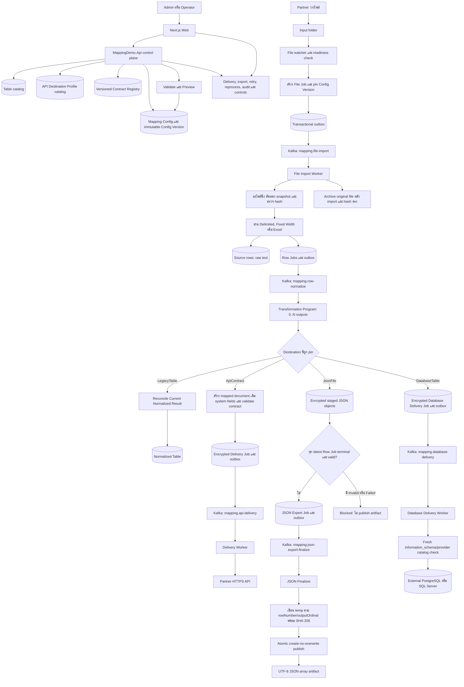
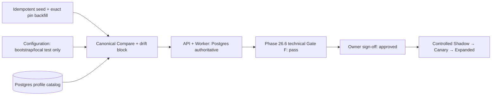
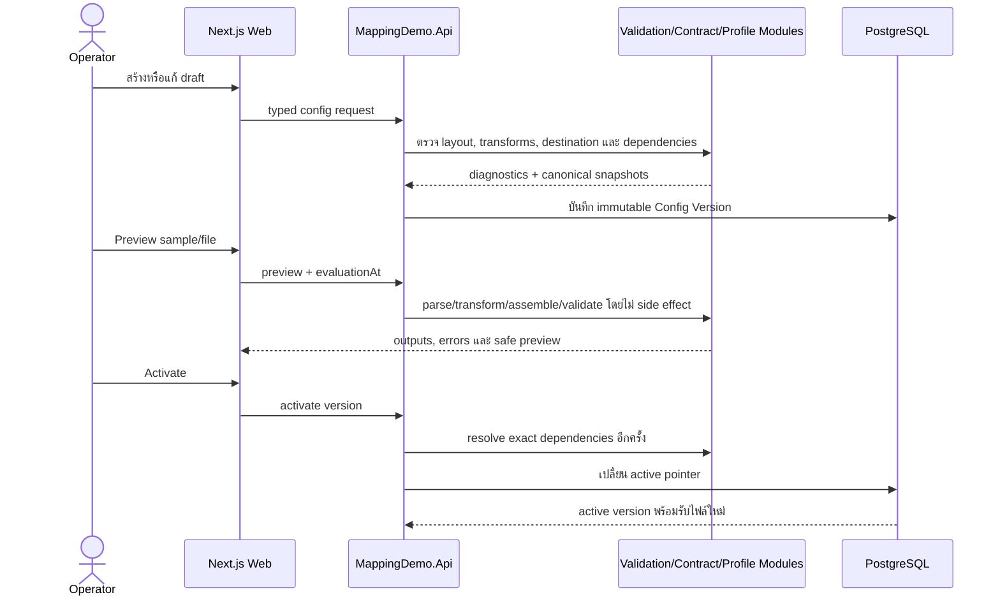
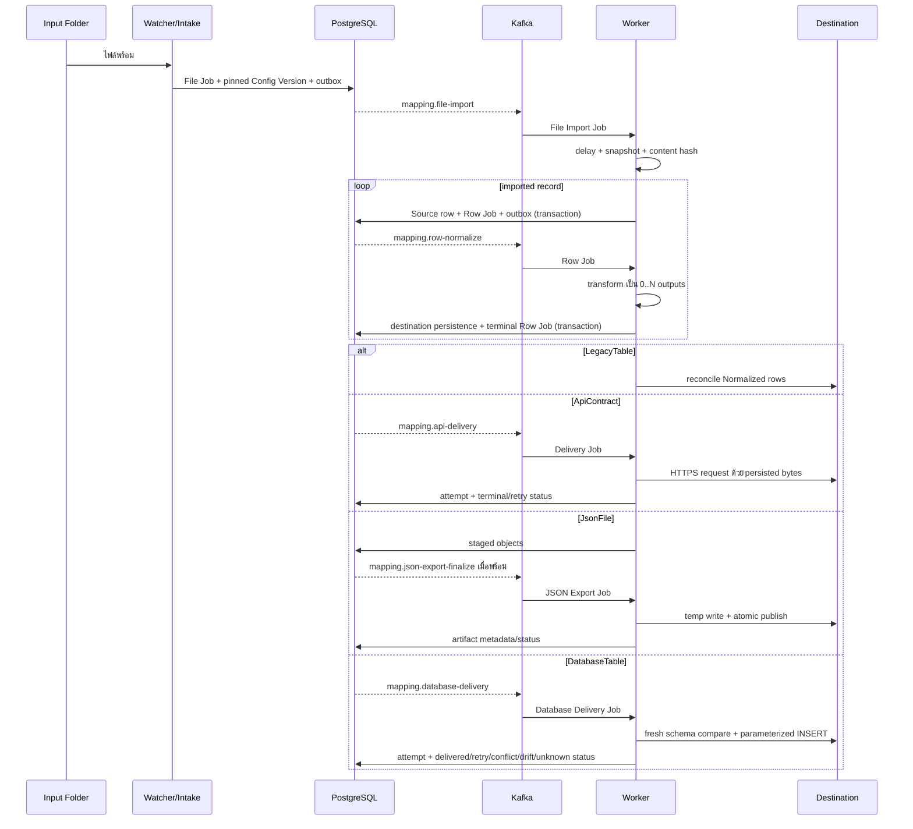
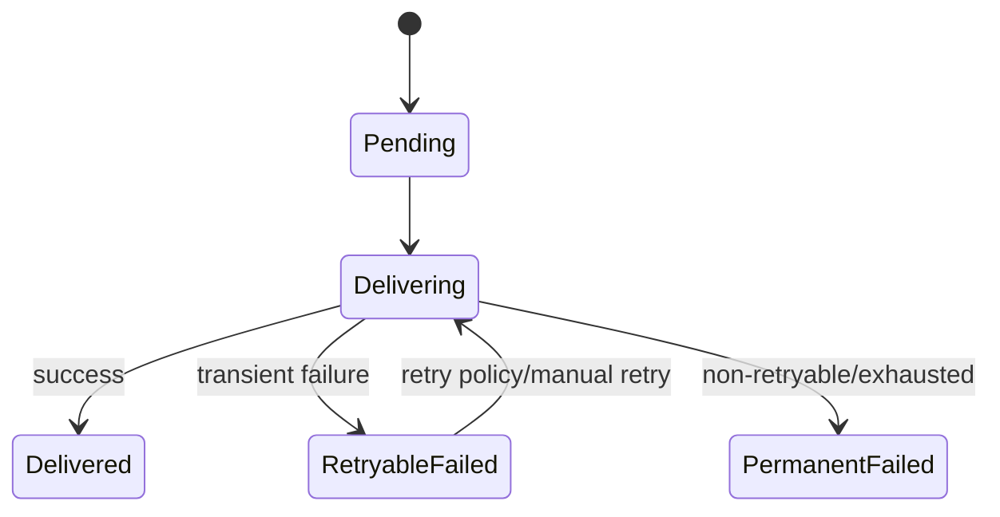
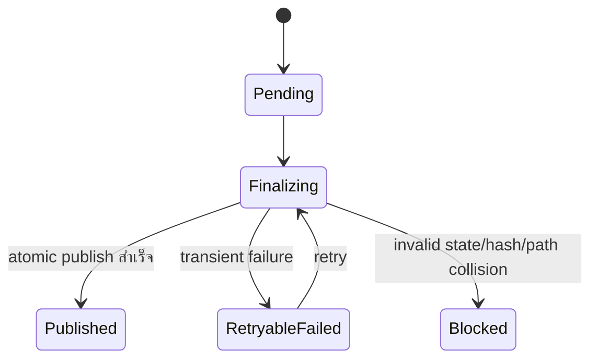
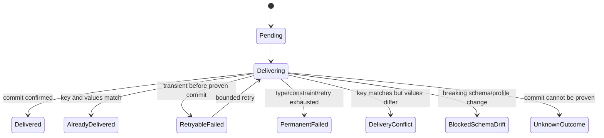

# Current Mapping Demo Workflow

เอกสารนี้อธิบายการทำงานของ Mapping Demo ปัจจุบันตั้งแต่ผู้ดูแลเตรียม configuration จนไฟล์ถูกแปลงและส่งไปยังปลายทาง รวม control plane, runtime data plane, สถานะงาน, retry/reprocess, security และขอบเขต rollout ไว้ในที่เดียว

> Baseline: Phase 29.0–29.8 implemented; Gate F, Gate G และ Gate H approved ณ 2026-11-03 แต่ Gate I ยังไม่ approved ณ 2026-11-09
> ข้อจำกัดสำคัญ: DatabaseTable production write/activation/schema monitor ยังคงปิดจนกว่า forced PostgreSQL+SQL Server E2E, canary observation และ owner sign-off ของ Gate I จะครบ

## 1. ภาพรวมตั้งแต่ต้นจนจบ



กฎใหญ่มี 4 ข้อ:

1. File Job pin `Config Version` ก่อน parse จึงไม่เปลี่ยนกฎหรือปลายทางกลางงาน
2. Source row เก็บค่าดิบเป็นข้อความ แล้ว Transformation Program สร้างผล `0..N` รายการ
3. Config Version เลือกปลายทางเดียว: `LegacyTable`, `ApiContract`, `JsonFile` หรือ `DatabaseTable`
4. การเปลี่ยน active version หรือ rollback มีผลกับไฟล์ใหม่เท่านั้น งานเดิมใช้ identity ที่ pin ไว้

## 2. ส่วนประกอบและเจ้าของหน้าที่

| ส่วน | หน้าที่ |
|---|---|
| Next.js Web | สร้าง/ดู Mapping Config, validate/preview/activate, ดูสถานะงาน และจัดการ API Destination Profile/Contract Registry/Table Catalog |
| `MappingDemo.Api` | Control plane, file watcher/intake, validation, preview, activation, operations API และ authorization |
| PostgreSQL | เก็บ metadata, immutable versions, jobs, errors, outbox, staged payload, audit และ runtime controls |
| Kafka | ขน event ระหว่างขั้น file import, row normalization, API delivery, JSON finalization และ database delivery |
| `MappingDemo.Worker` | Import ไฟล์, transform รายแถว, reconcile ผล, ส่ง API, finalize JSON, inspect/write external database และ dispatch outbox |
| Input/Archive/Output folders | รับไฟล์ต้นฉบับ, เก็บไฟล์ที่ import แล้ว และเก็บ JSON artifact |
| Partner API | รับ delivery ผ่าน server-owned API Destination Profile |

## 3. Control plane: เตรียมระบบก่อนรับไฟล์

### 3.1 Table catalog

- Source Table เก็บ field จากไฟล์เป็น text และ system identity ของแถว
- Normalized Table ใช้เฉพาะ `LegacyTable`
- `ApiContract`, `JsonFile` และ `DatabaseTable` ไม่เขียน Normalized Table
- หน้า `/admin/tables` รองรับ list/search/filter, สร้าง Source/Normalized, detail, additive column และ Configuration impact
- `table_definitions`/`table_columns` เป็น authoritative metadata; browser ส่ง typed definition/table ID เท่านั้นและไม่รับ raw SQL/schema/connection
- PostgreSQL Inspector เปรียบเทียบ system/business columns, canonical type, nullability, identity, primary key และ unique constraintsแบบ read-only
- ผลแยก `Healthy`, `Drifted`, `Missing`, `VerificationFailed` พร้อม safe field diagnostics; ไม่มี auto-repair หรือ data browser
- create/add-column ต้องมี permission, operator/reason/correlation และ audit; Gate H approved แล้ว แต่ production mutation ยังปิด (`TableAdministration:MutationsEnabled=false`) จนกว่าจะมี controlled rollout change แยกต่างหาก
- detail แสดง Mapping Config/Config Version/pinned jobs ที่อ้าง table ก่อน additive change โดยไม่แก้ historical version/job

### 3.2 Mapping Config และ Config Version

Mapping Config เป็น logical configuration หนึ่งชุด ส่วน Config Version เป็น snapshot immutable ที่ runtime ใช้จริง โดยมี:

- input folder และ archive folder
- Source Table และ Normalized Table เมื่อปลายทางเป็น `LegacyTable`
- Input Layout
- Transformation Program
- Destination Definition
- contract snapshot/hash/path catalog เมื่อปลายทางต้องใช้ contract
- profile/version identity และ payload bindings ที่ปลายทางต้องใช้

การแก้ config ไม่แก้ version ที่ activate แล้ว แต่สร้าง version ใหม่ จากนั้น validate, preview และ activate

### 3.3 Input Layout

รองรับ:

- Delimited เช่น CSV/TXT
- Fixed Width โดยใช้ตำแหน่งเริ่ม 1-based และ length
- Excel `.xlsx` และ `.xls`
- record action แบบ `Import` หรือ `Ignore` สำหรับ header/trailer

`Row Number` นับเฉพาะ record ที่ import ส่วน `Physical Line Number` นับ record จริงทั้งหมด ใช้ชี้ input error

### 3.4 Transformation Program

เป็น typed declarative AST ไม่รับ raw SQL หรือ arbitrary code ประกอบด้วย:

- predicates และ validation
- typed expressions/conversions
- versioned Named Transforms และ Named Lookups
- Output Branch แต่ละ branch มี `outputKey`, emit condition และ field assignments
- หนึ่ง Source row ให้ผลได้ `0..N` outputs

ผลรายแถว:

- `Done`: สำเร็จและมี outputs
- `Filtered`: สำเร็จแต่เป็น empty set
- `Invalid`: business/input validation ไม่ผ่าน
- `Failed`: technical processing ล้มเหลวหลัง retry policy

### 3.5 Destination Definition

| Destination | ผลที่ persist | Side effect | สิ่งที่ไม่สร้าง |
|---|---|---|---|
| `LegacyTable` | Current Normalized Result | upsert/reconcile ลง Normalized Table | Delivery Job, JSON artifact |
| `ApiContract` | encrypted payload bytes, hash, idempotency identity และ Delivery Job | HTTPS request ต่อหนึ่ง mapped output | Normalized row, JSON artifact |
| `JsonFile` | encrypted staged objects และ JSON Export Job | JSON array หนึ่ง artifact ต่อ revision ของ File Job | Normalized row, Delivery Job |
| `DatabaseTable` | encrypted mapped values/hash, target/schema/key snapshot และ Database Delivery Job | parameterized INSERT ต่อ mapped outputไป PostgreSQL/SQL Server | Entity/ORM model, target DDL, Normalized row, API Delivery Job |

### 3.6 API Destination Profile Admin

หน้า `/admin/api-destination-profiles` รองรับ:

- list/search/filter และดู safe projection
- create profile/draft และแก้ draft ด้วย optimistic concurrency (`If-Match`)
- validate endpoint, method, headers, auth reference, contracts และ bindings
- activate, rollback และ disable พร้อม operator/reason/audit
- history/diff, diagnostics, unsaved-change guard และ stale edit recovery

ข้อห้าม:

- browser ห้ามรับหรือแสดง secret value
- เก็บเพียง logical `AuthSecretReference`; validator ตรวจ existence/shape เท่านั้น
- endpoint ต้องผ่าน HTTPS, host/path/method และ SSRF/DNS policy
- activated Profile Version immutable
- disable ห้ามงานใหม่ แต่ historical pinned retry ต้องยัง resolve exact version ได้

สถานะ rollout ปัจจุบัน:



API และ Worker ตรวจว่า catalog พร้อมตอน startup และ fail closed เมื่อ Postgres ใช้ไม่ได้. `Configuration` และ `Compare` ยังอยู่เป็น explicit compatibility mode สำหรับ local test, mixed deployment และ rollback ก่อน DB-only useเท่านั้น; application config ปัจจุบันไม่มี duplicated runtime profile definitions แล้ว

### 3.7 Versioned Contract Registry

- หน้า `/admin/contracts` รองรับ Draft, validate, clone, publish, retire, history/diff และ derived path catalog
- identity คือ `contractKey/version`; Published/Retired schema/canonical bytes/hash แก้หรือลบไม่ได้
- `proposal/1` และ `claims/2` seed แบบ idempotent และต้องตรง bundled bootstrap ทั้ง canonical bytes/hash/path ก่อน startup
- profile editor เลือกได้เฉพาะ Published Version; Retired ห้ามงานใหม่แต่ exact historical resolution ยังทำงาน
- API สร้าง Contract Snapshot จาก Postgres registry; Worker ใช้ immutable snapshot/hash ที่ pin ไว้
- cache miss/outage/hash mismatch fail closed และไม่ fallback ไป bundled schema อัตโนมัติ
- production Publish/Retire ยังปิดแม้ Gate G approved แล้ว จนกว่าจะมี explicit rollout configuration

## 4. ลำดับการสร้างและ activate configuration



Preview ไม่เขียน Source/Normalized rows, ไม่สร้าง Delivery Job และไม่ publish JSON

## 5. Runtime data plane แบบละเอียด

### 5.1 พบไฟล์และสร้าง File Job

1. Watcher ตรวจ input folder ของ Mapping Config ที่ active
2. Intake pin Config Version ที่ active ตอนรับไฟล์
3. สร้าง File Job สถานะ `Queued`
4. เขียน outbox event ใน transaction เดียวกัน
5. Outbox dispatcher ส่ง `mapping.file-import` เข้า Kafka

การ pin ก่อน parse ทำให้ config activation ระหว่างงานไม่เปลี่ยนผลของไฟล์นั้น

### 5.2 รอไฟล์นิ่ง, snapshot และ duplicate protection

File Import Worker:

1. เปลี่ยน `Queued → Delaying → Importing`
2. รอ readiness delay เพื่อไม่อ่านไฟล์ที่ partner ยังเขียนอยู่
3. คัดลอก snapshot และคำนวณ content hash
4. ตรวจ duplicate ด้วย Mapping Config + content hash
5. ถ้าซ้ำ จบเป็น `Duplicate` และไม่สร้างข้อมูลซ้ำ
6. ถ้าอ่านสำเร็จ parse snapshot ไม่อ่านไฟล์ที่กำลังเปลี่ยน

### 5.3 Parse และ persist Source rows

สำหรับแต่ละ imported record:

1. Input Layout แยก raw fields
2. บันทึก Source row โดย field ธุรกิจยังเป็น text
3. สร้าง Row Job สถานะ `Pending`
4. บันทึก `evaluationAt` เพื่อให้ retry deterministic
5. เขียน `mapping.row-normalize` ลง outbox ใน transaction เดียวกับ Source row/Row Job

เมื่อ import ครบ:

- File Job เป็น `Imported`
- ตรวจ hash ของไฟล์จริงกับ snapshot ก่อน archive
- ตรงกัน: ย้ายไป Archive Folder
- เปลี่ยนหลังอ่าน: `ChangedAfterRead`; ไม่อ้างว่า archive สำเร็จ
- archive ล้มเหลว: `ArchiveFailed` และ retry ตาม policy โดยไม่ import ซ้ำ

### 5.4 Transform รายแถว

Row Normalization Worker โหลด:

- Source row
- pinned Config Version
- `evaluationAt` เดิม
- Transformation Program และ exact dependencies

จากนั้น evaluate predicates/expressions และสร้าง ordered outputs `0..N` ก่อนส่งให้ destination adapter ที่ถูก pin



## 6. การทำงานของแต่ละ destination

### 6.1 LegacyTable

- `Done`: reconcile outputs ตาม `outputKey` เป็น Current Normalized Result
- `Filtered`: successful empty set และลบ current outputs เดิมของ Source row
- `Invalid` หรือ `Failed` จาก reprocess ไม่ทับ current successful result เดิม
- latest run status กับ current successful result จึงเป็นคนละแนวคิด

### 6.2 ApiContract

ต่อ mapped output หนึ่งรายการ ระบบทำใน Row Job transaction:

1. สร้าง nested Mapped Document
2. เติม system-bound paths
3. validate กับ pinned Contract Snapshot
4. serialize เป็น canonical delivery bytes
5. เข้ารหัส payload และ persist bytes/hash
6. สร้าง Delivery Job + outbox event

Delivery Worker resolve exact server-owned profile version แล้วส่ง HTTPS request การ retry ใช้ bytes, hash และ idempotency key เดิม ไม่ rebuild payload จาก config ล่าสุด

สถานะ Delivery Job:



`Business Resend` ต่างจาก retry: ใช้เฉพาะงานที่ Delivered แล้ว, ต้องมีสิทธิ์และเหตุผล, มี audit และสร้าง idempotency suffix/identity ใหม่

### 6.3 JsonFile

แต่ละ successful mapped output ถูก serialize และเข้ารหัสเป็น staged item พร้อม `rowNumber` และ `outputOrdinal` จากนั้นระบบรอ latest Row Jobs ของไฟล์ทั้งหมด:

- ทุกงาน terminal และไม่มี `Invalid`/`Failed`: สร้าง/queue JSON Export Job
- มี `Invalid`/`Failed`: block และไม่สร้าง partial artifact
- ไม่มี output เลย: publish `[]`

JSON Finalizer:

1. claim job ด้วย lease
2. อ่าน staged objects ตาม `rowNumber, outputOrdinal`
3. stream เป็น UTF-8 JSON array ไม่มี BOM
4. คำนวณ SHA-256 ระหว่างเขียน temp
5. validate count/bytes/hash
6. atomic move แบบ create-no-overwrite ไป final relative path
7. persist safe metadata: relative path, object count, byte count, SHA-256 และ timestamps

สถานะ JSON Export Job:



ห้ามแสดง payload body หรือ absolute Output Root ใน browser/log ปกติ

### 6.4 DatabaseTable

ต่อ mapped output หนึ่งรายการ Row Job transaction จะเข้ารหัส deterministic mapped values, เก็บ hash, profile configuration hash, provider/schema/table, schema snapshot/hash, mapped column names และ duplicate policy พร้อม outbox โดยยังไม่เปิด target connection

Database Delivery Worker:

1. ตรวจ feature/profile/runtime write gates
2. decrypt และตรวจ mapped-values hash
3. inspect target สดจาก `information_schema` + provider catalog แล้วเทียบ snapshot/mapped fields/selected key
4. สร้าง INSERT จาก writable mapped columns; omit unmapped default/generated columns; quote identifier และ bind typed parameters
5. execute target-local transaction และ classify provider error เป็น vocabulary กลาง
6. เมื่อ unique violation/commit ambiguity และมี existing unique key ให้ query full composite keyแล้วเทียบ mapped values
7. บันทึก attempt/status โดยไม่เก็บ raw SQL, connection string หรือ payload plaintext



`UnknownOutcome`, `DeliveryConflict` และ breaking drift ห้าม auto-repair/auto-retry Manual resolve ต้อง authorized พร้อม operator/reason/correlation และ append-only audit; no-key retry ต้องยืนยัน duplicate risk

## 7. สถานะรวมของ File Job

Import status:

```text
Queued → Delaying → Importing → Imported
                       ├→ ImportFailed
                       └→ Duplicate
```

Archive status แยกจาก import: `NotArchived`, `Archived`, `ArchiveFailed`, `ChangedAfterRead`

Normalization status คำนวณจาก import + Row Jobs:

- `InProgress`: import ยังไม่ `Imported` หรือยังมี `Pending`
- `CompletedWithErrors`: import สำเร็จแต่มี `Invalid`/`Failed`
- `Completed`: import สำเร็จและไม่มี pending/error

Row Job terminal states คือ `Done`, `Filtered`, `Invalid`, `Failed`

## 8. Retry, reprocess, resend และ rollback

| Action | ใช้ข้อมูล/config ใด | สร้าง identity ใหม่หรือไม่ | จุดประสงค์ |
|---|---|---|---|
| File import retry | File Job + pinned Config Version เดิม | ไม่สร้าง import identity ใหม่ | ทำ technical failure ซ้ำโดยไม่ import ซ้ำ |
| Row retry | Source row, Config Version และ `evaluationAt` เดิม | ไม่ | ทำ technical normalization failure ซ้ำ |
| Reprocess | Source row เดิม แต่เลือก Config Version ได้ | สร้าง Row Job ใหม่ | ประเมินกฎรุ่นที่เลือกและ reconcile ผลตาม semantics |
| Delivery retry | persisted encrypted bytes/hash/idempotency เดิม | ไม่ | ส่ง Delivery Job เดิมซ้ำ |
| Business resend | payload เดิมของ Delivered job | ใช่ พร้อม suffix/audit | ส่งเอกสารธุรกิจซ้ำโดยตั้งใจ |
| JSON retry | staged identity/profile/revision/path เดิม | ไม่ | finalize/publish revision เดิมซ้ำ |
| Database retry | encrypted mapped values + pinned target/schema/key เดิม | ไม่ | retry job ที่ policy อนุญาต; UnknownOutcome no-key ต้องรับ duplicate risk |
| Config rollback | activate prior Config Version | มีผลเฉพาะ File Job ใหม่ | หยุดใช้ version ใหม่โดยไม่ reroute งานเดิม |

งานที่ pin `ApiContract`, `JsonFile` หรือ `DatabaseTable` ต้องคง destination/profile/snapshot เดิม แม้ active version เปลี่ยนภายหลัง

## 9. Consistency และ crash recovery

- ใช้ transactional outbox เพื่อไม่ให้ DB commit แล้ว Kafka event หาย
- consumer ต้องรับ duplicate message ได้โดยไม่สร้าง business output ซ้ำ
- Source row, Row Job และ normalize outbox ถูกผูกด้วย transaction
- destination persistence กับ terminal Row Job ถูกผูกด้วย transaction
- Delivery Job เก็บ payload bytes ก่อน network call จึง retry โดยไม่ rebuild
- JSON ใช้ staged encrypted items, lease และ atomic publish จึงไม่เปิด partial file
- DatabaseTable ใช้ encrypted durable intent, lease และ target-local transaction; existing unique key ใช้ reconcile ส่วน no-key ambiguity หยุดที่ `UnknownOutcome`
- duplicate file ใช้ content hash ไม่พึ่ง filename
- immutable version/snapshot ทำให้ replay และ audit อธิบายผลย้อนหลังได้

## 10. Security และสิ่งที่ browser ห้ามเป็นเจ้าของ

- ไม่มี raw SQL, arbitrary code หรือ physical connection details ใน Mapping Config
- endpoint, credentials, absolute Output Root และ encryption key เป็น server-owned
- UI เห็น logical IDs และ safe summaries เท่านั้น
- secret ถูกอ้างด้วย logical reference; ไม่คืน secret value
- contract/profile activation และ admin mutation ใช้ authorization แยกตาม action
- mutation สำคัญต้องมี operator, reason, optimistic concurrency และ append-only audit
- partner response body และ business payload ไม่ถูกเก็บ/แสดงโดย default
- Database connection string/profile เป็น server-owned; UI ไม่เห็น credential, payload, raw SQL หรือ arbitrary identifier
- controls แยก gate สำหรับ API delivery, JSON finalization และ DatabaseTable activation/delivery; การปิด gate ไม่ reroute งานไปปลายทางอื่น

## 11. หน้าจอและ API สำคัญ

หน้าเว็บ:

| Path | ใช้ทำอะไร |
|---|---|
| `/configs` | ดู Mapping Config |
| `/configs/new` | สร้าง Mapping Config |
| `/configs/{id}` | ดู version, validate, preview และ activate |
| `/delivery` | ดู File/API/JSON/Database delivery, schema health และ audited actions ที่ policy อนุญาต |
| `/admin/api-destination-profiles` | จัดการ API Destination Profile แบบ versioned |
| `/prototype/file-to-json` | prototype UX เท่านั้น ไม่ใช่ runtime dependency |

กลุ่ม API:

- `/tables`: table metadata/create/add-column
- `/mapping-configs`: config/version/validate/preview/activate
- `/file-jobs`: status/errors/history/retry/reprocess
- `/delivery-jobs`: status/retry/resend
- `/json-exports`: history/retry
- `/delivery-operations`: metrics, alerts, controls และ rollout
- `/database-destinations`: safe profile/schema/table inspection สำหรับ editor
- `/database-delivery-operations`: safe jobs/schema checks/alerts และ authorized retry/resolve
- `/api-destination-profiles`: safe runtime catalog/resolve
- `/admin/api-destination-profiles`: permissions, drafts, validate, activate, rollback, disable
- `/admin/api-destination-profile-operations`: safe profile metrics และ alerts สำหรับ authorized operator

## 12. ข้อมูลสำคัญใน PostgreSQL

| กลุ่ม | ตารางหลัก |
|---|---|
| Table metadata | `table_definitions`, `table_columns` |
| Mapping versions | `mapping_configs`, `mapping_config_versions` |
| Runtime orchestration | `file_jobs`, `row_jobs`, `row_errors`, `outbox` |
| API delivery | `delivery_jobs`, `delivery_attempts`, `delivery_resend_audit` |
| Delivery controls | `delivery_runtime_control`, `delivery_control_audit`, `api_delivery_rollouts`, `api_delivery_rollout_audit` |
| JSON export | `json_export_jobs`, `json_export_items`, `json_export_retry_audit`, `json_export_operation_events` |
| Database delivery | `database_delivery_jobs`, `database_delivery_attempts`, `database_delivery_resolution_audit`, `database_target_schema_checks` |
| API profile admin | `api_destination_profiles`, `api_destination_profile_versions`, `api_destination_profile_contracts`, `api_destination_profile_bindings`, `api_destination_profile_audit` |
| Contract registry foundation | `contracts`, `contract_versions`, `contract_audit` |

Source/Normalized physical business tables สร้างตาม Table Definition จึงไม่ใช้ชื่อตารางตายตัวในแผนภาพ

## 13. ขอบเขตที่ทำแล้วและยังไม่ทำ

| ขอบเขต | สถานะ |
|---|---|
| LegacyTable, ApiContract, JsonFile runtime | ทำแล้ว |
| DatabaseTable profile/catalog/inspector/editor/durable delivery/reconciliation/operations (29.0–29.8) | ทำแล้วใน code; feature/profile/runtime gates ปิดโดย default |
| Full forced provider E2E/security/canary/owner sign-off (29.9 Gate I) | ยังไม่ approved; รอ PostgreSQL+SQL Server environment และเจ้าของระบบลงนาม |
| JSON deterministic finalization และ operations | ทำแล้ว |
| API Destination Profile design/schema/module/Admin API/UI (26.0–26.4) | ทำแล้ว |
| Seed/compare/cut over API+Worker ไป Postgres profile source (26.5) | ทำแล้ว; Postgres authoritative และ config definitions ซ้ำถูกลบ |
| Full regression/security/runbook/Gate F sign-off (26.6) | ทำแล้ว; Gate F approved สำหรับ controlled rollout โดยไม่เปิด Production อัตโนมัติ |
| Versioned Contract Registry design/catalog/module (27.0–27.2) | ทำแล้ว; lifecycle/immutability/audit, PostgreSQL catalog, bundled/Postgres adapters และ fail-closed cache |
| Contract Admin API/UI และ seed/cutover (27.3–27.5) | ทำแล้ว; Postgres Contract Registry เป็น runtime authority, bundled เหลือเฉพาะ explicit bootstrap/rollback mode |
| Full regression/security/operations/Gate G (27.6) | ทำแล้ว; วันที่ 2026-11-03 ผู้ใช้อนุมัติในนาม Contract/Business, Platform/Operations และ Security พร้อมรับ dev-only advisory; production publishing ยังปิดจนกว่าจะมี rollout change แยกต่างหาก |
| Table Admin + physical schema verification (Phase 28) | ทำแล้ว; วันที่ 2026-11-03 ผู้ใช้อนุมัติ Gate H ในนาม Platform/Operations, Security และ Mapping พร้อมรับ dev-only advisory; production mutation ยังปิดจนกว่าจะมี rollout change แยกต่างหาก |
| File Destination Profile Admin | นอกขอบเขต Phase 26; ยังเป็น server-managed configuration |

## 14. เอกสารอ้างอิงเฉพาะเรื่อง

- [Domain vocabulary](../CONTEXT.md)
- [Implementation plan Phase 19–29](web-config-plan.md)
- [Backend config handoff](backend-config-handoff.md)
- [API Destination Profile Administration Design](../spec/spec-design-api-destination-profile-administration.md)
- [Phase 26.5 profile catalog cutover handoff](phase-26.5-cutover-handoff.md)
- [Phase 26 operations runbook](phase-26-api-destination-profile-operations-runbook.md)
- [Phase 26 acceptance matrix](phase-26-acceptance-matrix.md)
- [Phase 26 Gate F evidence](phase-26-gate-f-evidence.md)
- [Phase 27 Contract Registry operations runbook](phase-27-contract-registry-operations-runbook.md)
- [Phase 27 acceptance matrix](phase-27-acceptance-matrix.md)
- [Phase 27 Gate G evidence](phase-27-gate-g-evidence.md)
- [Phase 24 API delivery operations runbook](phase-24-operations-runbook.md)
- [Phase 25 JSON export operations runbook](phase-25-json-export-operations-runbook.md)
- [Phase 29 DatabaseTable delivery runbook](phase-29-database-table-delivery-runbook.md)
- [Phase 29 acceptance matrix](phase-29-acceptance-matrix.md)
- [Phase 29 Gate I evidence](phase-29-gate-i-evidence.md)
- [Legacy program workflow](../current-program-workflow.md) — ใช้ดูบริบทระบบเดิม ไม่ใช่ภาพ current Mapping Demo ทั้งหมด

เมื่อ implementation เปลี่ยน runtime semantics, destination, status หรือ cutover source ต้องอัปเดตเอกสารนี้พร้อม phase handoff เพื่อรักษาเอกสารเดียวที่บอก flow ปัจจุบันตั้งแต่ต้นจนจบ
