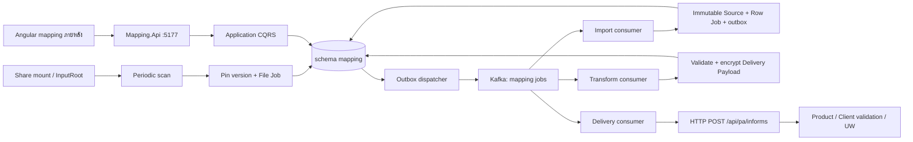

# แผน implement Mapping API จาก demo สำหรับ phase 1

เริ่ม implement ที่ `prjInsuranceValidationMapping` ก่อน แล้วจึงทำหน้า mapping ใน `prjInsuranceValidationWeb` เมื่อได้รับ Web design เอกสารนี้เป็นแผนสำหรับ review และแตกงาน ไม่ใช่หลักฐานว่า feature ถูก implement หรือข้อตกลง kickoff ได้รับอนุมัติแล้ว ติดตามงานและคำถามที่ [plan.md](plan.md)

## 1. แหล่งอ้างอิงและสถานะที่ตรวจพบ

ลำดับอ้างอิง: [README](README.md), [rules](rules.md), [glossary](glossary.md), [contract](contract-pa-inform.md), [MTLS](mtls-file.md), [Web](web.md) เป็นหลัก; ใช้ [reverse spec](../../specs/mapping_demo_reverse_spec.md) เพื่อค้น feature และโค้ดตัวอย่าง ไม่ยกพฤติกรรมทั้งหมดของ demo เป็นข้อกำหนดธุรกิจ

| แหล่ง | สิ่งที่ตรวจเมื่อ 2026-11-13 | ผลต่อแผน |
|---|---|---|
| เอกสาร mapping `d9bd8d8` | phase 1 / milestone เป็นร่าง รอ kickoff 11-16 | เสนอแผนภายในวันเดิม; เรื่องที่ยังไม่ตกลงระบุ gate ก่อน implement |
| Mapping `78453b3` | มี 4 layer, DI, `Uuid`, `BaseResponse`, initial migration; ยังไม่มี controller/entity/worker ของ feature และไม่มีไฟล์ test case ในสอง test projects | เริ่มจาก scaffold ที่มี ไม่ถือว่า demo ถูกย้ายมาแล้ว |
| Mapping integration test project | .NET 10, xUnit, FluentAssertions, WebApplicationFactory, Testcontainers PostgreSQL และ `init.sql` | ใช้ stack เดิมเพื่อพิสูจน์ API/DB จริง |
| Informs `6ab23ad` | schema และ `PaInformsController` ใช้ `insureds[]`, `BaseResponse`, key ใน request body | ใช้ schema ตัวจริงและ response จริง; ไม่ใช้ fixture เก่าของ demo |
| Informs implementation | `Infrastructure/Messaging/{OutboxDispatcher,StageConsumer}.cs`, `Infrastructure/Products/ProductsClient.cs`, DI ลง hosted services ใน process API | ทำ worker/outbox/client ตามรูปแบบนี้ตาม D-77 |
| Mapping Compose | มี PostgreSQL 15, migrator และ Mapping; ยังไม่มี Kafka | งานเพิ่ม messaging ต้องมี local infrastructure และขอ topic สำหรับบริษัท |
| Web | มี UW/Config และ API caller ของ Products; ยังไม่มี mapping feature | กำหนดข้อมูล API ให้ตรวจได้ก่อน; รอ design ก่อนออกแบบหน้าจอ |
| fixture | พบ `docs/MTLSPA0220261009.xls` ซึ่งเอกสารระบุว่าเป็นข้อมูลจริง; ยังระบุไฟล์ทดสอบ 2,556 แถวที่รับรองแล้วจากชื่อไฟล์ใน repo ไม่ได้ | ห้ามใช้ไฟล์จริงแทน fixture; ยืนยันตำแหน่งและที่มากับ Dev 1 ก่อนทดสอบเต็มไฟล์ (Q7) |

ตอนจัดทำร่างแผนยังไม่ได้รัน build/test; ต่อมา **2026-11-13** รัน baseline M0.3 ที่ Mapping `78453b3` ด้วย SDK **10.0.404** แล้ว `scripts/check.ps1` จบ exit 0: build ผ่าน, EF model ตรง migration แต่สอง test projects **ไม่มี test case ให้รัน** และมี `NU1903` ของ `SSH.NET 2023.0.0` (4 warnings) รายละเอียด environment/วิธีเลือก SDK อยู่ใน [plan.md ใต้ M0.3](plan.md#3-งาน) สถานะ test ของ demo ใน reverse spec ยังเป็นหลักฐานของ demo เท่านั้น ไม่ใช่ผลทดสอบ feature ของ Mapping API ใหม่

## 2. ขอบเขตและการเทียบ feature

**เป้าหมาย phase 1 ตาม D-70/D-77/D-78:** ไฟล์ MTLS → Source Table ที่แก้ไม่ได้ → JSON `pa-inform/1` → `POST /api/pa/informs` ทีละใบ → delivery log + retry; พร้อม API สำหรับหน้า mapping และรันบน Kubernetes

ตารางนี้ครอบคลุมกลุ่ม feature และ requirement ID ใน reverse spec คำว่า **เสนอเลื่อน** หมายถึงยังเก็บเป็น backlog และรอทบทวนใน Q2 ไม่ใช่ลบ feature ออกจากแผนทั้งหมด

| Feature / reverse spec | แผนสำหรับ API จริง | ช่วง / เงื่อนไข |
|---|---|---|
| Table Catalog `OBS-TBL-001..004` | phase 1 ใช้ Source definition ที่มี field catalog + immutable Source rows; เสนอไม่สร้าง physical table ตามคำสั่งจากหน้าเว็บ | metadata ที่ MTLS ต้องใช้ทำก่อน; dynamic DDL, schema verification/impact admin เสนอเลื่อน Q2 |
| Config `OBS-CFG-001..003,006` | config identity, version immutable, validate, clone เป็น version ใหม่, active version, compare, ปิดรับไฟล์ใหม่, optimistic concurrency | จำเป็นก่อนเปิด intake; validate dependencies และ folder/extension ownership ตอน activate |
| Preview `OBS-CFG-004..005` | text/source-row preview และ workbook upload แบบจำกัดขนาด; ใช้ compiler/evaluator ชุดเดียวกับ runtime; แสดง nested JSON + diagnostics | ทำก่อน activate; ไม่มี job/outbox/HTTP delivery และไม่ archive |
| Excel `OBS-IN-003..004` | `.xls` BIFF8, cp874 fallback, sheet แรก, header 19 columns, invariant numeric/date conversion | เส้นทางหลัก MTLS ก่อน 11-18; ทดสอบ `.xlsx` หลังเส้นทางหลักผ่าน |
| Delimited/Fixed width `OBS-IN-001..002` | เก็บ layout interface ให้ขยายได้ แต่ยังไม่ต้องเปิดตัวอ่านเหล่านี้ | เสนอเลื่อน Q2; ไม่เปิด capability ที่ runtime ยังไม่รองรับ |
| Transformation `OBS-TRN-001..005` | เสนอใช้ declarative Transformation Program ของ demo ที่ย้ายเข้า layer ใหม่: source/literal, null/default, convert แบบเก็บ unparsed, case, nested arrays และ metadata bindings | รอ Q1 ข้อ 1–5; MTLS ต้องได้ `default` 1 output ต่อแถว; filter/0..N branches ไม่เปิดใช้กับ MTLS โดยไม่มีข้อตกลง |
| Expressions/predicates เพิ่มเติม | catalog ระบุเฉพาะ capability ที่ย้ายและทดสอบแล้ว; pinned evaluation time/timezone/limits | การย้าย operator ทั้งชุด, Named Transform/Lookup และ semantic mode ของ demo เสนอเลื่อนเมื่อไม่มี MTLS ใช้; ไม่คัด `sqlserver-legacy-v1` มาเป็นกฎกลาง |
| File intake `OBS-FILE-001..006` | scan เป็นหลัก, file stability/snapshot/hash, version pin, Source persistence, row outbox, archive/recovery | ไม่พึ่ง FileSystemWatcher; hash duplicate policy ยังรอ Q6 เพราะ BR-001 เป็นข้อเสนอ |
| Retry/reprocess `OBS-FILE-007..008` | แยก import retry, row retry และ delivery retry; มีประวัติการรัน | retry เดิมทำ phase 1; reprocess ที่เปลี่ยน payload/s่งจริงรอ Q3 |
| API destination `OBS-DST-API-001..004` | pinned schema + server-owned Informs connection profile, final payload validation, encrypted durable bytes, delivery jobs/attempts, bounded concurrency | HTTP ไป Informs เท่านั้น; ไม่มี endpoint URL/credential รับจาก browser |
| Resend/rollout `OBS-DST-API-005..006` | มี pause intake/pause delivery เพื่อ operation; งานที่ pin แล้วไม่เปลี่ยนปลายทาง | business resend ด้วย key ใหม่, Shadow/Canary/Expanded และ generic profile rollout เสนอเลื่อน Q2/Q3 |
| LegacyTable `OBS-DST-LEG-001..002` | เสนอไม่เขียน Normalized Table เป็นขั้นบังคับก่อน API | รอ Q1 ข้อ 1; ห้ามเขียน `non_motor.*` ไม่ว่าผล kickoff เป็นแบบใด |
| JsonFile `OBS-DST-JSON-001..006` | เก็บข้อกำหนด encrypted staging, deterministic artifact, atomic publish, recovery/operations เป็น backlog | เสนอเลื่อน Q2; ไม่เพิ่ม JSON finalizer ใน phase 1 โดยปริยาย |
| DatabaseTable `OBS-DST-DB-001..007` | เก็บ profile/schema drift/insert-only/reconciliation/unknown-outcome เป็น backlog | เสนอเลื่อน Q2; ไม่ใช้เป็นทางส่งเข้า Informs (D-02) |
| Admin `OBS-ADM-001..005` | read-only contract/profile summary, config audit และ safe delivery metrics สำหรับ MTLS | generic profile/contract CRUD/publish/retire และ dynamic table admin เสนอเลื่อน Q2; Informs ยังคงเป็นเจ้าของ contract |
| Platform `OBS-PLT-001..003` | capability endpoint, OpenAPI, `/health/live`, `/health/ready`, environment config, migrations ผ่าน migrator | ไม่ทำ auto-migrate ตอน API start ตาม demo; ใช้ deployment flow ของ repo จริง |
| Web `OBS-WEB-001..004` | API รองรับ list/config/version/workbench preview/job/delivery views เท่าที่ kickoff ตกลง | หน้าและ interaction รอ Web design; generic admin screen และ dashboard ทุก destination รอ Q2 |
| Proxy `OBS-WEB-005` / prototype | ใช้ Angular `core/mapping-api.ts` + `environment.mappingApiUrl` ตาม Web repo | ไม่ย้าย Next.js proxy หรือ `/prototype/file-to-json` เข้า production |

เรื่อง product validation, Client API/MCIS และ UW ไม่อยู่ใน Mapping ตาม D-06 ไม่มีการเรียก Products หรือ Client API จาก Mapping

## 3. สถาปัตยกรรมและลำดับการทำงานที่เสนอ



Kafka ในภาพเป็นข้อเสนอสำหรับงานภายใน Mapping ตามรูปแบบ Informs ต้องตกลง topic/การใช้งานใน Q1 ข้อ 9 ก่อนสร้าง messaging ส่วนการส่ง Mapping → Informs ใช้ HTTP ตาม D-03 เสมอ

| Layer / path ใน repo Mapping | งานที่จะเพิ่ม | โค้ด demo ที่ใช้เป็น reference |
|---|---|---|
| `Mapping.Domain/Entities/<Feature>/`, `Repositories/<Feature>/` | config/version, Source definitions/rows, file/row/delivery jobs, attempts, outbox; entity factory + UUID v7 | job identities, destination/transform value models; ไม่ยก Shared project มาทั้งก้อน |
| `Mapping.Application/<Feature>/{Commands,Queries,DTOs}/` | command+handler ไฟล์เดียว, validator แยก, `BaseResponse`; interfaces สำหรับ input, compiler, contract, delivery, storage/clock | compiler/evaluator/input semantics ที่ไม่ผูก Dapper, file IO, Kafka หรือ ASP.NET |
| `Mapping.Infrastructure/Database/Configurations/<Feature>/`, `Repositories/`, `Migrations/` | EF mappings, indexes, transactions, immutable storage, claim/lease; SQL เฉพาะกรณี lock ที่ EF ไม่ครอบคลุม | transaction boundaries และ unique identities; ไม่รัน SQL migration เดิมของ demo |
| `Mapping.Infrastructure/Messaging/`, `Files/`, `Informs/` | hosted scan/import/transform/delivery/sweep, Kafka/outbox, typed HttpClient, encryption/storage adapters | patterns ของ Informs เป็นหลัก แล้วนำ logic demo มาแยกเข้าที่ |
| `Mapping.Api/Controllers/` | inject `IMediator` เท่านั้น, relative routes, HTTP status และ OpenAPI | request/use case เท่านั้น; ไม่ย้าย service orchestration เข้า controller |
| `tests/Mapping.{UnitTests,IntegrationTests}/` | ทดสอบกฎแปลง, commands/queries, API, PostgreSQL constraints, messaging และ HTTP failure | ย้ายเฉพาะ golden/contract cases ที่ยังตรง requirement; เปลี่ยน assertion/test structure ตาม repo |

ไม่มี project Worker/Shared เพิ่มในร่างนี้ ใช้ hosted services ใน process API ตาม Informs; การแยก deployment ภายหลังต้องมีเหตุผลและตกลงก่อนตาม D-77

## 4. ข้อมูลและขอบเขต transaction

ตารางต่อไปนี้เป็น **แบบร่างที่ต้องลงรายละเอียด DDL ก่อน M1.3** ทุกตารางอยู่ schema `mapping`; ชื่อ entity ใช้พหูพจน์, ID ระบบสร้างผ่าน `Uuid.NewV7()`, timestamps เป็น UTC และใช้ `row_version` สำหรับข้อมูลที่แก้ได้

| ตารางที่เสนอ | ข้อมูลหลัก / ข้อบังคับ |
|---|---|
| `source_definitions` | field catalog ของ Source Table (ชื่อกลาง/ลำดับ/column ที่มา); version/config pin snapshot ที่อ่านได้ย้อนหลัง; ยังไม่ใช่ dynamic physical table admin |
| `mapping_configs` | ชื่อ, relative `input_path`, enabled, active version, `row_version`; ตรวจ path อยู่ใต้ InputRoot และความเป็นเจ้าของ folder+extension ไม่กำกวม |
| `mapping_config_versions` | version number, immutable input layout/transformation/destination, source definition snapshot, contract schema/hash, profile identity/version, evaluation semantics; unique `(config_id, version_number)` |
| `file_jobs` | config/version, original filename, detected/first received time, snapshot reference/hash, import/checkpoint/archive state; unique claim ของ file occurrence ที่ยังทำงานอยู่; content hash scope รอ Q6 |
| `source_rows` | `file_job_id`, Row Number, Physical Line Number, immutable raw values ของทั้ง 19 columns เป็นข้อความใน JSONB, source ID; unique `(file_job_id, row_number)`; ไม่ update/delete ผ่าน API หรือ reprocess |
| `row_jobs`, `row_errors` | source/version/run identity, status/attempt/lease, error path/code; แยก diagnostic จากค่าธุรกิจแปลงไม่ได้ที่ต้องส่ง null + unparsed |
| `delivery_jobs` | logical identity `(file_job_id, source_row_id, output_key)`, config/contract/profile snapshot, encrypted final bytes + key ID, SHA-256, status/next-at/lease, `inform_id`/`existing_inform_id`; unique logical identity สำหรับการส่งปกติ |
| `delivery_attempts` | delivery ID + attempt number, HTTP status, safe message ID/path, latency, replayed/replaced, timestamps/correlation; ไม่ใส่ raw response หรือ PII ใน list/log |
| `outbox` | topic/key/payload ซึ่งมีเฉพาะ job IDs และชนิดงาน, sent state; ไม่มีข้อมูลลูกค้าใน event |
| `mapping_audits` | config activation/disable, retry/reprocess/pause action, fixed actor, reason, request ID และก่อน/หลังเฉพาะ metadata; ไม่ใช้ actor จาก browser เป็นหลักฐานสิทธิ์ |

เสนอ Source Table แบบ fixed `source_rows` + JSONB เพื่อเก็บค่าดิบโดยไม่สร้างตารางต่อ config; ต้องทบทวนร่วมกับ Table Catalog และ source inspection API ใน Q2 ก่อนปิดแบบ ไม่ใช่นำโครง DB ของ demo มาใช้ทั้งชุด

**จุด commit ที่ต้องเป็น atomic:**

1. File Job + version pin + import outbox ใน transaction เดียว; multi-pod claim ต้องถูกบังคับด้วย DB ด้วย
2. Source row + Row Job + transform outbox ใน transaction เดียวต่อแถว; resume หลัง crash ไม่เพิ่มแถวซ้ำ
3. final validated encrypted Delivery Payload + Delivery Job + delivery outbox ใน transaction เดียว; ห้ามส่ง HTTP ก่อน durable intent
4. attempt result + job state/next-at ใน transaction เดียว; HTTP อยู่นอก DB transaction และต้องมี lease กันหลาย consumer ส่งพร้อมกัน

Outbox เป็นการส่งอย่างน้อยหนึ่งครั้ง จึงต้องกันซ้ำที่ handler และ unique constraints; commit Kafka offset หลังผลลัพธ์ถูกบันทึกแล้ว การ crash หลัง HTTP สำเร็จแต่ก่อน commit DB ต้อง retry ด้วย bytes/key เดิมเพื่อรับ replay จาก Informs

## 5. API ที่เสนอก่อนมี Web design

prefix ร่าง **`/api/mapping`** (Q8) ทุก route ด้านล่างต่อจาก prefix นี้ ยกเว้น health/OpenAPI; route/DTO จะปิดรายละเอียดใน M1.2 ก่อนลง controller ไม่คัด route ของ demo ตรง ๆ

| Route ที่เสนอ | ความสามารถ / เงื่อนไข |
|---|---|
| `GET /capabilities` | supported layouts/operators/limits/destinations; แสดงเฉพาะที่ทำงานจริง และ reason เมื่อปิด feature |
| `GET /source-definitions`, `GET /source-definitions/{id}` | field catalog สำหรับ config; ไม่มี arbitrary DDL |
| `GET /contracts/pa-inform/1` | schema snapshot/hash + path catalog จาก Informs; มีสถานะ availability; ไม่สร้าง schema อีกฉบับเอง |
| `GET /destination-profiles` | safe logical Informs profile; ไม่มี secret/absolute file root และไม่รับ URL ปลายทางจากผู้ใช้ |
| `GET /mapping-configs`, `GET /mapping-configs/{id}` | list/detail, active version, enabled, version number |
| `POST /mapping-configs` | สร้าง config identity พร้อม input path และ source definition |
| `POST /mapping-configs/{id}/versions` | บันทึกทั้ง config definition เป็น immutable version ใหม่; clone ส่งทั้ง definition ไม่แก้ version เก่า |
| `GET /mapping-configs/{id}/versions`, `GET /mapping-configs/{id}/versions/{versionId}` | version history/detail; compare ใช้สอง immutable definitions โดยยังไม่ต้องมี diff engine แยก |
| `POST /mapping-configs/{id}/validate` | ตรวจ draft/paths/required system bindings/dependencies; ไม่สร้าง runtime job |
| `POST /mapping-configs/{id}/preview`, `POST /mapping-configs/{id}/preview-file` | source/text หรือ multipart workbook + draft; in-memory, sample จำกัด 50 records; text จำกัด 1 MiB, workbook compressed/uncompressed/row limits ต้องระบุใน M1.2 |
| `POST /mapping-configs/{id}/activate`, `POST /mapping-configs/{id}/disable` | ส่ง expected `rowVersion`, target version/reason; activate atomic; disable หยุดรับใหม่ ไม่แก้ version ของงานเดิม |
| `GET /file-jobs`, `GET /file-jobs/{id}` | filters/config/status/date, paged rows และผลรวมที่ไม่ปน import/transform/delivery |
| `GET /file-jobs/{id}/errors`, `GET /file-jobs/{id}/rows` | row diagnostics/history; default คืน metadata ไม่คืน raw PII; source/payload inspection รอ Q2/Q7 |
| `POST /file-jobs/{id}/retry`, `POST /row-jobs/{id}/retry` | import/row failure เท่านั้น; state guard, reason/request ID, ไม่สร้าง identity ใหม่ |
| `GET /file-jobs/{id}/delivery-jobs`, `GET /delivery-jobs/{id}/attempts` | delivery log, status, reason/path, hash, IDs, attempts;ไม่คืน payload body โดยปริยาย |
| `POST /delivery-jobs/{id}/retry` | เฉพาะ transient/exhausted transient ที่อนุญาต; ไม่ retry `400/409` แบบเดิม |
| `GET /delivery-operations`, `POST /delivery-operations/pause`, `POST /delivery-operations/resume` | safe counts, backlog/age, intake/delivery pause แยกกัน; ขอบเขต control รอ kickoff Q1 ข้อ 7–8 |
| `POST /file-jobs/{id}/reprocess` | ร่าง command สำหรับ source + version ที่เลือก; ยังไม่เปิดส่งจริงจน Q3 ตกลง |
| `/health/live`, `/health/ready` | live = process; ready ตรวจ DB; messaging/share dependency และ startup gate ต้องตกลงใน M5.1 |

รูปแบบสำเร็จใช้ `BaseResponse<T>` ของ repo เดิม รายการใช้ `result: { items, totalCount, page, pageSize }`, เรียงแบบคงที่พร้อม ID tie-breaker, default 20/max 100 และรองรับ 10/20/50 ของ Web; ชื่อ query filters/sort allowlist ปิดใน M1.2 วันเวลา API เป็น ISO/UTC, date เป็น `yyyy-MM-dd`; Web แสดงตาม [web.md](web.md)

ข้อผิดพลาดที่คาดได้: `400` มี `messages[].messageID` เป็น field path; `404` = `NotFound`; `409` = version/state/ownership conflict; `202` = รับ action asynchronous พร้อม job/action ID; global unexpected error ใช้ exception handler เดิม ต้องทดสอบ OpenAPI และ envelope รวมถึง validation จาก `[ApiController]` ไม่สมมติว่าจะได้ envelope เองทุกกรณี

ตัวอย่างบันทึก version และ activate (ข้อมูล config สมมติ ไม่ใช่ DTO ฉบับปิด):

```json
{
  "expectedRowVersion": 3,
  "inputLayout": { "kind": "Excel", "acceptedExtensions": [".xls"], "sheetIndex": 0, "headerRow": 1, "fallbackEncoding": "cp874" },
  "transformationProgram": { "outputs": [{ "outputKey": "default", "assignments": [{ "path": "inform.productCode", "value": { "literal": "MTLSPA" } }] }] },
  "destination": { "kind": "ApiContract", "contractVersion": "pa-inform/1", "profileId": "informs-pa" }
}
```

ตัวอย่างนี้ตัด field assignments อื่นออกเพื่อแสดงโครงสร้าง จึง **ยังไม่ใช่ config ที่ activate ได้**; request activate แยก `{ "versionId": "<uuid-v7>", "expectedRowVersion": 4, "reason": "เปิด config MTLS ที่ผ่านการทดสอบ" }` เมื่อมีคน activate/บันทึกก่อน ให้ตอบ `409` และไม่เขียนทับ version/ค่าที่อีกคนส่ง

## 6. MTLS mapping และ contract ที่ต้องพิสูจน์

ใช้ตาราง column → path ใน [contract §3.1](contract-pa-inform.md#31-mtls-column-ในไฟล์--path) เป็นหลัก; ค่าคงที่/default/การแปลงอยู่ใน versioned config ตามข้อเสนอ Q1 ข้อ 2–5 ไม่แยกชื่อ/ที่อยู่ ไม่หา master และไม่เติมเบี้ย/ทุนจาก package (D-06)

ตัวอย่างต่อไปนี้เป็น **ข้อมูลสมมติที่สร้างเพื่ออธิบายกรณีขอบ**; การตรวจเต็มไฟล์ใช้เฉพาะ fixture ที่ Dev 1 รับรอง (Q7)

| ส่วนของแถวต้นทาง | ผลที่คาดหมาย |
|---|---|
| Transaction Type=`C`, หมายเลข PA=`PA-DEMO-C-001`, ชื่อ=`ยกเลิก`, เริ่ม/สิ้นสุด=`-293`, เงิน=`0` | คง Source ดิบ; output `CANCELLED`, date null + raw value ใน `extras.unparsed`; ไม่ทิ้งแถว |
| เลขบัตร Excel เป็น number ที่แสดง 11 หลัก | ส่ง string 11 หลัก ไม่มี `.0`, ไม่เติมเลขนำหน้า/ไม่ตัดแถวด้วย checksum |
| ผู้รับผล1/2 ว่าง | default ตาม BR-035; ประเด็น 100% ที่ไม่มี field ใน schema รอ Q5 ห้ามเพิ่ม field เอง |
| คนเดิมสองแถว แต่ `sourceReference` ต่างกัน | ได้สอง Delivery Jobs; ไม่ deduplicate ด้วยเลขบัตร (BR-003) |

ส่วนของ Delivery Payload จากแถว `C` (ละ field ที่ไม่จำเป็นต่อการอธิบาย):

```json
{
  "contractVersion": "pa-inform/1",
  "fileName": "MTLS-fixture.xls",
  "fileJobId": "<file-job-uuid-v7>",
  "sourceRowId": "<source-row-uuid-v7>",
  "outputKey": "default",
  "sourceRowNo": 2,
  "mappingConfigVersionId": "<config-version-uuid-v7>",
  "inform": {
    "partnerCode": "MTLS", "saleChannel": "FILE",
    "sourceReference": "PA-DEMO-C-001",
    "transactionType": "CANCELLED", "sourceTransactionType": "C",
    "productCode": "MTLSPA", "agentCode": "74000490",
    "effectiveDate": null, "expiryDate": null, "totalPremium": 0,
    "insureds": [{ "fullName": "ยกเลิก", "isPolicyholder": true, "relation": "PRIMARY", "packageCode": "MTL2", "premium": null }],
    "extras": { "unparsed": { "effectiveDate": "-293", "expiryDate": "-293" } }
  }
}
```

system-bound fields ได้แก่ file/source/config IDs, filename, row number และ output key เติมจาก job context ห้าม config เขียนทับ; schema มาจาก Informs ผ่าน endpoint แล้ว pin schema/hash ตอนสร้าง version ไม่ fetch schema ล่าสุดแทนใน retry ไม่มี build/runtime path อ้าง repo เอกสารหรือ project reference ข้าม repo

**ข้อจำกัดของ D-04:** nullable business field ที่แปลงไม่ได้ใช้ null + unparsed; แต่ schema ยังบังคับ `sourceReference` เป็น nonempty และ `transactionType` เป็น enum หากข้อมูลต้นทางทำให้สร้าง envelope ที่ผ่าน schema ไม่ได้ ต้องเก็บ Source + แสดง row error และรวมในยอดไม่ถูกส่ง ห้ามสร้างค่าอ้างอิง/transaction type ขึ้นเอง ประเด็นการให้ UW เห็นกรณีนี้เสนอ Q5

## 7. Delivery, retry และ reprocess

| ผล Informs / transport | สถานะ Mapping ที่เสนอ | การทำงาน |
|---|---|---|
| `201`, `200 replayed`, `200 replaced` พร้อม response ที่ถูกต้อง | `Delivered` | เก็บ `informId`, flags และ attempt; หมายถึงรับบันทึก ไม่ใช่ผ่าน validation |
| `400` | `Rejected` | เก็บ safe field paths; ไม่ auto retry; แก้ config แล้วทำตามนโยบาย reprocess ที่ตกลง |
| `409` | `Rejected` | เก็บ `DUPLICATE_SOURCE_REFERENCE`/`existingInformId`; ไม่เปลี่ยน key เพื่อหลบ duplicate |
| `408/429`, `5xx`, timeout/connection loss | `RetryableFailed` | next-at + exponential backoff/jitter และเคารพ `Retry-After` ทั้งวินาที/HTTP date; bytes/key เดิม |
| timeout หลัง server อาจ commit แล้ว | `RetryableFailed` | key เดิมเพื่อให้ได้ replay; ไม่สร้าง Delivery Job ใหม่ |
| authentication/endpoint error เช่น `401/403/404` | `Blocked` | ตรวจ server configuration;ไม่วน retry ต่อเนื่องและไม่แก้ URL จากหน้าเว็บ |
| `2xx` แต่ body ผิด/ไม่มี result หรือ inform ID | `Blocked` พร้อม diagnostic | ไม่ถือว่าส่งสำเร็จโดยไม่มีหลักฐาน; recovery ด้วย key เดิมหลังแก้ protocol/config |
| transient ถึงเพดาน | `Failed` | เก็บเหตุสุดท้าย/จำนวนครั้ง; manual retry เป็น action ที่มี audit ไม่สร้าง identity ใหม่ |

ค่าเริ่มที่ **เสนอ**: delivery รวมสูงสุด 6 attempts, HTTP concurrency 1 ก่อน แล้วปรับจากผลทดสอบ/ค่า Informs; retry delay/timeout/limits อ่าน environment ได้ ไม่ใช้ทั้ง HttpClient retry และ job retry ซ้อนกันโดยไม่รวม attempt count ตัวเลขเหล่านี้เป็น internal configuration ไม่ใช่ SLA ของบริษัท

Row transform สำเร็จหมายถึงมี Delivery Job durable ไม่เท่ากับ `Delivered`; file import เสร็จและ archive แล้วอาจยังมีแถวรอส่ง การ scan/lease recovery ต้องทำงานเมื่อ pod restart หรือ Kafka redeliver

**Retry** ใช้ job identity/config/schema/profile/payload เดิม ส่วน **Reprocess** สร้างประวัติ Row Job ใหม่และอาจใช้ version ใหม่ได้ แต่ D-44 มี key `(fileJobId, sourceRowId, outputKey)` ซึ่งไม่รวม config version: การ reprocess แล้วใช้ key เดิมของ output ที่เคย Delivered จะได้ผลเดิม ไม่ได้แทนที่ด้วย payload ใหม่ การสร้าง key ใหม่ก็อาจทำให้ข้อมูลเก่าทับข้อมูลแก้ไขภายหลัง จึงยังไม่เปิด business resend หรือ changed-payload reprocess ใน phase 1 จน Dev 1 ตอบ Q3

## 8. ลำดับ implement และหลักฐานปิดงาน

ID ในตารางตรงกับ [plan.md §3](plan.md#3-งาน) เป้าทั้งหมดเป็นร่างเพื่อ review ใน kickoff ไม่เลื่อน milestone ของ Dev 1 โดยปริยาย

| ชุดงาน / เป้า | Dependency / ผลส่งมอบ | หลักฐานก่อนขยับขั้น |
|---|---|---|
| **M0 — วางแผน 11-13 → kickoff 11-16** | M0.1 แผนนี้; M0.2 ตกลง Q1–Q8/fixture/scope; M0.3 baseline build/test | แผน review, คำตอบ Dev 1, baseline ผลจริงของ repo ใหม่ |
| **M1 — foundation / control plane 11-16 → 11-18** | M1.1 domain/state/schema; M1.2 API/DTO/error contract; M1.3 EF migration/config versions/Source storage; M1.4 contract/profile snapshots | model/DDL + ตัวอย่าง, API contract, DB constraints/concurrency tests; health/readiness เริ่มได้ตั้งแต่ชุดนี้ |
| **M2 — อ่านและแปลง 11-17 → 11-23** | M2.1 Excel reader; M2.2 compiler/MTLS config; M2.3 validate/preview; M2.4 read+schema acceptance | 11-18 อ่าน 2,556 แถว; 11-23 ได้ 2,556 payloads ผ่าน schema ตาม fixture ที่ยืนยันและการตัดสินใจ kickoff |
| **M3 — durable pipeline 11-19 → 11-24** | M3.1 outbox/Kafka/local Compose; M3.2 scan/snapshot/import/resume/archive; M3.3 transform claim/lease/errors | crash tests, repeated message, two consumers และ version pinning ไม่ทำข้อมูลซ้ำ; ไม่มี cross-schema writes |
| **M4 — delivery / operations 11-23 → 11-26** | M4.1 HTTP durable delivery; M4.2 retry/recovery; M4.3 logs/counts/actions; M4.4 full local flow | fixture เข้า Informs จริงบน local, source/payload/delivery counts ตรง, `400/409/429/5xx` และ replay/replaced ผ่าน; check.ps1 ผ่าน |
| **M5 — Web handoff / Kubernetes 11-27 → 12-04** | M5.1 Linux paths/env/probes/shutdown; M5.2 API examples/OpenAPI/hand-off; M5.3 หน้า mapping หลังได้ design | API contract ใช้งานจาก Angular ได้; Web ใช้ได้ 12-03; K8s config/secret/mount พร้อม 12-04 |
| **M6 — integration/UAT 12-08 → 12-14** | M6.1 cluster acceptance 12-09; M6.2 regression/UAT evidence | end-to-end บน cluster, recovery/operations runbook, UAT checklist; เริ่ม UAT 12-15 ตามแผนเดิม |

ลำดับ dependency: M0 → M1 → M2; เริ่ม M3 ได้เมื่อ transaction/state/Source model ปิดแล้ว; M4 ใช้ผล M2+M3; M5.2 ทำได้ก่อนมี Web design แต่ M5.3 รอ design และ scope ที่ตกลง หากคำตอบ/fixture/design ไม่ทัน ให้ลงความเสี่ยงใน plan ไม่เปลี่ยนวันเอง

## 9. เกณฑ์ตรวจรับและการทดสอบ

| ID | สถานการณ์และผลที่ต้องตรวจ | ชั้นทดสอบ / งาน |
|---|---|---|
| AC-01 | fixture MTLS ที่รับรองแล้วอ่านครบ 2,556 records, P=2,553/C=3, ไทยไม่เพี้ยน, raw numbers ไม่มี `.0` ที่เกิดจาก formatter | Excel integration/golden, M2.1/M2.4; ยืนยันสถิติ fixture ก่อนยึดเป็น assertion |
| AC-02 | ทุกแถวได้ 1 output `default`, `insureds[0]`, schema ผ่าน; C เก็บ `-293` ใน unparsed ไม่หาย; idNo 11 หลักไม่ถูกแก้ | unit + schema/golden, M2.2/M2.4 |
| AC-03 | beneficiary slots ถูกข้าม/สร้าง default ตามคำตอบ Q5, ไม่มี field ที่ schema ไม่รู้จัก; ไม่มีการแยกชื่อ/ที่อยู่หรือ lookup master | unit/contract, M2.2 |
| AC-04 | validate/preview ทำซ้ำแล้วจำนวน job/source/outbox/attempt ไม่เพิ่ม; ไม่มี outbound delivery หรือ archive | WebApplicationFactory + PostgreSQL + HTTP spy, M2.3 |
| AC-05 | activate N+1 ระหว่าง import แล้วงานเดิมยังใช้ N/schema/hash เดิม; config ที่มี conflict ตอบ 409 ไม่เขียนทับ | DB/API integration, M1.3/M3.2 |
| AC-06 | scan สอง instance และ duplicate Kafka message ไม่เพิ่ม File/Source/Delivery logical identity ซ้ำ; duplicate content เป็นไปตาม Q6 | PostgreSQL/Kafka integration, M3.1–M3.3 |
| AC-07 | crash หลัง insert Source/ก่อน Kafka offset หรือ publish แล้วก่อน mark outbox sent สามารถ resume และนับแถวได้ถูกต้อง | failure injection + restart, M3 |
| AC-08 | `201/200 replayed/200 replaced` เก็บ inform ID/flags ถูก; `400/409` ไม่ auto retry และแถวอื่นยังดำเนินต่อ | fake HTTP + local Informs integration, M4.1/M4.4 |
| AC-09 | `429` เคารพ Retry-After, 5xx/timeout retry ตามเพดาน, restart ไม่สูญ next-at, shutdown ยกเลิกโดยไม่บันทึก Delivered เท็จ | TimeProvider/fake HTTP + PostgreSQL, M4.2 |
| AC-10 | Informs commit แล้ว Mapping crash ก่อนบันทึกผล: retry bytes/hash/key เดิม ได้ replay และไม่สร้างใบเพิ่ม | local integration/failure injection, M4.4 |
| AC-11 | file summary แยก imported/pending/transform blocked/Delivered/Rejected/Failed; ผลรวมไม่ตกหล่นและ totals นับ unique logical outputs ไม่ใช่จำนวน attempts | query/API integration, M4.3 |
| AC-12 | lease หมดหรือหลาย consumer ทำงานพร้อมกันไม่ให้ stale worker เขียนทับผลใหม่; original เปลี่ยนหลัง snapshot ไม่ถูก archive ทับหลักฐาน | PostgreSQL + temporary filesystem, M3/M4.2 |
| AC-13 | source rows ถูกคงไว้เมื่อ retry/reprocess/disable; changed-payload reprocess/Delivered resend ถูกปิดจนตกลง Q3 | API/DB integration, M1.3/M4.3 |
| AC-14 | `..`, absolute path, symlink/real path ที่หลุด root, shared-folder ambiguity และ unsupported workbook ถูกปฏิเสธอย่างมี diagnostic; URL/secret/payload ไม่หลุด list/log | unit + Linux container/API integration, M2/M3/M5.1 |
| AC-15 | migrator/check.ps1 ผ่าน, DB ownership จำกัด schema mapping, `/health/ready` ไม่พร้อมเมื่อ DB ใช้ไม่ได้; config จาก environment และ pod restart ใช้งานได้ | Testcontainers PostgreSQL 15 + deployment smoke, M5/M6 |

ใช้ xUnit `[Fact]`, FluentAssertions, NSubstitute ตาม repo; unit test อยู่ feature เดียวกับ command/entity, integration ใช้ PostgreSQL จริงและ `docker/postgres/init.sql` ไม่ใช้ in-memory provider แทน constraint/transaction tests Messaging ใช้รูปแบบ `tests/Informs.IntegrationTests/KafkaFixture.cs` เป็น reference

ก่อน commit โค้ด Mapping ต้องผ่าน `./scripts/check.ps1` (build + test + model/migration consistency); การทดสอบ end-to-end เพิ่มสำหรับ pipeline/HTTP/restart ไม่ถือว่า script เดิมครอบคลุมเอง ผล full fixture ต้องบันทึก elapsed time, throughput, concurrency, counts และ environment โดยไม่ตั้ง SLA ที่ยังไม่ตกลง

## 10. สิ่งส่งต่อให้ Web และการนำขึ้นระบบ

- ส่ง OpenAPI จาก API ที่ทำงานจริง, ตัวอย่าง BaseResponse/field diagnostics/version conflict, capability catalog, pagination/filter/sort, enum/state/action availability และความหมายของทุก count; เก็บคำอธิบายและตัวอย่างใน repo เอกสารนี้ ไม่สร้าง docs ใน repo โค้ด
- Web ใช้ `core/mapping-api.ts`, `environment.mappingApiUrl` (:5177), `features/mapping/`; route/menu/shared files แยก change ขนาดเล็กตามกฎ Web ไม่ผูก API กับ layout ของ demo Next.js และไม่ลิงก์ข้ามเมนู UW โดยยังไม่ตกลง
- config ผ่าน environment: Mapping DB, Kafka/topics/groups, Informs base URL/timeout, InputRoot/archive/snapshot roots, encryption key references, retry/concurrency, scan/stability interval และ CORS; secret อยู่ Secret ไม่อยู่ image/appsettings ที่ไม่ใช่ Local
- ใช้ internal Informs service ที่ server กำหนด; ไม่คัด network policy ที่บังคับ public HTTPS ของ generic demo มา block internal Kubernetes service URL; protocol/auth/TLS และ network policy ของบริษัทต้องยืนยันใน Q7
- mount share ครั้งเดียวและเก็บ input path เป็น relative path, ตรวจ containment ตอนใช้จริง; archive/snapshot ต้องมี durable storage/access mode ที่ทีม infrastructure ยืนยัน; shutdown หยุดรับงานและคืน lease โดยไม่สูญ durable intent
- DB migration บนบริษัทให้คน/DBA รันเอง; Mapping ไม่แก้ Informs repo/Compose ให้เอง งานรวม compose/deploy ของ Dev 1 ส่งข้อกำหนดผ่าน plan แล้วให้เจ้าของ repo ดำเนินการ

## 11. ประเด็นที่รอตกลงและจุดเริ่ม implement

| Gate | คำถามใน plan | กระทบงาน |
|---|---|---|
| kickoff 9 ข้อ | Q1 ใน plan และ rules §6: direct nested output/Transformation Program/Excel/constants/defaults/row number/delivery log/Web/Kafka | M0.2 ก่อนปิด M1/M2/M3 |
| feature subset และ Source model | Q2: ยืนยัน API destination ก่อน, ส่วนที่เสนอเลื่อน, JSONB source, read-only catalog และ source/payload inspection | M1.1, API/DB และ Web scope |
| changed-payload reprocess/resend | Q3: D-44 ไม่มี version ใน key; อะไรอนุญาตให้ส่งใหม่และคง source lineage อย่างไร | เปิดได้เฉพาะ retry เดิมจนได้คำตอบ; ไม่ขวาง normal import/delivery |
| row ordering | Q4: `nSeq` หรือ import order, gap/duplicate/invalid sequence และเวลารับไฟล์ | M2/M3; pin row number เสมอตาม D-23 |
| business/contract gaps | Q5: BR-035 100% แต่ schema ไม่มี share; business field ที่บังคับใน schema แปลงไม่ได้ | MTLS default และ error handling; ไม่เพิ่ม field/เดาค่าเอง |
| duplicate file | Q6: BR-001 ยังเป็นข้อเสนอ; hash scope/config/version และกรณี partner ส่งไฟล์แก้ไข | M3.2; file occurrence claim ที่กันหลาย pod ยังจำเป็นไม่ว่าคำตอบจะเป็นแบบใด |
| fixture/infrastructure/security | Q7: certified fixture, topics, DB, share, encryption keys, auth/TLS, fixed actor/log access | full-fixture tests และ deployment readiness |
| Mapping API routes | Q8: prefix/response/concurrency/pagination และขอบเขต controls | ปิด M1.2 ก่อนเริ่ม controller |

**ขั้นถัดไป:** review แผนและปิดคำตอบ kickoff ที่จำเป็น → วัด baseline จริง → ทำ M1.1/M1.2 เป็น data/API design พร้อมตัวอย่าง → ระบุรายการไฟล์ source/test/script ที่จะสร้าง/แก้ให้ผู้ใช้ยืนยันตาม AGENTS.md ก่อนเริ่มเขียนโค้ดแต่ละชุด งานนี้ยังไม่แก้ source ของ Mapping/Web/Informs และยังไม่ commit/push
