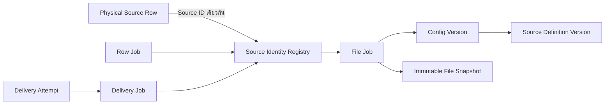

# แบบข้อมูลและ runtime กลางของ Mapping

แบบสำหรับ M1.1 ตามคำสั่งผู้ใช้ให้ครอบคลุมหลายรูปแบบ โดยไม่ผูก engine กับ field ของ MTLS ผู้ใช้จะส่งรายละเอียด fields ภายหลัง จึงพักการตัดสินเรื่อง field/สัดส่วนใน Q5 ไว้ ข้อกำหนด technical ใน §8 เป็น baseline ปิด design ภายใน Mapping ตาม M-26; status `approved` ใช้กับแบบภายในนี้ ไม่ใช่การอนุมัติเปลี่ยน Informs contract หรือผลทดสอบ application ติดตามสถานะใน [plan.md](plan.md) และเกณฑ์ตรวจรับใน [แผน API](api-implementation-plan.md)

## 1. หลักร่วมและสิ่งที่ยังต้องรับข้อมูล

- Source definition, Input Layout, Transformation Program และ contract schema กำหนด fields/paths ผ่านข้อมูลที่มี version; ไม่มี `if partner == ...` สำหรับ business mapping ใน engine
- ใช้ physical Source Table ต่อ config ตาม M-15, กำหนดผ่าน Web ตาม M-16, เพิ่ม column ได้อย่างเดียวตาม M-17 และเปิด Source/Payload detail ตาม M-18/M-19
- ย้าย Transformation Program ให้ครบตาม M-03; ผู้ใช้ชี้แจงภายหลังตาม M-27 ว่า MTLS เป็นหนึ่ง example เท่านั้น และเลือก Excel/Delimited/FixedWidth รอบแรก; [แบบ API/Web หลาย format](multi-format-api-web-design.md) เพิ่ม Input Reader seam โดยไม่เปลี่ยนตาราง/identities ของ M1.1
- runtime destination ช่วงแรกเป็น Informs API ตาม M-21; การออกแบบกลางไม่เปิด destination/partner ใหม่โดยปริยาย และไม่เพิ่ม abstraction สำหรับ destination ที่ยังไม่ implement
- business rules อ้าง [rules.md](rules.md) ด้วย ID; ข้อมูลตัวอย่างด้านล่างใช้ชื่อเชิงเทคนิคสมมติ ไม่เสนอ business fields ของ partner ใหม่
- fields/defaults/สัดส่วนที่ยังไม่ส่งมาเป็น pending input ใน config/contract ไม่เดาค่า ไม่สร้าง field ใน Informs และไม่ถือว่าคำว่า cover ทุกเรื่องแปลว่าผ่าน scenarios ที่ยังไม่ทดสอบแล้ว

| เรื่อง | ออกแบบ/ทดสอบกลไกได้ก่อน | สิ่งที่ยังปิดไม่ได้ |
|---|---|---|
| fields ต้นทาง/ปลายทาง | catalog/version, nested paths, required/optional, validation, diagnostics และ schema pin | bindings/defaults/สัดส่วนจริงใน Q5 รอผู้ใช้ส่ง |
| file occurrence | ownership claim หลาย pod, snapshot, checkpoint และ hash ต่อ config ข้าม versions ตาม M-25 | dependency filesystem/share รอ Q7 |
| เวลา/ลำดับ | `sourceRowNo` ตาม M-06 และ `FileJob.CreatedAt` ตาม M-23 | การรับ/ใช้เวลานี้ใน Informs รอ Dev 1 ใน Q4 |
| messaging/HTTP | outbox, local Kafka, idempotency และ transport failure tests | [fixture MTLS สมมติ](fixtures/README.md) พร้อมแล้ว; broker/topics บริษัท, URL/auth/TLS/keys/share ยังรอ Q7 |
| Web/API | use cases, response examples และ read-only availability | prefix/DTO ฉบับปิดใน M1.2/Q8 และ layout จาก Web design |

## 2. Module และ interface ที่ผู้เรียกใช้

Module หมายถึงชุดพฤติกรรมที่มี interface เดียวให้ผู้เรียกและ tests ใช้; interface รวมคำสั่ง ผลลัพธ์ กติกา และข้อผิดพลาด ไม่ได้หมายถึงชื่อ C# interface อย่างเดียว Seam คือจุดเปลี่ยน implementation โดยผู้เรียกไม่ต้องรู้รายละเอียด ส่วน adapter ทำหน้าที่เชื่อม I/O ที่ seam นั้น

| Module | Interface ที่ต้องรู้ | Implementation ที่ซ่อนไว้ | Test surface |
|---|---|---|---|
| Input reader | รับ stable snapshot + pinned `inputLayout` → raw records พร้อม source row no/physical position/diagnostics แบบเดียวกัน | adapter Excel/Delimited/FixedWidth ตาม `kind`; limits/encoding/header/field positions อยู่หลัง seam | synthetic fixtures ของทั้งสาม format, preview/import consistency |
| Source catalog | create definition, add columns, read pinned definition; คืน version/conflict/diagnostics | identifiers/types, DDL/metadata transaction, immutable definitions และ schema checks | CQRS handlers + PostgreSQL จริง |
| Config lifecycle | save immutable version, validate/preview, activate/disable ด้วย expected row version | definition/compiler/contract compatibility และ folder ownership | commands/queries + pure compiler |
| Transformation | compile pinned definition; evaluate raw row + immutable context → outputs/diagnostics | expressions/predicates/nested arrays/conversions/limits; ไม่มี file/HTTP writes | pure compile/evaluate interface เดียวกับ preview/runtime |
| Durable jobs | รับ occurrence, commit row, claim/recover job, บันทึกผลด้วย lease token | PostgreSQL transactions, identities, outbox, checkpoint และ fencing | application use cases + DB/Kafka failure injection |
| Informs delivery | ส่ง durable payload ที่ระบุด้วย delivery/attempt identity; คืน classified outcome | decrypt, HTTP bytes, timeout/Retry-After และ safe response parsing | job use case + HTTP adapter กับ fake/local Informs |
| Inspection | อ่าน file/row/output/attempt/snapshot พร้อม availability | physical table resolution, pinned schema, decrypt และ count aggregation | query interface + DB + ตรวจว่าไม่มี delivery side effects |

คง CQRS/4 layer/`BaseResponse` ตาม repo จริง ไม่เพิ่ม facade ที่ส่งต่อทุก method ของ repository อีกชั้น Controller ส่ง MediatR เท่านั้น; pure transformation ไม่ขึ้นกับ EF/Kafka/ASP.NET ส่วน Source catalog รับชื่อเมื่อสร้างใหม่ตาม M-39 และคืนชื่อเพื่อแสดงตาม M-38; SQL/DDL และการ resolve ตารางตอนทำงานอยู่ใน Infrastructure

ไม่สร้าง field-specific class หรือ repository ต่อ business field; ไม่สร้าง generic destination plugin framework ให้ JsonFile/DatabaseTable ในช่วงที่ยังเป็น backlog Named Lookup เดิมต้องมี adapter/dependency ที่ตกลงจริงก่อนเปิด capability ตาม M-03/Q7

## 3. ข้อมูลและ identities ที่เสนอ

ทุกตารางอยู่ schema `mapping`, IDs สร้างด้วย `Uuid.NewV7()` ตาม D-15 และ timestamps ใช้ UTC; entity ใช้ชื่อพหูพจน์ตาม repo ข้อมูล metadata ที่เปลี่ยนได้ใช้ optimistic row version ส่วน immutable version/Source ไม่ใช้ `IsActive` เป็นช่องทางซ่อนหรือลบหลักฐาน

| ตาราง/กลุ่ม | ข้อมูลและ constraint หลัก |
|---|---|
| `mapping_configs` | identity, input path, enabled, active version, row version; สร้าง draft identity ก่อนเปิดรับไฟล์ |
| `source_definitions` | owner config, physical table handle, current definition version, row version; physical table ผูก owner เดียว ไม่แชร์โดยบังเอิญข้าม configs |
| `source_definition_versions` | immutable ordered fields/physical column mapping/system columns และ definition hash; unique `(source_definition_id, version_number)`; เพิ่ม column สร้าง version ใหม่ของ metadata แม้ใช้ physical table เดิม |
| physical Source Tables | system identity และ raw columns แบบ `text NULL` ตาม §8; รองรับค่าที่แปลงธุรกิจไม่ได้; เพิ่ม nullable column ที่ไม่มี business backfill; logical type/conversion อยู่ใน definition/program |
| `source_row_refs` | registry ของ identity เท่านั้น: Source ID, File Job ID, definition version, row number/physical row number; ไม่มี raw values กลาง; unique `(file_job_id, row_number)` และ `(id, file_job_id)` |
| `mapping_config_versions` | immutable Input Layout/Transformation Program/Source definition version/schema bytes+hash/profile version/evaluation semantics; unique `(config_id, version_number)` |
| `file_intake_claims` | normalized relative path ต่อ config → occurrence ล่าสุด; unique `(config_id, relative_path)`; ระหว่างทำงานใช้เป็น ownership หลัง Archived เก็บ pointer กันรับ bytes เดิมซ้ำ เปลี่ยนไป job ใหม่เมื่อ stable bytes เปลี่ยนตาม M-32 ไม่ลบเพราะ lease หมด |
| `file_content_claims` | unique `(config_id, content_sha256)` → canonical File Job ตาม M-25 ไม่รวมชื่อไฟล์/config version; failed job ยังเป็น owner เพื่อ resume งานเดิม |
| `file_jobs` | version pin, accepted fingerprint, durable snapshot/hash, import checkpoint/lease และ work lease แยกสำหรับ snapshot/archive, archive intent/ref/state ตาม M-32; CreatedAt ใช้ตาม M-23 ไม่เพิ่มเวลารับไฟล์อีก field |
| `row_jobs` | Source reference, pinned execution identity, state, attempts/next-at, lease owner/epoch/until; unique initial run ต่อ Source+config version ในช่วงที่ไม่เปิด reprocess |
| `row_errors` | stage/code/target path/source field reference และ safe diagnostic; raw value อ่านจาก Source detail ไม่คัดไป operational log |
| `delivery_jobs` | unique `(file_job_id, source_row_id, output_key)`, pinned version/profile/contract, encrypted payload reference, payload hash, status/next-at/lease/attempts reserved, response IDs/flags |
| `delivery_attempts` | unique `(delivery_job_id, attempt_number)`, dispatch/outcome state, HTTP status/latency/safe diagnostics, correlation และ response IDs; append history ไม่ reset |
| `outbox` | ordered event ID, typed IDs-only JSON, topic/key, sent/blocked state; publish ซ้ำใช้ ID เดิมใน header ตาม M-31 ไม่มี raw Source |
| `inbox` | immutable receipt ต่อ consumer group/topic/partition/offset, event/job ID และ safe outcome; จัดคิว Row Job พร้อม receipt ก่อน commit offset ตาม M-31 |
| `delivery_controls` | global intake/delivery pause และ concurrency budget/version ที่ claim ใช้ร่วมกัน; ค่าเริ่ม budget 1 ตาม M-07 |
| `mapping_audits` | fixed actor/reason/request ID/action และ metadata ก่อน/หลัง; ไม่มี raw payload/keys; action request ID กัน double click ตามขอบเขต use case |

ใช้ `source_row_refs` เพื่อให้ row/delivery jobs มี FK ไป Source identity เดียวได้ แม้ raw rows อยู่หลาย physical tables; ไม่ย้อนกลับไปใช้ Source กลาง + JSONB ที่ผู้ใช้ไม่เลือก การเก็บ program/layout/schema เป็น JSON metadata ไม่เปลี่ยนรูปแบบ raw Source ที่ตกลงแล้ว

FK ตาม §8: physical Source row และ registry ใช้ Source ID เดียวกัน; row/delivery jobs อ้าง registry และตรวจ `(source_row_id, file_job_id)` ว่าคู่กัน ส่วน File Job/registry ต้องอ้าง definition version ที่ตรงกับ config version ที่ pin ไว้ การสร้าง EF migrations และ application integration tests เป็นด่าน M1.3/M1.5 ไม่อาศัย string table name จาก browser

ภาพแสดงความสัมพันธ์อ้างอิงของแบบ ไม่ใช่ schema ที่ deploy แล้ว:



### 3.1 ตัวอย่าง lineage โดยไม่กำหนด business fields

ชื่อ A/V1/F1/R1/D1 ต่อไปนี้เป็น aliases เพื่ออ่านตัวอย่าง ไม่ใช่ค่า ID จริงที่จะส่ง API

| รายการ | ตัวอย่าง |
|---|---|
| Config A/V1 | Source definition S/V1, table handle T1, fields `field_a`, `field_b`, schema hash H1 |
| File Job F1 | pin A/V1 + S/V1 + T1; CreatedAt `2026-11-13T03:00:00Z` |
| Source R1 | F1, row 1, physical row 2, `field_a="12.50"`, `field_b=""` |
| Row Job J1 | R1 + A/V1 + evaluation context ที่ตรึงไว้ |
| Delivery D1 | `(F1,R1,default)`, payload bytes P1, hash HP1, encrypted key reference K1 |
| Attempts | D1/#1 timeout; D1/#2 สำเร็จ/replayed → ส่งสำเร็จ 1 output, attempts 2 |

หากเพิ่ม `field_c` เป็น S/V2 ใน T1 งาน F1 ยังคงอ่านตาม S/V1 โดยไม่เห็น field ใหม่เป็นส่วนหนึ่งของหลักฐานเดิม หากเปลี่ยนชนิด/rename field เดิม ใช้ table/definition ใหม่สำหรับ config version ใหม่ตาม M-17; การ activate ไม่ reprocess F1 ตาม M-22

ตัวอย่าง JSON ของ raw values ที่แสดงให้ผู้ใช้ดู (raw จริงอยู่ columns ใน T1 ไม่ใช่ JSONB กลาง):

```json
{
  "field_a": "12.50",
  "field_b": ""
}
```

fields เหล่านี้ใช้พิสูจน์กลไก source/literal/convert/default/nested output กับ test schema เท่านั้น ไม่ถือว่าเป็น paths ที่ส่งให้ Informs ได้ เมื่อผู้ใช้ส่ง fields จริงจึงผูก paths ใน schema ที่ Informs ประกาศตาม D-02

## 4. Definition, schema และ compilation

1. สร้าง config draft identity → กำหนด Source fields → ตรวจ names/types/system columns → สร้าง table/metadata แบบ atomic; ไม่รับ SQL จาก browser
2. บันทึก config version ที่อ้าง Source definition/schema/profile/evaluation semantics แบบ immutable; required system-bound paths ถูกจองให้ job context
3. compile ตรวจ source references, target paths/types/required bindings, array groups, operators/lookup availability และ limits; ไม่ตรวจ product/master/Client API ตาม D-06
4. preview ใช้ compiler/evaluator เดียวกับ runtime และตรึง evaluation context; จำกัดขนาด/records ไม่มี Source/job/outbox/archive/delivery side effects
5. activate แบบ expected row version; ตรวจ folder/extension ownership และ dependencies อีกครั้งใน transaction ที่กัน concurrent activate ได้
6. การรับไฟล์ pin versions/definitions/hash/time ก่อน import; ไม่อ่าน latest definition/schema แทนของงานเดิม

Source field catalog ระบุโครงต้นทาง ส่วน contract schema ระบุโครงปลายทาง ทั้งสองเปลี่ยน version แยกกันได้โดย config version ผูกคู่ให้ชัดเจน Compiler รองรับ nested objects/arrays ไม่ผูกกับจำนวนผู้เอาประกัน/ผู้รับประโยชน์ของ MTLS

Conversion failure ต้องผ่านกติกา contract/profile: nullable path ใช้ null+unparsed ตาม D-04; ถ้า required/non-nullable path ทำให้ document ไม่ผ่าน schema ให้คง Source และ diagnostic/ยอดยังไม่ส่ง ไม่แต่งค่าเพื่อบังคับผ่าน; binding/default ที่เป็นธุรกิจจริงรอผู้ใช้ส่งตาม Q5

Schema major เดิมแต่ hash เปลี่ยนต้องได้ snapshot ใหม่เมื่อสร้าง config version ใหม่ ไม่เปลี่ยน payload ของงานที่รับแล้ว; ฝั่ง Informs เป็นเจ้าของการยอมรับ schema ตาม D-02 ไม่ fallback latest เพื่อทำ retry เดิมให้ผ่านเอง

## 5. Transaction, claim และ recovery

| จุด commit | สิ่งที่ต้อง atomic | ถ้าหยุดกลางทาง |
|---|---|---|
| สร้าง/เพิ่ม Source column | validate expected version + physical DDL + definition version + audit | rollback ไม่ทิ้ง orphan table/column metadata; เรียกซ้ำด้วย action identity ได้ผลเดิม |
| รับ occurrence | acquire path claim + File Job/version pin/CreatedAt + import outbox | claim/job เดิมใช้ต่อ; ไม่สร้าง File Job ใหม่จาก scanner race |
| commit แถว | identity registry + physical raw row + Row Job + transform outbox + contiguous checkpoint | rollback ทั้งชุด หรือพบแถวเดิมแล้วขยับตาม checkpoint ที่ถูกบันทึกจริง |
| รับ transform event (M-31) | lock broker coordinates + ตรวจ lineage/lock Row Job + schedule งานที่ยังไม่จัดคิว + immutable Inbox Receipt | rollback ไม่ commit offset; record เดิมหรือ republish ไม่ reset NextAt/backoff หรือเพิ่มงานซ้ำ |
| transform | output jobs + encrypted final payload/bytes/hash/key reference + delivery outbox + row result | ไม่มี durable intent จึงยังไม่ส่ง; redelivery ไม่เพิ่ม output key ซ้ำ |
| เริ่มส่ง | claim lease + ตรวจ pause/global budget/attempt cap + reserve attempt | reserved/unknown attempt ไม่ถูก reset เมื่อ restart; ห้ามเกิน 6 ตาม M-20 |
| จบ attempt | outcome + IDs/flags + attempt history + job state/next-at + release budget | stale worker เขียนไม่ได้; HTTP ที่อาจรับแล้วต้องใช้ replay bytes/key เดิมภายในโควตา |
| archive (M-32) | persist intent/ref หลัง Imported/Duplicate → publish/verify สำเนาจาก sealed snapshot → ตรวจ original → fenced DB result | คง input; original เปลี่ยนให้ RecoveryRequired เก็บหลักฐานทั้งคู่; crash หลัง publish ให้ตรวจ ref/hash เดิมแล้ว complete ซ้ำได้ |

ตาราง metadata ใช้ EF migrations; physical Source DDL ใช้ implementation ที่สร้าง SQL จาก validated catalog ภายใน transaction ของ connection เดียวกับ metadata/row jobs ไม่สร้าง EF entity ต่อ field หรือรัน migration ที่ API startup แบบ demo การใช้ SQL เฉพาะ DDL/locks ต้องถูกซ่อนใน Infrastructure ตาม D-77

### 5.1 หลาย pod และ fencing

- ใช้ DB clock และ atomic conditional claim/row locking; ไม่ใช้ in-memory lock เป็นหลักฐาน ownership ทั้งระบบ
- ทุก claim มี lease epoch เพิ่มขึ้น ผลลัพธ์ต้อง update ด้วย job ID + epoch + state ที่คาดไว้; worker เก่าที่ lease หมดเขียนทับผล worker ใหม่ไม่ได้
- Kafka commit offset หลังผล DB durable; publish แล้ว crash ก่อน mark sent อาจได้ duplicate event จึงต้องกันซ้ำที่ job identity/state
- ตรวจ global budget ผ่าน control row ที่ serialize budget check+claim ใน transaction เดียว ไม่ตีความว่า 1 request ต่อ pod เท่ากับเพดานรวม 1
- HTTP อยู่นอก DB transaction; fencing ป้องกัน stale DB writes แต่หยุด request ที่ server อาจกำลังรับไม่ได้ จึงไม่อ้าง exactly-once HTTP; correctness ของการรับซ้ำใช้ D-44
- timeout ของ request/lease/recovery grace และการจัดการ request ที่ outcome ยังไม่ทราบต้องลงรายละเอียดและทดสอบก่อนอ้างว่าคุม concurrency/recovery ผ่านแล้ว

### 5.2 เพดาน attempts กับ outcome ที่ไม่ทราบ

จอง attempt อย่าง durable ก่อนเรียก HTTP และนับ reservation ที่อาจถูกส่งแล้วในเพดานด้วย หาก crash ระหว่าง reserve/send ต้องแยกสถานะว่ายังยืนยัน dispatch/outcome ไม่ได้ ไม่ล้าง attempt เพราะไม่มี response; การนับนี้อาจใช้โควตาแม้ยังพิสูจน์ไม่ได้ว่า request ออกจาก process แต่ป้องกันเกินเพดานจาก recovery

หาก attempt สุดท้ายอาจถูก Informs รับแล้วแต่ Mapping ไม่ได้รับผล ให้เก็บ diagnostic `OutcomeUnknown` และไม่แสดง Delivered โดยไม่มีหลักฐาน; หยุดส่งตาม M-20 ไม่มี attempt 7 เพื่อ probe ผล ไม่สร้าง status-query endpoint ของ Informs ขึ้นเอง ทีม Ops ตรวจผลจากข้อมูลที่มีและส่งกรณีที่ยังยืนยันไม่ได้ให้เจ้าของระบบ

## 6. States และยอดข้อมูล

สถานะต่อไปนี้เป็นคำอธิบายร่าง enum/HTTP action states ต้องปิดใน M1.2 ไม่ใช้ status เดียวครอบ import/transform/archive/delivery ทั้งไฟล์

| กลุ่ม | การเปลี่ยนสถานะหลัก | กติกา |
|---|---|---|
| Config | disabled/enabled + active immutable version | disable หยุดรับใหม่ งานที่ pin แล้วไม่เปลี่ยน version |
| Import | Claimed → Snapshotting → Importing → Imported; error แยก retryable/blocked | checkpoint คงที่และ Source ไม่ซ้ำ; archive state แยก |
| Row transform (M-33) | Pending → Running → Transformed / Filtered / RetryableFailed / Blocked | Transformed หมายถึง encrypted durable outputs/outbox ที่ commit พร้อมผลแถว ไม่ใช่ Delivered; Filtered ใช้เฉพาะ config ที่อนุญาต; Running ที่ lease หมดและพ้น grace จึงกู้คืนได้ |
| Delivery | Pending/RetryableFailed → Sending → Delivered / Rejected / Blocked / Failed | Delivered terminal; Rejected 400/409 ไม่ auto retry; ถึง 6 attempts ไม่มี retry เพิ่ม |
| Attempt | Reserved → Dispatching → Completed หรือ OutcomeUnknown | history ไม่ reset; unknown ไม่เท่ากับ Informs ไม่รับ |
| Archive | Pending → Archiving → Archived หรือ RecoveryRequired | import เสร็จไม่ต้องรอทุก delivery จบ; snapshot ต้องอยู่จน archive ยืนยัน |

สำหรับ engine กลาง Source 1 แถวอาจให้ 0..N outputs ตาม M-03 จึงต้องมีทั้ง row counts และ output counts:

- แถวที่อ่านพบและ Source ที่ commit เปรียบเทียบได้เมื่อ import จบแล้ว พร้อม physical/import row number; ระหว่าง import ให้แสดงสถานะ incomplete
- Source rows แบ่งตาม row-job state แบบไม่ซ้ำกัน; blocked/filtered ต้องมีเหตุ ไม่หายจากยอด
- outputs นับ delivery logical identities แยก Delivered/Rejected/Pending/Blocked/Failed; attempts เป็นอีกยอดและไม่รวมเป็น outputs
- แถวที่สร้าง output ไม่ได้แสดงใน row-blocked ไม่สมมติว่ามี delivery ที่ไม่เคยถูกสร้าง; file summary ต้องแสดงส่วนนี้เพื่อไม่ให้เข้าใจว่าไม่มีงานค้าง
- ตัวอย่าง engine: Source 3 แถว → outputs 0, 1, 2 รวม 3 outputs; แถวที่ได้ 2 outputs อาจมีผลต่างสถานะ ห้ามใช้จำนวน Delivered เป็นจำนวน Source rows โดยตรง
- สำหรับ MTLS บังคับ cardinality 1 output `default` ต่อแถวที่อ่านเป็นข้อมูลตาม config/acceptance เดิม; ไม่ใช้ความสามารถ filter/branches ตัดแถวโดยไม่มีข้อตกลงตาม D-04

## 7. Scenario coverage สำหรับตรวจแบบและ implement

รายการนี้เป็น test obligations ยังไม่ใช่ผลทดสอบ เชื่อม AC-xx ในแผน API และงานใน plan; fields/business expectations จริงรอผู้ใช้ส่ง

| Scenario | ผลที่ต้องได้ | หลักฐานที่จะใช้ |
|---|---|---|
| S01 ต่าง config มี fields/จำนวน columns ต่างกัน | อ่านตาม Source definition ของตัวเอง ไม่มี global 19-column assumption | unit + DB, M1.1/M1.5/M2.1 |
| S02 สร้าง table พร้อมกัน/ชื่อชน/DDL ล้มเหลว | conflict ชัดเจน metadata/schema ไม่ค้างครึ่งหนึ่ง | DB/API, M1.5 |
| S03 เพิ่ม column ระหว่างงานเก่าทำงาน | pin เดิมยังอ่านได้ Source เก่าไม่ถูกเติมธุรกิจย้อนหลัง | AC-13, M1.5/M3 |
| S04 ลบ/rename/เปลี่ยนชนิด field เดิม | ปฏิเสธ operation; ใช้ table/definition ใหม่เมื่อจำเป็น | AC-13, M1.5 |
| S05 names/types/paths/system fields ไม่ถูกต้อง | field-path diagnostic ไม่มี arbitrary SQL หรือ system override | unit/API, M1.2/M1.5/M2.3 |
| S06 activate/disable/save พร้อมกัน | expected version conflict; pin ของงานเดิมไม่เปลี่ยน | AC-05 |
| S07 schema major เดิมแต่ hash เปลี่ยน | config version ใหม่ pin ใหม่ งานเก่าใช้ snapshot/bytes เดิม | M1.4 + AC-05/10 |
| S08 preview/validate/inspection เรียกซ้ำ | ไม่มี Source/job/outbox/delivery/archive เพิ่มหรือเปลี่ยน | AC-04/13, M2.3/M4.3 |
| S09 header/blank row/physical gap/nSeq ไม่สม่ำเสมอ | row order ตาม M-06; raw values/physical position ยังตรวจได้ | AC-01, M2.1 |
| S10 number/Thai/encoding/invalid workbook | formatter เก็บหลักฐานได้ตาม layout; parser failure ไม่แกล้ง import สำเร็จ | AC-01/14 |
| S11 source/literal/default/case/convert และ expressions ทั้งชุด | generic compiler/evaluator ตาม capability ที่ย้ายจริง | M2.2/M2.5 |
| S12 predicates/Named Transform/Named Lookup | รองรับตาม catalog; dependency ไม่มีต้องปิด capability มีเหตุ | M2.5/Q7 |
| S13 nested objects/arrays/empty slots/0..N outputs | structure/cardinality ตาม definition/limits; outputs มี stable keys | AC-02/03, M2.5 |
| S14 nullable conversion failure | null + unparsed ตาม active contract โดยไม่ลบ Source/ทิ้งแถว | AC-02, M2.2 |
| S15 required/non-nullable target สร้างไม่ได้ | Source คงอยู่; diagnostic และยอด row-blocked ไม่แต่งค่า | Q5 + M2.2/M4.3 |
| S16 limits/deep expression/unknown path/operator | bounded failure มี code/path ไม่อ่านหรือส่งงานต่อครึ่งหนึ่ง | unit/API, M2.3/M2.5 |
| S17 สอง scanners รับ path เดียวกัน | occurrence claim/job เดียว version pin เดียว | AC-06, M3.2 |
| S18 เนื้อหาเดียวกันแต่ชื่อ/config/version ต่างกัน | config เดิม/hash เดิมถือว่าซ้ำข้าม versions; hash ใหม่หรือคนละ config ไม่ชน content claim; path claim แยกต่างหาก | M-25 + AC-06 |
| S19 partial file/source เปลี่ยนระหว่าง snapshot | snapshot เสถียรก่อน import ไม่อ้างหลักฐานจากไฟล์ที่กำลังเปลี่ยน | AC-12/14, M3.2 |
| S20 crash ก่อน/หลัง row transaction commit | registry/raw/Row Job/outbox/checkpoint ไม่ขาดหรือเพิ่มซ้ำ | AC-07, M3 |
| S21 publish ซ้ำ/consume ซ้ำ/restart | no duplicate logical work; offsets หลัง DB durable | AC-06/07 |
| S22 lease หมด/stale worker กลับมา | fenced writes; effect ของ request ที่อาจ in-flight ใช้ idempotency | AC-10/12 |
| S23 encrypt/persist intent ล้มเหลว | ไม่มี HTTP ก่อน durable payload และไม่มี plaintext fallback | M4.1 + AC-10 |
| S24 201/200 replayed/200 replaced | ได้ response IDs/flags; Delivered ไม่ใช่ business validation ผ่าน | AC-08 |
| S25 400/409/401/403/404/2xx body ผิด | classify rejection/blocked/unknown ตาม protocol; ไม่ auto retry ถาวร | AC-08, M4.1/M4.2 |
| S26 429/Retry-After/5xx/timeout | durable next-at/backoff; bytes/key เดิมภายในโควตา | AC-09/10 |
| S27 attempt สุดท้ายไม่มี response | outcome unknown เห็นได้; ไม่แสดง Delivered เท็จ/ไม่ส่งครั้งที่ 7 | M-20 + AC-09/10 |
| S28 manual retry/API ตรง/double click พร้อม worker | state/action guard และเพดานเดียวกัน ไม่ reset attempts | M-20, M4.2/M4.3 |
| S29 หลาย pod กับ global concurrency/pause | claim ใช้ shared budget; pause intake กับ delivery แยกกัน | M-07, M3/M4.2 |
| S30 shutdown ระหว่างงาน/HTTP | หยุดรับใหม่ ยกเลิกและ recover ได้โดยไม่สร้าง Delivered เท็จ | AC-09/12/15 |
| S31 archive สำเร็จ/ล้มเหลว/original ถูกแทนที่ | snapshot ไม่หาย ไม่ย้าย/ลบไฟล์ใหม่แทนไฟล์เดิม | AC-12, M3.2 |
| S32 Source/Payload detail กับ wrong IDs/ไม่มี payload/ไม่มี key | ตรวจ lineage/availability อ่านจริง ไม่มี side effects/secret leakage | AC-13/14, M4.3 |
| S33 summary มี filtered/blocked/multi-output/retries | row/output/attempt counts แยกและกระทบยอดได้ | AC-11, M4.3 |
| S34 config ใหม่กับไฟล์/Source เก่า | รับใหม่ใช้ version ใหม่ แต่ไม่เปิด changed-payload resend งานเดิม | M-22 + AC-05/13 |
| S35 วันที่รับไฟล์กับ HTTP arrival ต่างกัน | CreatedAt ฝั่ง Mapping คงเดิม; acceptance ข้าม service รอ Q4 | Q4/M-23 ไม่อ้างว่าผ่านแล้ว |
| S36 DB/broker/share/keys ใช้ไม่ได้ | readiness/diagnostics ตาม dependency; durable intent ไม่หาย | Q7 + AC-15 |

## 8. ข้อกำหนด technical สำหรับ implement M1.1

### 8.1 ชนิดข้อมูลและหลักร่วม

- PK = primary key, FK = foreign key; `UQ(...)` หมายถึง unique constraint ของ columns ในวงเล็บ ทุก FK ในแบบใช้ `ON DELETE RESTRICT` เว้นกรณีวงอ้างอิงที่ระบุเป็น deferred และไม่เปิด cascade ลบหลักฐาน
- Entity ID ใช้ PostgreSQL `uuid`, สร้างด้วย `Uuid.NewV7()` ฝั่ง application ไม่มี database UUID default; external action request ID เป็น correlation ไม่ใช่ entity ID
- เวลาใช้ `timestamptz NOT NULL` เป็น UTC; ข้อมูล mutable มี `updated_at` และ `row_version bigint NOT NULL DEFAULT 1 CHECK > 0`; command เทียบ expected version แล้วเพิ่ม 1 ใน transaction เดียว
- Version/Source/claim เนื้อหา/audit เป็น append-only ไม่มี soft delete; immutable entities ใช้ CreatedAt แต่ไม่ persist `BaseEntity.IsActive` เป็นช่องทางแก้หลักฐาน
- M-32 เพิ่ม accepted fingerprint (`accepted_hash/accepted_size/accepted_last_write_at`) ของ File Job และ work lease (`work_owner/work_epoch/work_until`) แยกจาก import lease; `archive_ref` เปลี่ยนไม่ได้เมื่อมีค่าแล้ว; งานเก่าที่ไม่มี accepted fingerprint ไม่ถูก scanner worker claim อัตโนมัติ
- Fields ที่ไม่ระบุว่า optional ในตารางด้านล่างเป็น `NOT NULL`; ID ทุกตัวในตาราง entity เป็น PK เว้นตาราง claim/routes ที่ระบุ composite PK ชัดเจน
- `hash32` ใช้ `bytea CHECK (octet_length(value)=32)` เก็บ SHA-256; content hash คำนวณจาก bytes ของ stable file snapshot ไม่ใช่ชื่อไฟล์หรือการเทียบค่าทางธุรกิจใน cells การ save Excel ใหม่อาจเปลี่ยน bytes/hash แม้ข้อมูลที่มองเห็นคล้ายเดิม
- `jsonb` ใช้เฉพาะ definition/program/layout/safe metadata ไม่ใช้เป็นที่เก็บ raw Source กลาง; immutable schema snapshot เก็บ `bytea` ของ schema จริงพร้อม hash ไม่คำนวณ hash จาก JSON ที่ reserialize ไม่แน่นอน

### 8.2 ตาราง/columns/keys ที่ต้องมี

ชนิด `lease` ในตารางหมายถึง `lease_owner text NULL`, `lease_epoch bigint NOT NULL DEFAULT 0 CHECK >=0`, `lease_until timestamptz NULL`; owner/until ต้องว่างหรือมีค่าพร้อมกัน `next_at` เป็น `timestamptz` และ indexes ที่กล่าวถึงเป็น B-tree เว้นระบุอื่น

| Entity / ตาราง | Columns นอกเหนือจาก ID/เวลา และข้อบังคับ |
|---|---|
| `MappingConfigs` / `mapping_configs` | `name text`, `input_path text`, `is_enabled boolean DEFAULT false`, `active_version_id uuid NULL`, row version; UQ `(id,active_version_id)`; FK `(active_version_id,id)` → config versions `(id,config_id)` แบบ deferred; enabled ต้องมี active version |
| `SourceDefinitions` / `source_definitions` | `config_id uuid` FK configs, `physical_table_name varchar(63)` UQ, `current_version_id uuid NULL`, row version; UQ `(id,config_id)`; current version ต้องเป็นของ definition นี้; config identity สร้างก่อน Source definition |
| `SourceDefinitionVersions` / `source_definition_versions` | `source_definition_id uuid`, `config_id uuid`, `version_number integer CHECK >0`, `fields jsonb` array, `definition_hash hash32`; FK `(source_definition_id,config_id)` → definitions `(id,config_id)`; UQ `(source_definition_id,version_number)`, `(id,config_id)`, `(id,source_definition_id)` |
| `ContractSnapshots` / `contract_snapshots` | `contract_version text`, `schema_bytes bytea`, `schema_hash hash32`; UQ `(contract_version,schema_hash)`; paths/types derive จาก snapshot ไม่ใช่ latest schema |
| `DestinationProfileSnapshots` / `destination_profile_snapshots` | `profile_key text`, `profile_version text`, `safe_settings jsonb` object, `profile_hash hash32`; UQ `(profile_key,profile_version)`; ชื่อ/version เดิมแต่ hash ต่างตอบ conflict ไม่ overwrite; credentials เก็บแค่ key/secret reference |
| `MappingConfigVersions` / `mapping_config_versions` | `config_id uuid` FK configs, `version_number integer CHECK >0`, `source_definition_version_id uuid`, `contract_snapshot_id uuid` FK contract snapshots, `profile_snapshot_id uuid` FK profile snapshots, `input_layout/program/evaluation_semantics jsonb` objects; FK `(source_definition_version_id,config_id)` → definition versions `(id,config_id)`; UQ `(config_id,version_number)`, `(id,config_id,source_definition_version_id)`, `(id,config_id)` |
| `ActiveInputRoutes` / `active_input_routes` | PK `(normalized_input_path,extension)` เป็น `text`; `config_id/config_version_id uuid` FK config version ที่เป็นของ config นั้น; extension normalize lowercase; activation/disable เปลี่ยน routes กับ active pointer ใน transaction เดียว |
| `FileJobs` / `file_jobs` | `config_id/config_version_id/source_definition_version_id uuid`, `original_file_name/input_relative_path text`, `snapshot_ref text NULL`, `content_hash hash32 NULL`, `content_size bigint NULL CHECK >=0`, `duplicate_of_file_job_id uuid NULL`, import/archive states, lease, `next_at`, row version; `read_count/committed_count/checkpoint_row_number/checkpoint_physical_row bigint DEFAULT 0 CHECK >=0`; committed <= read และ checkpoint row = committed; UQ `(id,config_id,content_hash)`, `(id,source_definition_version_id)`, `(id,config_version_id)`; FK pin triple → config versions; CreatedAt/config/version/definition ตรึงตั้งแต่รับงาน |
| `FileIntakeClaims` / `file_intake_claims` | PK `(config_id,normalized_relative_path)`; `file_job_id uuid` FK file job ที่มี config เดียวกัน; claim mutable เก็บ owner ขณะทำงานและ occurrence pointer หลัง Archived; รับ bytes ใหม่จึงเปลี่ยน pointer แบบ atomic ตาม M-32 ไม่ลบเพราะ lease หมด |
| `FileContentClaims` / `file_content_claims` | PK `(config_id,content_hash)`; `canonical_file_job_id uuid`; FK `(canonical_file_job_id,config_id,content_hash)` → file jobs `(id,config_id,content_hash)`; append-only ไม่ใส่ชื่อไฟล์/version/expiry ใน key ตาม M-25 |
| `SourceRowRefs` / `source_row_refs` | `file_job_id/source_definition_id/source_definition_version_id uuid`, `row_number/physical_line_number bigint CHECK >0`; FK `(file_job_id,source_definition_version_id)` → file jobs; FK `(source_definition_version_id,source_definition_id)` → definition versions; UQ `(file_job_id,row_number)`, `(id,file_job_id)`, `(id,file_job_id,source_definition_id)`; index `(file_job_id,physical_line_number)` |
| physical Source Table | `id/file_job_id/source_definition_id uuid`; PK ID; CHECK definition ID เป็นเจ้าของ physical table นี้; FK triple → registry; raw columns ทั้งหมด `text NULL` ไม่มี business defaults/NOT NULL ที่ทิ้งค่าผิดได้; row/physical numbers อ่านจาก registry ไม่เก็บซ้ำอีกชุด |
| `RowJobs` / `row_jobs` | `source_row_id/file_job_id/config_version_id uuid`; FK source/file pair → registry และ file/config-version pair → file jobs; UQ `source_row_id` ในช่วงไม่เปิด reprocess; state, `attempt_count integer DEFAULT 0 CHECK >=0`, `output_count integer NULL CHECK >=0`, next-at, lease, row version; UQ `(id,source_row_id,file_job_id,config_version_id)`; index `(state,next_at,created_at,id)` |
| `RowErrors` / `row_errors` (M-33 ทำแล้ว) | `row_job_id uuid` FK row jobs, `attempt integer CHECK >0`, `stage varchar(32)`, `code varchar(64)`, `path varchar(512)`, `severity varchar(16)` error/warning, `source_field varchar(48) NULL`; append-only; index `(row_job_id,attempt,created_at)`; ไม่มี free-form message/raw value/exception body |
| `DeliveryJobs` / `delivery_jobs` (M-33/M-35 ทำแล้ว) | `row_job_id/source_row_id/file_job_id/config_version_id uuid`; FK quadruple → row jobs และ FK `(config_version_id,contract_snapshot_id,profile_snapshot_id)` → pinned config; UQ `(file_job_id,source_row_id,output_key)` โดย output key `varchar(128)` ไม่ว่าง; `payload_ciphertext bytea`, `payload_nonce bytea` 12 bytes, `payload_tag bytea` 16 bytes, `encryption_version integer` 1, `key_reference varchar(128)`, `payload_hash hash32`; immutable identity/payload; `attempts_reserved integer` 0..6, lease owner varchar(128)/epoch/until, state/next-at/row version; last outcome code varchar(64)/HTTP status, inform/existing IDs และ replay/replace flags; Delivered ต้องมี informId, budget/epoch ลดไม่ได้ และ Delivered/Rejected/Failed result immutable; index `(state,next_at,created_at,id)` |
| `DeliveryAttempts` / `delivery_attempts` (M-35 ทำแล้ว) | `delivery_job_id uuid` FK deliveries; `attempt_number integer CHECK BETWEEN 1 AND 6`; UQ `(delivery_job_id,attempt_number)`; `lease_epoch bigint CHECK >0`, state varchar(32) Reserved/Dispatching/Completed/OutcomeUnknown, `dispatched_at/completed_at timestamptz NULL`, `http_status integer NULL CHECK BETWEEN 100 AND 599`, `latency_ms bigint NULL CHECK >=0`, `outcome_code varchar(64) NULL`, `inform_id/existing_inform_id uuid NULL`, replay/replace flags nullable; CreatedAt คือ reserved time; identity/dispatched time และ completed/unknown history immutable ไม่มี delete/truncate หรือ raw response |
| `OutboxMessages` / `outbox` (M-29/M-31/M-32/M-33) | `id bigint identity`, `topic`, `message_key`, `payload jsonb`, `created_at`, `sent_at NULL`, `blocked_code varchar(64) NULL`; partial index `(id) WHERE sent_at IS NULL AND blocked_code IS NULL`; dispatcher ใช้ transaction/`FOR UPDATE SKIP LOCKED` ตาม Informs ไม่ใช้ lease; strict typed IDs-only payload: import UUID 3 ตัว, transform 4 ตัว, delivery 2 ตัว (`deliveryJobId,rowJobId`) แล้วสร้าง canonical event ใหม่ พร้อม header `mapping-event-id` = outbox ID เดิม; topic/schema/key ผิดให้ blocked ไม่มี sent timestamp |
| `InboxMessages` / `inbox` (M-31) | UUID v7, consumer group/topic/partition/offset, nullable event ID/job ID, safe outcome, DB-created time; unique broker coordinates พร้อม advisory transaction lock และ immutable guards; ไม่มี raw body/headers; lock Row Job และตั้ง NextAt ครั้งแรกใน transaction เดียวกันก่อน commit Kafka offset |
| `DeliveryControls` / `delivery_controls` | `scope text CHECK = 'mapping'` UQ (หนึ่ง row), `intake_paused/delivery_paused boolean DEFAULT false`, `max_parallel integer DEFAULT 1 CHECK >0`, row version; ใช้เป็น serialization lock สำหรับ route activation/intake budget/delivery claim ตามลำดับ lock ใน §8.5 |
| `MappingAudits` / `mapping_audits` | `action/entity_kind text`, `entity_id uuid NULL`, `request_id text`, `request_hash hash32`, `fixed_actor/reason text`, `safe_metadata jsonb` object; UQ `(action,request_id)`; append-only; request ID เดิม/body เดิมคืนผลเดิม body ต่าง conflict |

Outbox `job_id` และ audit `entity_id` เป็น polymorphic references ไม่สร้าง FK ปลอมที่อ้างหลายตารางพร้อมกัน; ไม่มี public endpoint เขียนสองตารางนี้โดยตรง ผู้เขียนคือ use case ที่บันทึก job/action ใน transaction เดียวกัน consumer ตรวจ kind/job state ก่อนทำงาน กรณีอ้างอิงผิดต้องเป็น diagnostic ไม่ส่งไปปลายทาง

FK ไม่อนุญาตโยง Source ของไฟล์อื่น หรือ config version ของอีก config; current/active pointers สร้างหลัง parent/version แล้วจึงเติม FK วงอ้างอิงแบบ deferred ไม่ใช้ disable-constraints เป็นขั้นตอนปกติ [PostgreSQL 15 รองรับ composite FK และ deferred constraints](https://www.postgresql.org/docs/15/ddl-constraints.html)

### 8.3 Raw storage และ immutable definition

- ตาม M-39 ผู้ใช้กรอก physical table name ใน wizard ขั้นที่ 1 เช่น `partner_d_raw` → `mapping.partner_d_raw`; ชื่อเป็น `[a-z][a-z0-9_]{0,47}` และ schema ตายตัว `mapping` ไม่รับ schema prefix หรือ SQL จาก browser; API เดิมที่ไม่ส่งชื่อยังใช้ `src_` + Source definition UUID hex lowercase เพื่อรักษาความเข้ากันได้
- สร้างใหม่แล้วบันทึกชื่อใน `source_definitions.physical_table_name` พร้อม physical table/definition/audit ใน transaction เดียว; ตรวจทั้ง metadata และ PostgreSQL relation ที่มีอยู่ และ lock ตามชื่อเพื่อกันหลาย config แย่งชื่อเดียวกัน; ชนชื่อคืน `409 TableNameConflict` โดยไม่เปลี่ยนตารางเดิม
- ชื่อล็อกหลังสร้าง Source definition สำเร็จ ไม่มีคำสั่ง rename หรือผูกกับตารางที่มีอยู่; import/append/transform/inspection อ่านชื่อจาก metadata ของ definition/job ที่ pin และตรวจ identifier ก่อน quote ใช้ใน SQL ไม่คำนวณ `src_<ID>` ใหม่; ตารางเดิมคงชื่อเดิม
- ตัวอย่างข้อมูลสมมติ: `POST /source-definitions` มี `physicalTableName: "partner_d_raw"`, fields `reference`, `amount` → สร้าง `mapping.partner_d_raw` ที่มี raw columns `reference text NULL`, `amount text NULL`; ไฟล์ถัดไปของ config เดิมเพิ่มแถวในตารางนี้ และเพิ่ม field `note` เป็น nullable column ในตารางเดิมตาม M-17
- logical field key ใช้ `[a-z][a-z0-9_]{0,47}` ห้ามชน system columns และห้ามซ้ำ; ภาษาไทย/ชื่อ header จริงเก็บเป็น metadata ของ Input Layout ไม่บังคับให้ชื่อ header เป็น SQL identifier
- Fields metadata เก็บ key, ordinal, input binding/display name และ optional logical type hint; physical raw type เป็น `text NULL` เสมอ การแปลงเป็น 7 target types อยู่ใน Transformation Program จึงเก็บ `-293` หรือค่าที่ไม่ใช่ตัวเลขใน field ที่คาดว่าเป็นตัวเลขได้ตาม D-04
- เพิ่ม column ด้วย `ALTER TABLE ... ADD COLUMN ... text NULL` โดยไม่มี default/backfill; สร้าง definition version ใหม่พร้อม hash และเปลี่ยน current pointer แบบ expected row version
- config/job เก่าอ่านเฉพาะ field set ใน version ที่ pin ไม่ใช้ `SELECT *`; field เพิ่มใหม่จึงไม่ถูกนำไปอ้างว่าเป็นข้อมูลที่ partner เคยส่งในงานเก่า
- Version tables, schema/profile snapshots, Source registry/raw rows และ content claims ใช้ trigger ปฏิเสธ UPDATE/DELETE/TRUNCATE; role/migration owner ยังเป็นเรื่องสิทธิ์ Q7 ไม่อ้างว่าป้องกัน DBA ที่มีสิทธิ์เปลี่ยน trigger ได้
- File Job อนุญาตแก้ state/counters/lease แต่ pin IDs/CreatedAt แก้ไม่ได้; snapshot/hash หลัง seal แก้ไม่ได้ เช่นเดียวกับ delivery identity/payload/hash/key reference และ attempt number/reservation identity
- ทุก FK และ read query ใช้ table/definition จาก registry/job ที่ server resolve; Source ID อย่างเดียวไม่เป็นเหตุให้ browser ระบุ physical table อื่นได้

### 8.4 รับไฟล์ซ้ำและ transaction boundaries

1. **Activate:** lock control row → config row → definitions; validate owner routes/extension/path containment → compare expected version → เปลี่ยน routes+active pointer+audit → commit การตรวจ path overlap อยู่ใน critical section เดียว ไม่ใช้ CHECK ข้ามตาราง
2. **Receive path:** transaction สร้าง File Job/pin version/CreatedAt + path claim + import outbox; unique path claim กัน scanner race; ถ้า claim มีอยู่ resume/refer job เดิม
3. **Seal snapshot:** เขียน stable snapshot แบบ durable ก่อน → transaction seal snapshot/hash + insert content claim `(config_id,hash)`; hash ชนให้ mark occurrence นี้ Duplicate พร้อม canonical job reference ไม่มี Source/row/delivery ใหม่; คนละ hash รับใหม่และอ่านทุกแถว คนละ config ไม่ชน ledger นี้
4. **Import row:** transaction insert registry + raw row + initial Row Job + transform outbox + contiguous checkpoint; ไม่มี commit raw row แยกจาก identity/job; crash ใช้ UQ `(file_job_id,row_number)` และ checkpoint เดิม ไม่สร้าง Source ID ใหม่ให้แถวที่ commit แล้ว
5. **Transform row:** ใช้ pinned compiler/context สร้าง 0..N outputs → ตรวจทุก output กับ pinned schema → encrypt → transaction persist delivery intents/outbox + row result; fatal error ของ output ใดทำให้ row นี้ Blocked ทั้งชุด แถวอื่นทำต่อได้ ค่าธุรกิจผิดที่ทำ null+unparsed ได้ไม่ใช่ fatal
6. **Reserve/send/complete:** ตาม §8.5–§8.6; HTTP ไม่อยู่ใน DB transaction และห้ามส่งก่อน payload durable
7. **Archive/retain occurrence (M-32):** หลัง Imported/Duplicate เก็บ archive intent → copy/publish/verify sealed snapshot → ตรวจ original เทียบ accepted fingerprint → บันทึก Archived แบบ fenced และคง input/path pointer กันสแกน occurrence เดิมซ้ำ; หาก original เปลี่ยนให้ RecoveryRequired เก็บ snapshot/archive/input ใหม่ไว้ทั้งหมด; bytes ใหม่ที่ path เดิมหลัง Archived จึงรับ job ใหม่ได้

Content claim ไม่ถูกล้างเมื่อ job ล้มเหลว เจ้าของ hash เดิมต้อง resume ไม่สร้าง canonical job ใหม่จากการเปลี่ยนชื่อไฟล์; duplicate occurrences ยังมี metadata/audit อธิบายว่าถูกข้าม ไม่เพิ่มยอด accepted Source rows BR-001 ใน rules ให้ Dev 1 อัปเดตสถานะตามคำตอบ Q6 ไม่แก้เอกสารของ Dev 1 เอง

### 8.5 Lease, global budget และ lock order

- ใช้ `READ COMMITTED` และ DB clock; control transactions lock ตามลำดับ **control row → config/file/job row → attempt/action row** เสมอ; Source DDL lock **Source definition → physical table** และไม่ย้อนมา lock control ภายหลัง
- lease defaults ฝั่ง runtime: 120 วินาที, heartbeat ทุก 20 วินาที, recovery grace 30 วินาที และ HTTP timeout 30 วินาที; เป็น environment configuration โดย validate ว่า heartbeat < lease และ timeout+grace < lease ไม่ใช้ตัวเลขเหล่านี้เป็น business SLA
- claim เพิ่ม epoch, ตั้ง owner/until และเปลี่ยน state แบบ conditional; heartbeat/finish ต้องตรง owner+epoch+state และ lease ที่ยังใช้ได้ worker เก่าที่ไม่ผ่านเงื่อนไขหยุดเขียน/หยุดเริ่ม I/O ใหม่
- **global concurrency:** statement แรก lock `delivery_controls FOR UPDATE`; statement ถัดไปจึงอ่าน pause/budget และจำนวน jobs ที่ Sending แล้ว claim candidate แบบ `FOR UPDATE SKIP LOCKED`; ถ้าใช้ snapshot ที่เริ่มก่อนรอ control lock อาจนับ budget เก่า จึงไม่รวมสองขั้นเป็น statement เดียวโดยสมมติว่าจะเห็น commit ล่าสุด
- jobs Sending ที่ lease เพิ่งหมดยังกิน budget ระหว่าง recovery grace; implementation ตาม M-35 นับ active/grace leases ภายใต้ control lock เดียวกัน หลังพ้น grace ไม่ถือว่า owner เดิมมี active permit แล้ว และ DB sweep จะปิด attempt เก่าเป็น OutcomeUnknown/ตั้ง next-at หรือ Failed ก่อนให้ job นั้น reserve รอบใหม่ ไม่อ้างว่าปลด lease แล้วหยุด HTTP ฝั่ง Informs ได้
- completion/recovery ตรวจ epoch ก่อนปรับ outcome/next-at/release budget; Kafka offset หลัง durable commit; duplicate wake-up ไม่ reserve attempt อีกถ้า state/next-at/lease ไม่อนุญาต
- การจัดการ locks/rows อ้าง [PostgreSQL 15 explicit locking](https://www.postgresql.org/docs/15/explicit-locking.html); ไม่อ้างว่า lease หยุด HTTP ที่ server อาจกำลังรับได้ กรณี process pause/crash ยังต้องอาศัย D-44 และแสดง outcome unknown ตามจริง

### 8.6 Attempts และ state guards ที่ต้องใช้ร่วมกัน

- ใน transaction ที่ lock job: reserve ด้วย `attempts_reserved = attempts_reserved + 1` เฉพาะเมื่อค่าเดิม < 6 และ state/next-at/budget อนุญาต พร้อม insert attempt number ใหม่ใน transaction เดียว; counter ลดไม่ได้ และ UQ/check ของ attempt table ป้องกันเลขซ้ำ/เลข 7
- HTTP adapter ใช้ reservation นี้ครั้งเดียว ไม่มี retry loop ซ่อนใน HttpClient; ก่อน dispatch compare lease/epoch/state และเลื่อน Reserved → Dispatching แบบ conditional
- crash หลัง reserve แต่ยังพิสูจน์ไม่ได้ว่าส่งแล้วหรือไม่ยังใช้โควตานั้น ไม่ reset; ประวัติแยก reserved/dispatched/completed/unknown ไม่แสดงว่า HTTP ออกไปครบทุก reservation โดยไม่มีหลักฐาน
- `Delivered` terminal และต้องมี inform ID; `Rejected` จาก 400/409 ไม่เปิด retry; `Blocked` ใช้กับ config/protocol/contract ที่ต้องตรวจ; transient กลับ RetryableFailed เมื่อยังเหลือโควตา
- ครบ 6 → Failed พร้อมเหตุสุดท้าย; หากผลครั้งสุดท้ายไม่ทราบให้คง `OutcomeUnknown` เป็น diagnostic ไม่ตีความว่า Informs ไม่รับ และไม่ส่งครั้งที่ 7 เพื่อ probe
- Manual retry ก่อนครบเพดานต้องผ่าน state guard/expected row version/action request ID และนับรวมเพดาน; หลังครบ API/worker/Web ใช้กติกา M-20 เดียวกัน ไม่ reset counter/key
- preview/Source/Payload inspection ไม่มีสิทธิ์สร้าง job/attempt หรือเปลี่ยน Source/snapshot; config activate/table version เปลี่ยนไม่เปิด changed-payload resend ตาม M-22

### 8.7 M4.3 delivery operations และ safe diagnostics

- M-36 เพิ่ม `delivery_attempts.safe_diagnostics_json jsonb NOT NULL DEFAULT '[]'`; CHECK เป็น array ไม่เกิน100รายการและ JSON textไม่เกิน65536 bytes; Application/Domain จำกัด code/path และ pathไม่เกิน512 ตัวอักษร; completed/unknown history guard เดิมครอบคลุม column ใหม่นี้ ไม่เติมเหตุผลย้อนหลังจาก schema ล่าสุด
- `DeliveryContext` ส่ง schema bytes ของ Contract Snapshot ที่ pin ให้ Application สร้าง path allowlist; 400 เก็บเฉพาะ `{code,path}` ที่ปลอดภัย และคง Rejected แม้รายละเอียดผิดรูปแบบ/เกินขนาด/อ่านหมดเวลา; ไม่ persist response body/messageText/unknown property names
- migration `20261118031413_AddDeliveryDiagnosticsAndLogIndexes` เพิ่มดัชนี `file_jobs(created_at,id)` และ `(config_id,created_at,id)` รองรับ global/config filter พร้อม stable pagination; index config_id เดิมถูกรวมใน composite index ที่มี prefix เดียวกัน ไม่มีตารางใหม่หรือ schema นอก mapping
- `MappingRuntimeReader` อ่านใน read-only repeatable-read transaction; file summary/counts อยู่ใน snapshot เดียวพร้อม DB asOf; lists ไม่คืน raw fields/ciphertext/paths ของไฟล์ และแยก total Source rows, unique Delivery Jobs, attempt reservations และ dispatched count
- Source inspection resolve registry/file/pinned Source Definition Version เลือก columns จาก validated server catalogและใช้ parameters ของ row/file/definition; NULL/empty/raw text คงเดิม; Payload inspection decrypt/verify snapshotจริงตาม M-33; HTTP inspection ใช้ Cache-Control no-store และไม่มี GET writes/audit/HTTP/archive
- `RuntimeInspection` limits (`MaxSourceBytes` default1MiB, `MaxPayloadBytes` default4MiB) เป็น server configuration/environment ไม่มาจาก browser; เกินขนาดคืน TooLarge พร้อม fields/payload null ไม่ truncate ข้อมูล; payloadเปิดไม่ได้แยก KeyUnavailable/IntegrityCheckFailed โดยไม่คืน key bytes/path
- Retry/pause/resume ใช้ lock control ร่วม workerและ atomic MappingAudits; `(action,request_id)`/canonical request hash คืนผลเดิมก่อนตรวจ rowVersion; FixedActor=`mapping-api`; retryคง state RetryableFailed/identity/bytes/key/budget/epoch และตั้ง NextAt=max(DB now,ค่าเดิม), เพิ่มเฉพาะ rowVersion/UpdatedAt/audit; retryขณะ pausedเป็นการจัดคิวเท่านั้น
- **ตัวอย่างสมมติ:** Source3แถว = Filtered1/Blocked1/Transformed1 → outputs2 = Delivered1/Rejected1; attempts3 = Completed2/OutcomeUnknown1, dispatched3; duplicate occurrenceมี own counts0และ canonical File Job ID โดยไม่คัดยอดของ canonicalมานับซ้ำ
- Route/DTO/validation/status codes และรายละเอียด tests อยู่ใน [contract subset M4.3 ที่ผู้ใช้ยืนยัน](m4-3-delivery-operations-api-design.md); ไม่ขยายเป็น file/row retry, reprocess/resend, max-parallel editor, Web หรือ actual Informs acceptance
- หลักฐาน local 2026-11-18: check.ps1 ผ่าน Release build/unit38/38/integration162/162/EF model ด้วย temporary sequential-collection RunSettings ตาม M4.2; M4.3ปิดใน plan แล้ว source commit `3fd48f8` push developตามคำสั่งผู้ใช้แล้ว และแบบ/หลักฐานอยู่ใน commit เอกสารชุดนี้ ส่วน actual Informs Q4/M4.4, company dependencies Q7 และ M1.2/Q8/Web review แยกติดตาม

## 9. หลักฐานปิด M1.1 และงานที่ยังแยกติดตาม

**ปิด M1.1 วันที่ 2026-11-16 ตาม M-26:** แบบนี้มีตัวอย่าง lineage, ตาราง/types/keys, immutable version/Source, states/counts และ transaction/lease/budget/attempt guards พร้อม [หลักฐาน 29 checks บน PostgreSQL local](m1-1-validation.md); ไม่ถือว่าเป็นการปิด M1.3/M1.5 หรือ application tests ไปด้วย

- M1.2: route/DTO/state/action availability/pagination/preview limits/error paths พร้อม request-response; Q8 ยังไม่ถือว่าเลือกแล้ว
- M1.3/M1.5: ทำ EF model/migrations/controlled DDL และ automated integration tests ตามแบบจริง ต้องผ่าน `scripts/check.ps1` ก่อน commit ตามกฎ repo
- Q4: Dev 1 ตกลงวิธีรับ/ใช้ `FileJob.CreatedAt` ใน Informs; Q5 รอ fields/semantics ที่ผู้ใช้จะส่ง ไม่หยุดแบบกลางเพราะรอ field เดียว
- Q6 เลือกแล้วตาม M-25; [fixture MTLS สมมติ](fixtures/README.md) มาแล้วจาก Dev 1 แต่ Q7 เรื่อง keys/permissions/บริษัทต้องมีหลักฐานก่อนทดสอบ environment นั้น; ไม่มีผล local ใดใช้แทน corporate readiness
- ปิดแบบ M1.1 ไม่อนุมัติ source changes อัตโนมัติ ก่อนเขียน source/test/script/Compose แจ้งรายการไฟล์และรอยืนยันตาม AGENTS.md; ไม่ commit/push จนผู้ใช้สั่ง
