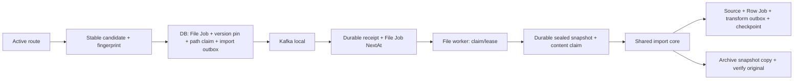

# M3.2 — Scan, snapshot, import, resume และ archive

ต่อจาก M-25/M-29/M-30/M-31 และเกณฑ์ M3.2 ใน `plan.md`; ใช้ Kafka local ที่ตรวจแล้ว ไม่รอ Q7 บริษัทก่อนพัฒนา งานนี้อยู่ภายใน Mapping ไม่เปลี่ยน contract ของ Informs หรือเพิ่ม API จากร่าง M1.2 ที่ยังรอ review

## ขอบเขตที่ผู้ใช้ยืนยัน (2026-11-17)

1. สแกนเฉพาะ active input routes ด้วย `PeriodicTimer`/`Directory.EnumerateFiles` ใน hosted service ของ Infrastructure ตาม D-77; เรียก use cases ผ่าน MediatR ไม่เพิ่ม Worker project
2. รับ File Job พร้อม version pin, path claim และ import outbox ใน transaction เดียว; snapshot/hash/content claim แยกจาก path claim ตาม M-25
3. Import consumer บันทึกผลรับ event และจัดคิว File Job ใน DB ก่อน commit offset; worker ประมวลผลจาก DB พร้อม lease/recovery แบบเดียวกับขอบเขต wake-up ของ M-31
4. ต่อ Excel `.xls` เข้ากับ `FileImportService` โดยใช้ reader เดียวกับ preview รวม fixture BIFF5/cp874 สมมติ 2,556 แถว; CSV/TSV/Fixed-width ใช้แกน M-29/M-30 ต่อ
5. Archive เป็น **สำเนา immutable จาก snapshot ที่นำเข้าจริง และคงไฟล์ใน input ไว้** รอบนี้ไม่ย้าย/ลบต้นฉบับ partner; ตรวจต้นฉบับเปลี่ยนแล้วแสดง `RecoveryRequired` โดยไม่กระทบ snapshot/Source เดิม ตามคำยืนยัน source batch และ M-32
6. ทดสอบ filesystem + PostgreSQL + Kafka จริง รวม crash/rollback/redelivery/หลาย scanner และตรวจ regression ทั้งระบบก่อนปิด M3.2

## เส้นทางการทำงาน



### รับและตรึง version

- อ่าน route พร้อม input path ที่เก็บตัวพิมพ์จริงจาก config; normalized path ใช้ตรวจ ownership/claim ไม่ใช้แปลง directory จริงบน Linux ให้เป็นตัวพิมพ์เล็ก
- รับเฉพาะ extension ของ pinned layout; ตรวจ relative path/containment ทั้งตอน activate และใช้งานจริง ปฏิเสธ rooted paths, drive/UNC, `..`, NUL และ symlink/reparse point ของส่วนประกอบ path; ไม่สแกน snapshot/archive ย้อนเข้า input
- ตรวจขนาด/mtime อย่างน้อยสองครั้งห่างตาม stability interval และตรวจ SHA-256/ขนาด/mtime ระหว่างอ่าน fingerprint; ไฟล์ที่เปลี่ยนหรือเปิดไม่ได้ยังไม่รับว่า stable และไม่สร้าง Source
- transaction lock ตาม control → config → File Job/claim; ตรวจ route ยัง active/version ตรงกับที่สแกนก่อนสร้าง job หากเปลี่ยนให้สแกนใหม่ ไม่ใช้ layout ล่าสุดแทนงานเก่า
- เก็บ accepted fingerprint ของ occurrence เพื่อกันการใช้ path เดิมที่ partner เขียนทับระหว่างรับกับ snapshot; `FileJob.CreatedAt` ใช้ DB clock และคงเดิมเมื่อ resume ตาม M-23/D-80
- path claim เดิมที่กำลังทำ/blocked/recovery ให้ใช้ File Job เดิม ไม่สร้างคู่แข่ง หลัง archive สำเร็จ claim ทำหน้าที่ชี้ occurrence ล่าสุด: fingerprint เดิมคืน AlreadyObserved; bytes เปลี่ยนจึงเปลี่ยน pointer ไป File Job ใหม่ใน transaction พร้อม pin ใหม่

### Import event และการจัดคิว

Body มี GUID non-empty เพียง 3 ตัว เช่น:

```json
{
  "fileJobId": "019a9000-0000-7000-8000-000000000101",
  "configVersionId": "019a9000-0000-7000-8000-000000000102",
  "sourceDefinitionVersionId": "019a9000-0000-7000-8000-000000000103"
}
```

- topic local `mapping.import.requested`, key = File Job ID, header `mapping-event-id` = ordered outbox ID เดิม; dispatcher validate topic/body/key และสร้าง canonical JSON แบบ allowlist เช่น M-31
- consumer ส่ง command ผ่าน MediatR; repository lock job/check lineage และบันทึก receipt เป็น append-only `mapping_audits` action สำหรับ file event โดย unique request identity มาจาก group/topic/partition/offset; เก็บ safe IDs/codes เท่านั้น ไม่เก็บ body/headers/exception text
- receipt และการตั้ง NextAt ครั้งแรก atomic ก่อน Kafka commit; duplicate coordinates/republish ไม่ reset backoff/lease/state; missing job/invalid header/schema/key/lineage บันทึก safe outcome แล้ว commit ส่วน DB ล้มเหลวต้อง seek/redeliver
- transform consumer/inbox ของ M-31 ใช้ต่อ ไม่ถือว่าการรับ import event คือ import หรือ transform สำเร็จ

### Snapshot, duplicate และ resume

- filesystem adapter อยู่ Infrastructure หลัง Application interface; roots มาจาก `Paths:InputRoot`, `Paths:SnapshotRoot`, `Paths:ArchiveRoot` และต้องไม่ซ้อนกัน; refs ที่ DB เก็บเป็น relative/generated refs ไม่รับ absolute ref จาก event
- worker claim File Job ด้วย work owner/epoch/until และ DB clock; work lease ครอบ snapshot/archive แยกจาก import lease เดิม เพื่อไม่ให้การ claim ของ `FileImportService` ชน lease ของตัวเอง; heartbeat/cancellation/finish ต้องตรวจ fencing token
- snapshot เขียน temporary file ต่อ job/epoch, flush ก่อน publish ชื่อ final แบบไม่ overwrite; ตรวจ bytes กับ accepted fingerprint และตรวจต้นฉบับซ้ำก่อน seal ใน DB; ไม่ import จาก input path โดยตรง
- seal snapshot/hash/size + insert content claim `(config_id,content_hash)` ใน transaction เดียว; hash ชน mark Duplicate พร้อม canonical File Job ID ไม่มี Source/Row Job/transform outbox ใหม่; content claim คงอยู่แม้ canonical job blocked
- snapshot ที่เขียนแล้วแต่ DB commit ไม่สำเร็จต้องตรวจ hash และนำกลับมาใช้/reconcile อย่างปลอดภัย ไม่ลบหลักฐานหรือปลอมว่า seal แล้ว; stale owner เขียน DB ไม่ได้และห้าม overwrite snapshot ที่ seal แล้ว
- import ใช้ pinned layout และ sealed snapshot เท่านั้น; resume จาก contiguous checkpoint เดิม, hash mismatch/invalid file เป็น Blocked หรือ RecoveryRequired พร้อม safe diagnostic; transient I/O/DB แยก retry ไม่ตีความเป็น Imported
- เชื่อม Excel validation ร่วมระหว่าง reader/validate/preview/import โดยคงกฎเดิม; ไม่เพิ่ม business defaults หรือแก้ Source ย้อนหลัง; capability ยังไม่แสดง delivery พร้อมจน M3.3/M4 ทำครบ

### Archive แบบสำเนาและการรับไฟล์ชื่อเดิม

- เมื่อ Imported หรือ Duplicate จึงบันทึก archive intent/ref จาก job ID/hash; copy จาก sealed snapshot ไป archive temp → flush → publish แบบไม่ overwrite → verify hash → บันทึกผล DB แบบ fenced; ไม่รอ HTTP delivery
- คงต้นฉบับ input ไว้ เนื่องจาก hash check ตามด้วย `File.Move(path)` คนละขั้นตอนไม่ได้พิสูจน์ว่า path ยังเป็นไฟล์เดิมเมื่อ partner เขียนทับ; รอบนี้ไม่มีคำสั่งลบ/ย้ายไฟล์บน share บริษัท
- ถ้าต้นฉบับยังตรง fingerprint ให้ ArchiveState = Archived และเก็บ path pointer เป็นหลักฐานกันสแกนไฟล์เดิมซ้ำ; ถ้า bytes เปลี่ยน/ไฟล์หายระหว่างทำงานให้ RecoveryRequired เก็บ snapshot/archive ที่ตรวจได้ และไม่แก้ต้นฉบับใหม่
- หลัง Archived เมื่อพบ stable bytes ใหม่ที่ path เดิม จึงรับเป็น occurrence ใหม่; ถ้า bytes เดิมแต่ rename เป็น path ใหม่ ให้มี metadata ของ Duplicate occurrence ตาม M-25 แล้ว archive สำเนา snapshot ของ occurrence นั้น โดยไม่สร้าง Source ใหม่
- archive มีอยู่แล้วแต่ process หยุดก่อนบันทึก DB ให้ตรวจ hash/ref เดิมแล้ว complete ซ้ำได้; archive ref/hash ผิดให้ RecoveryRequired ไม่ overwrite ไฟล์ที่มีอยู่; การ cleanup ต้นฉบับ/retention ต้องแยกตกลง ไม่แฝงไว้ใน scanner

## ตัวอย่างข้อมูลสมมติ

| เหตุการณ์ | ผลที่ต้องได้ |
|---|---|
| A/v1 รับ `partner/a.csv` bytes `ref\nTEST001\n` hash H1 | File Job F1 pin v1 → Source 1 แถว/Row Job 1/outbox 1 → archive สำเนา H1; ต้นฉบับคงเดิม |
| scanner สองตัวเห็น occurrence เดียวกัน | File Job/path claim ชุดเดียว; duplicate wake-up ไม่เพิ่ม Source/outbox |
| สแกน `a.csv` H1 ซ้ำหลัง Archived | AlreadyObserved ไม่เพิ่ม File Job หรือ Source |
| เปลี่ยนชื่อเป็น `b.csv` หรือ activate v2 แต่ hash ยัง H1 | Duplicate ชี้ F1 ไม่เพิ่ม Source ตาม M-25 |
| `a.csv` เปลี่ยนเป็น H2 หลัง F1 Archived | File Job ใหม่ pin active version ขณะรับ และอ่านทุกแถว |
| input เปลี่ยนหลัง seal F1 ก่อน archive | archive ของ F1 ยังเป็น H1; เก็บ input ใหม่ไว้และแสดง RecoveryRequired |
| หยุดหลัง commit Source แถว 1 ก่อนแถว 2 | resume F1 จาก checkpoint; แถว 1/outbox เดิมไม่เพิ่มซ้ำ |

## Configuration / local และ company

- `FileIntake.Enabled` default false; poll 5 วินาที, stability 10 วินาที, recovery grace 30 วินาที, work lease 120 วินาที/heartbeat 20 วินาที, retry delay 30 วินาที และ bounded candidates ต่อ poll เป็น technical defaults ที่ validate ได้ ไม่ใช่ business SLA
- เปิด intake ต้องมี roots ที่ตรวจได้และ messaging พร้อม; รองรับ environment variables ทุกค่า, import topic ต้องตรง producer/consumer/init; local ใช้ 3 partitions เช่น transform topic
- local compose เตรียม input mount สำหรับอ่าน และ snapshot/archive volumes ที่เขียนได้; script local เปิด intake เฉพาะเมื่อ caller ไม่ตั้งค่า และคืน env เดิม ส่วน company ไม่เปิดให้อัตโนมัติ/ไม่ apply migration/ไม่เตรียมหรือเปลี่ยน share บริษัท
- local `data/` และ artifacts ไม่เข้า git; credentials บริษัทไม่อยู่ใน image/config ตัวอย่าง; share permissions/access mode/durability และ Kafka บริษัทติดตาม Q7 ก่อน deployment

## Source batch ที่ผู้ใช้ยืนยันและ implement แล้ว

ทุก path ด้านล่างอยู่ใน `prjInsuranceValidationMapping`; ไฟล์/record ช่วยภายในให้อยู่ไฟล์ feature เดียวกันเมื่อไม่ได้เป็น entity/DTO แยกตามกฎ repo ไม่มีไฟล์ที่จะลบ:

| ส่วน | เพิ่ม | แก้ |
|---|---|---|
| Domain | `src/Mapping/Mapping.Domain/Repositories/FileJobs/IFileIntakeRepository.cs`, `Entities/Outbox/FileImportMessage.cs` | `Entities/FileJobs/FileJobs.cs`, `Entities/FileIntakeClaims/FileIntakeClaims.cs`, `Entities/MappingAudits/MappingAudits.cs` |
| Application intake | `src/Mapping/Mapping.Application/Intake/{FileIntakeOptions,IFileSnapshotStore,FileIntakeService}.cs`, `Intake/DTOs/{FileCandidate,FileWorkResult,FileScanResult}Dto.cs`, `Intake/Commands/{ScanInputFiles,ProcessFileJob,ReceiveFileImportMessage}Command.cs` | `DependencyInjection.cs` ของ Application |
| Shared import/validation | `src/Mapping/Mapping.Application/Input/ExcelInputLayoutValidator.cs` | `Application/Imports/FileImportService.cs`, `Application/Preview/PreviewService.cs`, `Infrastructure/Files/ExcelInputReader.cs`, `Application/Capabilities/Queries/GetCapabilitiesQuery.cs` |
| Infrastructure | `src/Mapping/Mapping.Infrastructure/Files/{FileStorageOptions,FileSnapshotStore}.cs`, `Repositories/FileIntakeRepository.cs`, `Messaging/{FileIntakeWorker,FileImportConsumer}.cs` | `Repositories/{FileImportRepository,ConfigLifecycleRepository}.cs`, `Messaging/{MessagingOptions,OutboxDispatcher}.cs`, `DependencyInjection.cs`, `Database/Configurations/FileJobs/FileJobsConfiguration.cs` |
| Migration | `src/Mapping/Mapping.Infrastructure/Migrations/20261117062250_AddFileIntakeRuntime.cs` และ `.Designer.cs` | `Migrations/MappingDbContextModelSnapshot.cs`; เพิ่ม accepted fingerprint/archive ref/work lease/index/check/immutable guards ใช้ตาราง claims/audits เดิม ไม่เพิ่มตาราง raw Source กลาง |
| Local config | — | `docker-compose.yml`, `scripts/up.ps1`, `.gitignore`, `.dockerignore`, `src/Mapping/Mapping.Api/appsettings.Local.json` |
| Tests | `tests/Mapping.IntegrationTests/Intake/{FileIntakeRepository,FileSnapshotStore,FileIntakePipeline,KafkaFileIntake}Tests.cs`, `tests/Mapping.IntegrationTests/Imports/ExcelFileImportTests.cs`, `tests/Mapping.UnitTests/Intake/FileIntakeOptionsTests.cs`, `tests/Mapping.UnitTests/Messaging/FileImportMessageTests.cs` | `tests/Mapping.IntegrationTests/Imports/{DelimitedFileImportTests,FixedWidthFileImportTests}.cs`, `tests/Mapping.IntegrationTests/Messaging/MessagingConfigurationTests.cs` |

ในแต่ละ layer path ที่ย่ออยู่ใต้ `src/Mapping/Mapping.<Layer>/`; ในแถว Shared import/validation คำ `Application/` และ `Infrastructure/` หมายถึง `Mapping.Application/` และ `Mapping.Infrastructure/` ตามลำดับ; brace notation เช่น `{A,B}.cs` หมายถึงไฟล์ `A.cs` และ `B.cs` แยกกัน ไม่เพิ่ม dependency ไป repo เอกสารหรือ Informs และไม่แตะ Web/demo source

ไฟล์เดิม `Messaging/KafkaOutboxPipelineTests.cs`, `Api/{MappingPreviewApiTests,MappingCatalogApiTests}.cs` และ `Input/ExcelInputReaderTests.cs` ที่อยู่ใน batch สำรวจไว้ ไม่ต้องแก้ source; ตรวจ regression ผ่านใน full gate แล้ว

### ไฟล์เพิ่มเติมที่ผู้ใช้ยืนยัน

- `src/Mapping/Mapping.Infrastructure/Repositories/SourceStorageRepository.cs`: full-fixture Excel test พบว่าการส่ง `DBNull.Value` เป็น raw parameter ที่ไม่ระบุชนิดทำให้ EF Core หยุดด้วย `The current provider doesn't have a store type mapping for properties of type 'DBNull'`; เสนอใช้ typed text parameter ของ Npgsql สำหรับ raw columns เพื่อรักษา SQL NULL ตาม D-07 โดยไม่แปลงเป็น empty string/เติม default
- ผู้ใช้ยืนยันเพิ่มไฟล์และแก้ NULL (2026-11-17) แล้ว: ใช้ `NpgsqlParameter` ที่มี `NpgsqlDbType.Text` สำหรับ raw columns รวมค่าที่เป็น NULL; ตรวจด้วย `ExcelFileImportTests.Biff5Pipeline_ShouldImportAll2556SyntheticRowsExactlyAsSharedReaderAndArchiveOriginalBytes` (fields ทั้ง 19 ตัว เทียบ SQL NULL กับ shared reader ราย cell)

## หลักฐานปิด M3.2 บน local (2026-11-17)

- migration `20261117062250_AddFileIntakeRuntime` เพิ่ม accepted fingerprint/work lease/archive ref/index/check และ immutable guards โดยใช้ตาราง claim/audit เดิม; build ผ่าน ไม่มีการ apply DB บริษัท
- `./scripts/check.ps1` ผ่าน build, unit **22/22**, integration **95/95** และ EF model check; M3.2 เพิ่ม **2 unit + 21 integration tests** (repository 5, filesystem 5, pipeline 6, Kafka 3, Excel 2); มี NU1903 ของ SSH.NET 2023.0.0 จาก Testcontainers รุ่นเดิม ไม่มี compile error
- PostgreSQL/temporary filesystem ตรวจ concurrent scanners, atomic receive/seal/content claim, stale route/pause, work/import fencing, path traversal/Windows junction, stability/bounded scan, snapshot/archive reconcile, original change, cancellation, Source/archive DB rollback และ duplicate hash ข้ามชื่อ/version/config แล้ว
- hosted Kafka pipeline ใช้ Excel BIFF5/cp874 (2 fields สมมติ 2,556 แถว), CSV และ Fixed-width ผ่าน directory → File Job/outbox → broker → consumer receipt → snapshot/import → Source/Row Job → archive รวม **2,560 แถว**; full-fixture อีกกรณีเทียบ **2,556 แถว × 19 fields** กับ shared reader ทุก cell รวม SQL NULL และเทียบ archive/input bytes เดิมผ่านแล้ว
- Kafka local `mapping.import.requested` มี **3 partitions / replication factor 1**, broker healthy, topic-init exit 0; compose syntax/PowerShell parse ผ่าน; mock Docker ยืนยัน script local เปิด default, รักษาค่า explicit false และคืน env ของ caller แล้ว
- import consumer DB rollback ไม่ commit offset/ไม่ตั้ง NextAt ก่อน durable receipt; หลัง DB recovery, republish และ rewind offset/restart ไม่ reset NextAt/row version/เพิ่มงานซ้ำ; poison schema/header/key/lineage/missing job เก็บ safe outcomes ไม่มี raw body/log ผ่านแล้ว
- ปิด M3.2 ในขอบเขต local ตาม M-32; work จบถึง raw Source/Row Job wake-up และ archive ไม่ใช่ผล transform/delivery; company share/Kafka/permissions/durability ติดตาม Q7 ก่อน deployment; source commit `9198a54` ใน repo Mapping บน develop (2026-11-17) ยังไม่ push; เอกสารยังไม่ commit

## เกณฑ์ตรวจและปิด M3.2

- intake จริงครบ Excel/Delimited/FixedWidth จาก directory → pinned File Job → Kafka wake-up → snapshot → raw Source/Row Job/transform outbox/checkpoint → archive copy โดยไม่ส่ง HTTP
- สอง scanners, activation/disable race, duplicate content ข้ามชื่อ/version, คนละ config และ updated bytes ที่ path เดิม มีผลตรง M-25 และไม่เปลี่ยน pin/CreatedAt ของงานเดิม
- เปลี่ยนไฟล์ระหว่าง stability/capture/seal/archive, invalid paths/symlinks, missing roots/permissions, storage/full/flush/publish failure ไม่ทำ Source/หลักฐานค้างครึ่งหนึ่งหรือย้ายต้นฉบับใหม่
- failure ก่อน/หลัง snapshot publish/DB seal, archive publish/DB complete และ Source commit, work/import lease expiry, cancellation/restart และ Kafka redelivery ต้อง resume ด้วย identity เดิมและ fence stale owner
- poison import event มี durable safe receipt ก่อน commit; broker/DB ล้มเหลวไม่ปลอมว่าสำเร็จ ไม่ส่ง raw fields ออก bus/log; disabled intake ไม่สร้าง hosted worker/เชื่อม filesystem เอง
- `./scripts/check.ps1` ผ่าน พร้อมหลักฐาน real PostgreSQL/Kafka/temporary filesystem และ MTLS fixture สมมติ; บันทึก M-32 และปรับ `data-runtime-design.md` ส่วน archive/path pointer ให้ตรงรูปแบบที่ผู้ใช้ยืนยัน; company deployment ยังรอ Q7 แต่ไม่ขวางการปิดงาน local ตามแนวทาง M3.1
