# M3.3 — Row transformation worker, durable outputs และ diagnostics

ต่อจาก M-31/M-32: transform consumer จัดคิว `row_jobs.next_at` แล้ว แต่ยังไม่มี worker ประมวลผล M3.3 ใช้ Source/config/schema/profile ที่ pin ไว้ และ compiler/evaluator เดียวกับ preview ตาม M-03/D-77

## ขอบเขตที่ผู้ใช้ยืนยันและทำแล้ว

1. เพิ่ม hosted row worker ที่ claim/recover งานด้วย DB clock/lease epoch; เรียก Application command ผ่าน MediatR ไม่เพิ่ม project หรือ public API
2. อ่าน raw Source ตาม registry/definition ที่เป็นเจ้าของจริง แล้ว compile/evaluate ด้วยโปรแกรมของ Config Version เดิม; ไม่อ่าน input file หรือ rebuild Source
3. เติม system envelope จาก job context ตรวจทุก output กับ pinned JSON Schema แล้วบันทึก encrypted Delivery Payload/Delivery Job/delivery outbox/row result ใน transaction เดียว
4. เพิ่ม Row Errors แบบ append-only พร้อม code/path/severity/stage/attempt โดยไม่เก็บ raw value หรือ exception text; แยก warning/business failure/contract failure/technical retry
5. ทำ encrypted-output storage ที่ M4.1 ต้องใช้ต่อให้พร้อมในรอบนี้ เพราะ `Transformed` ต้องหมายถึงมี durable outputs; typed Informs HttpClient/HTTP dispatch/delivery attempts/retry budget ยังเป็น M4.1/M4.2 และไม่ปิดตามไปด้วย
6. ตรวจกลไกบน local PostgreSQL/Kafka/temporary key store; การรับตรวจ schema `fileReceivedAt` ของ Informs จริงยังมี dependency T2.6 ตาม Q4/D-80 ไม่แก้ schema ของ Informs เอง

## ขั้นตอนการทำงาน

```mermaid
flowchart LR
    A[Transform event: IDs only] --> B[Inbox Receipt + Row Job NextAt]
    B --> C[Row worker: claim / recover + epoch]
    C --> D[Pinned raw Source + config / schema / profile]
    D --> E[Shared compiler / evaluator]
    E --> F[System envelope + final schema validation]
    F --> G[Encrypt final bytes]
    G --> H[DB transaction: Delivery Jobs + outbox + diagnostics + row result]
    H --> I[Delivery Pending: M4 processes later]
```



### Claim, fencing และ replay

- `Pending`/`RetryableFailed` ต้องมี NextAt ถึงเวลาแล้ว; งาน `Running` ที่ lease หมดและพ้น recovery grace จึง claim ใหม่ได้; claim เพิ่ม epoch/attempt count แบบ atomic และใช้ `FOR UPDATE SKIP LOCKED` เพื่อกันหลาย worker
- check owner/epoch/state/lease ก่อนบันทึกผล; worker เก่าที่ lease หมดต้องคืน LeaseLost/Discarded โดยไม่สร้าง outputs/diagnostics ใหม่
- ใช้ run timeout สั้นกว่า lease และตรวจ/renew lease ที่ขอบเขต load/evaluate/validate/encrypt/commit; cancellation และ dependency timeout ไม่ปลอมว่า Transformed และไม่ reset attempts
- งาน terminal ไม่ evaluate/encrypt ซ้ำ; publish ซ้ำ/offset เดิม/consumer restart ใช้ guard ของ M-31 ต่อ; durable outputs unique `(file_job_id,source_row_id,output_key)` และตรวจ lineage ด้วย FK ของ Row Job
- technical retry ใช้ backoff/เพดานเวลา delay ที่ตั้งผ่าน environment ได้; เป็นคนละ counter กับ delivery attempts สูงสุด 6 ครั้งของ M-08/M-20 ไม่ใช้การ claim transform เป็น HTTP attempt
- defaults ที่เสนอ: poll 1 วินาที, batch 32, concurrency ภายใน process 1, lease 120 วินาที, run timeout 60 วินาที, recovery grace 30 วินาที, retry delay 30 วินาที/สูงสุด 300 วินาที; ตรวจความสัมพันธ์ timeout/grace/lease ก่อนเริ่ม worker

### Pinned input และ shared evaluation

- resolve physical Source Table จาก definition UUID/catalog ภายใน Infrastructure เท่านั้น; validate identifiers และอ่าน raw columns ด้วย parameterized Source ID พร้อมตรวจ registry/File Job/Config Version/definition version ว่าตรงกัน
- compiler/evaluator เดิมเป็น authority; เพิ่ม reserved-system-path guard ใน compiler ที่ใช้ร่วมกันเพื่อปฏิเสธ config override แต่ไม่ hardcode business mapping ของ MTLS
- evaluation time = `FileJob.CreatedAt` เดิม; metadata filename = original filename เดิม; resume วันอื่นไม่เปลี่ยน `currentDate`/evaluationTime/filename ของงานนั้น
- preview ใช้ compiler/evaluator ชุดเดียวกันต่อไป ไม่เปลี่ยน route/DTO ของ Web ในรอบนี้; preview ที่ไม่มี pinned job context ยังคงคืน diagnostic สำหรับ expression ที่ต้องใช้เวลา/filename ไม่เดาเวลาปัจจุบันให้เอง
- generic engine รองรับ 0..N ตาม M-03; เสนอ optional pinned output policy ใน `EvaluationSemanticsJson`: `{ "outputPolicy": "oneDefault" }` สำหรับ config ที่ต้องมี output `default` หนึ่งรายการเสมอ ส่วน `{}` ใช้ generic 0..N เดิม; fixture MTLS ตั้ง oneDefault อย่างชัดเจน ไม่ตรวจ `if partner == MTLS`
- 0 outputs ที่ config อนุญาตเป็น Filtered/OutputCount 0; ถ้า oneDefault แต่ได้ 0/หลาย outputs/ชื่ออื่นเป็น Blocked พร้อม diagnostic ไม่ทิ้ง Source

### System envelope และ final contract

ระบบเติม root paths `contractVersion`, `fileJobId`, `sourceRowId`, `mappingConfigVersionId`, `outputKey`, `fileName`, `sourceRowNo`, `fileReceivedAt` จาก pinned job context ตาม D-23/D-44/D-80 ไม่อ่าน nSeq เป็นลำดับและไม่ให้ Transformation Program เขียนทับ

ตัวอย่างสมมติหลัง evaluate business fields:

```json
{
  "contractVersion": "pa-inform/1",
  "fileJobId": "019a9000-0000-7000-8000-000000000201",
  "sourceRowId": "019a9000-0000-7000-8000-000000000202",
  "mappingConfigVersionId": "019a9000-0000-7000-8000-000000000203",
  "outputKey": "default",
  "fileName": "synthetic.csv",
  "sourceRowNo": 2,
  "fileReceivedAt": "2026-11-17T06:00:00Z",
  "inform": { "partnerCode": "SYNTHETIC", "saleChannel": "FILE", "sourceReference": "TEST002", "transactionType": "NEW" }
}
```

- validate จาก schema bytes/hash ของ Contract Snapshot ที่ pin ไว้ ไม่ fetch latest แทนระหว่างประมวลผล; ใช้ JsonSchema.Net รุ่นเดียวกับ integration tests เดิมผ่าน Infrastructure adapter
- nullable conversion failure คง null/unparsed ใน encrypted payload ตาม D-04 พร้อม warning ที่ไม่คัด raw value; required/non-nullable หรือ final schema ไม่ผ่านให้ Blocked ทั้ง row ไม่มี partial Delivery Job แม้ output อื่นของ row จะผ่าน
- schema error เก็บ keyword/code/ปลายทางที่ปลอดภัยและ bounded เท่านั้น ไม่เก็บข้อความ error ที่แสดงค่าจริง; ขนาดโปรแกรม/payload/จำนวน outputs/diagnostics มี technical limits

### Dependency `fileReceivedAt` ที่พบจาก repo ปัจจุบัน

- D-80 และคำตอบ Dev 1 ใต้ Q4 ระบุว่า Informs เพิ่ม field นี้ใน T2.6 และต้อง deploy ก่อน Mapping ส่ง ขณะตรวจ 2026-11-17 schema ที่ `prjInsuranceValidationInforms/src/Informs/Informs.Api/Contracts/PaInform/pa-inform-1.schema.json` และ fixture ที่ pin อยู่ยังไม่ประกาศ field นี้ โดย root มี `additionalProperties: false`
- บันทึกหลักฐานใต้ Q4 ให้ Dev 1 ติดตาม T2.6; ไม่ตัด `fileReceivedAt` ออกเพื่อให้ผ่าน ไม่แก้ Informs/fixture contract จริงเอง และไม่ upgrade schema ของงานเดิมอย่างเงียบ ๆ
- ทดสอบ success ของกลไกกับ pinned **synthetic test schema** ที่รองรับ field ตาม D-80 และทดสอบ actual schema ปัจจุบันให้ได้ safe Blocked diagnostic; ผล synthetic ไม่ใช่หลักฐานว่าพร้อมส่ง Informs จริง
- worker ปิดโดย default และไม่เปิด local อัตโนมัติ เพื่อไม่ให้ Row Jobs ที่ pin schema รุ่นเก่าถูกประมวลผลโดยไม่ตั้งใจ; เมื่อ Informs T2.6 พร้อม ต้องใช้ schema/profile/version ที่รับรองตามขั้นตอน config ไม่เปิด changed-payload reprocess ตาม M-22

## Durable encrypted outputs และเส้นแบ่ง M4

- เพิ่ม `mapping.delivery_jobs` ตามแบบ M1.1: UUID v7, row/source/file/config/profile/contract identity, output key, immutable ciphertext/nonce/tag/key reference/plaintext hash และ Pending state; ยังไม่มี attempt หรือ inform ID
- เพิ่ม `mapping.row_errors` แบบ append-only พร้อม attempt/stage/code/path/severity/source-field reference; outcome และ OutputCount ของ row เปลี่ยนพร้อมกับ outputs/diagnostics ใน transaction เดียว
- encrypt final UTF-8 bytes ด้วย AES-256-GCM ตาม primitive ของ demo: random nonce ต่อ payload, authentication tag, key reference; เพิ่ม authenticated identity binding เพื่อให้ย้าย ciphertext ข้าม Delivery Job แล้วถอดไม่ได้; ห้าม plaintext fallback
- key สำหรับ local เป็นไฟล์ 32 bytes ใต้ `data/keys/` ที่ ignore อยู่แล้ว; script สร้างเฉพาะเมื่อผู้ใช้เปิด transformation อย่างชัดเจนและไม่มี key นั้น ห้าม overwrite key เดิม; compose mount key directory แบบ read-only และเก็บเพียง logical key reference/path configuration ใน appsettings
- key หาย/อ่านไม่ได้/ขนาดผิดต้องมี safe retry diagnostic โดยไม่สร้าง output; metadata/ciphertext ของงานที่ commit แล้ว immutable และ retry ภายหลังต้องอ่าน bytes/hash/key reference เดิม; key provisioning/rotation/retention ของบริษัทยังรอ Q7
- delivery outbox มี IDs-only `DeliveryMessage`, key = Delivery Job ID, header outbox ID เดิม; dispatcher รองรับ topic local `mapping.delivery.requested` และ topic init เตรียม 3 partitions; publish event ไม่เท่ากับส่ง HTTP และยังไม่มี delivery consumer ใน M3.3
- M4.1 ใช้ storage/crypto นี้ต่อเพื่อทำ typed HttpClient/response contract; M4.2 จึงเพิ่ม attempt reservations/backoff/budget/unknown outcome; ไม่มีการเรียก HTTP หรือเขียน `non_motor.*` ใน M3.3

## ตัวอย่างผลที่ต้องพิสูจน์

| เหตุการณ์ | ผล |
|---|---|
| Source A แปลงได้ 2 outputs | Delivery Jobs 2/outbox 2 + Transformed/OutputCount 2 commit พร้อมกัน |
| output แรกผ่าน แต่อันที่สอง schema ไม่ผ่าน | Blocked/OutputCount 0 พร้อม diagnostic; ไม่มี Delivery Job/outbox บางส่วน |
| null/unparsed ของ field nullable | Source เดิมคงอยู่; payload null/unparsed + warning และสร้าง intent ได้เมื่อ final schema ผ่าน |
| kill หลัง commit outputs ก่อน offset/event ถูกอ่านซ้ำ | พบ terminal row/identities เดิม ไม่ encrypt หรือสร้าง output ใหม่ |
| stale epoch กลับมาหลัง worker ใหม่ claim | owner เก่าเขียน row/errors/outputs/outbox ไม่ได้ |
| key หรือ lookup ล่ม | RetryableFailed/NextAt พร้อม safe code; ไม่มี plaintext/output ปลอมและแถวอื่นยังไปต่อ |
| schema เก่ายังไม่มี fileReceivedAt | Blocked พร้อม contract diagnostic; ไม่แอบเปลี่ยน schema/ละ field |

## Source batch ที่ผู้ใช้ยืนยัน

ทุก path อยู่ใน `prjInsuranceValidationMapping`; path ที่ย่อในแต่ละแถวอยู่ใต้ layer นั้น ไม่มีไฟล์ที่จะลบ:

| ส่วน | เพิ่ม | แก้ |
|---|---|---|
| Domain | `src/Mapping/Mapping.Domain/Repositories/RowJobs/ITransformJobRepository.cs`, `Entities/RowErrors/RowErrors.cs`, `Entities/DeliveryJobs/DeliveryJobs.cs`, `Entities/Outbox/DeliveryMessage.cs` | `Entities/RowJobs/RowJobs.cs` |
| Application | `src/Mapping/Mapping.Application/RowTransformation/{RowTransformationOptions,RowTransformationService,IContractPayloadValidator}.cs`, `RowTransformation/DTOs/{RowTransformResult,RowDiagnostic}Dto.cs`, `RowTransformation/Commands/RunRowTransformationCommand.cs`, `Delivery/IPayloadProtector.cs` | `DependencyInjection.cs`, `Transformation/TransformationCompiler.cs`, `Capabilities/Queries/GetCapabilitiesQuery.cs` |
| Infrastructure | `src/Mapping/Mapping.Infrastructure/Repositories/TransformJobRepository.cs`, `Messaging/RowTransformationWorker.cs`, `Contracts/ContractPayloadValidator.cs`, `Delivery/{PayloadProtectionOptions,FilePayloadProtector}.cs`, `Database/Configurations/{RowErrors/RowErrorsConfiguration,DeliveryJobs/DeliveryJobsConfiguration}.cs` | `DependencyInjection.cs`, `Database/MappingDbContext.cs`, `Database/Configurations/RowJobs/RowJobsConfiguration.cs`, `Messaging/{MessagingOptions,OutboxDispatcher}.cs`, `Mapping.Infrastructure.csproj` |
| Migration | `src/Mapping/Mapping.Infrastructure/Migrations/20261117081518_AddRowTransformationOutputs.cs` และ `.Designer.cs` | `Migrations/MappingDbContextModelSnapshot.cs`; เพิ่ม tables/FKs/unique/index/checks/immutable guards และ row lease/terminal result guards |
| Config/local | — | `docker-compose.yml`, `scripts/up.ps1`, `src/Mapping/Mapping.Api/appsettings.Local.json`; key files อยู่ ignored data/ ไม่ commit secret และ company ไม่ auto-provision/เปิด worker |
| Unit tests | `tests/Mapping.UnitTests/RowTransformation/{RowTransformationOptionsTests,RowJobsTests}.cs`, `tests/Mapping.UnitTests/Messaging/DeliveryMessageTests.cs` | `tests/Mapping.UnitTests/Transformation/{TransformationProgramTests,TransformationExtendedTests}.cs` เฉพาะ shared guards ที่เกี่ยว |
| Integration tests | `tests/Mapping.IntegrationTests/RowTransformation/{TransformJobRepositoryTests,RowTransformationPipelineTests,PayloadProtectionTests,KafkaRowTransformationTests,MtlsRowTransformationTests}.cs` | `tests/Mapping.IntegrationTests/Database/MappingCatalogTests.cs`, `Messaging/{MessagingConfigurationTests,KafkaOutboxPipelineTests}.cs`, `Intake/FileIntakeRepositoryTests.cs` (test helper/config เท่านั้น), `Api/MappingPreviewApiTests.cs` (guard regression เท่านั้น) |

`JsonSchema.Net` เพิ่มใน Infrastructure รุ่น 7.2.3 ตาม test project เดิม; ไม่มี project reference ไป Informs/demo และไม่เปลี่ยน public API/DTO/Web/contract ของ Informs

รายการนี้เป็นขอบเขตที่อนุญาต ไม่จำเป็นต้องแก้ทุกไฟล์ในคอลัมน์แก้: รอบนี้ไม่เปลี่ยน `TransformationExtendedTests.cs`, `KafkaOutboxPipelineTests.cs` และ `MappingPreviewApiTests.cs` เพราะ regression เดิมใช้ได้โดยไม่แก้ ส่วน metadata การเข้ารหัสใช้ typed columns `payload_nonce bytea` 12 bytes, `payload_tag bytea` 16 bytes, `encryption_version integer` 1 และ `key_reference varchar(128)` แทน JSON ตาม M-33

## หลักฐานการตรวจ local (2026-11-17)

- `./scripts/check.ps1` ผ่าน build Release, unit **27/27**, integration **113/113** และ EF model check; M3.3 เพิ่ม unit 5 + integration **18**: repository 4, crypto 2, pipeline 10 (รวม stale owner หลัง encrypt และ program/payload limits), Kafka 1 และ full MTLS 1; ไม่มี failing/skipped test
- source เพิ่ม/แก้ **46 ไฟล์** ใน repo Mapping บนฐาน `9198a54`; commit `7014c83` (`feat(mapping): add durable row transformation and encrypted outputs`) บน develop แล้วตามคำสั่งผู้ใช้ ยังไม่ push; มี NU1903 เดิมของ SSH.NET 2023.0.0 ซึ่งมาจาก test dependency และไม่ได้เปลี่ยนในรอบนี้
- fixture สังเคราะห์ hash `CDF70EFDB67641764995D525D97FCB9752F01441CFD9F586A2AD558DD6C29E99` ผ่าน actual import → Source/Row Jobs → transform → encrypted Delivery Jobs **2,556/2,556**, output key `default` หนึ่งรายการต่อแถว, cancelled 3 แถวมี null/unparsed และ short ID 11 หลัก 2 แถวคงค่าเดิม; ทดสอบโดย pin synthetic schema ที่รองรับ D-80 ชัดเจน ไม่ใช่หลักฐานว่า Informs จริงยอมรับแล้ว
- real Kafka ทดสอบ IDs-only wake-up → worker สองตัว → encrypted intents/delivery outbox → bus event; replay ที่ offset ใหม่และ worker restart ไม่เพิ่ม outputs หรือเปลี่ยน ciphertext/RowVersion ของ terminal result
- ตรวจ script ด้วย mock Docker: transformation ปิดไม่สร้าง key; เปิดอย่างชัดเจนสร้าง key 32 bytes ครั้งเดียว; รันซ้ำ hash เดิมและคืนค่า environment ของผู้เรียก; compose syntax ผ่าน และ topic local `mapping.delivery.requested` มี **3 partitions**, init exit **0**
- `RowTransformation.Enabled` คง false โดย default; ไม่ provision key บริษัท ไม่ migrate DB บริษัท และไม่มี HTTP sender/delivery attempt ในรอบนี้; acceptance ของ Informs ยังรอ T2.6/Q4 และ company dependencies รอ Q7
- ตรวจ `git diff --check` ผ่าน ไม่มี workspace path dependency ที่เพิ่มใน source/test/script ไม่มี connection/credential บริษัทในไฟล์ที่เปลี่ยน และ Informs/Web working tree สะอาด; `scripts/up.ps1` มีชื่อ repo Informs ใน comment เดิม ไม่ใช่ runtime dependency ใหม่

## เกณฑ์ตรวจและการปิดงาน

- real PostgreSQL: atomic claim/completion, 0/1/N outputs, duplicate logical key, row-count reconciliation, stale epoch/lease expiry/grace/renew/cancel/restart; force rollback ที่ errors/outputs/outbox แล้วไม่มี partial result
- pinned Source/config/schema/profile/context ไม่เปลี่ยนเมื่อ activate/disable config หรือ clock ผ่านวันใหม่; business null/unparsed ไม่ทิ้งแถวและ fatal output หนึ่งรายการไม่ commit outputs อื่นของ row
- AES round-trip/hash เดิม, tamper/wrong key/wrong identity, missing key และ restart หลัง commit; ค้น persisted rows/outbox/diagnostic/log ไม่พบ synthetic PII marker นอก Source และ encrypted payload ที่ถอดด้วย key ทดสอบ
- Kafka → wake-up → worker → encrypted outputs/outbox บน local; duplicate/redelivery/หลาย worker ไม่เพิ่ม Source/output; ไม่เรียก HTTP และไม่อ้าง Delivered
- current Informs schema ที่ยังขาด fileReceivedAt ต้องมี regression ที่แสดง Blocked; success fixture ระบุชัดว่าเป็น synthetic schema รองรับ D-80; เก็บ T2.6/Q4 เป็น dependency ก่อนรับตรวจ Informs จริง
- `./scripts/check.ps1` ผ่าน และอัปเดต plan/M-33/แบบข้อมูลตาม implementation; company key/Kafka/share และ acceptance ที่ยังรอไม่ถือว่าพร้อมเพราะผล local
