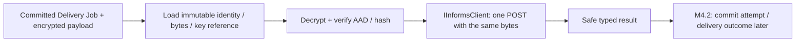

# M4.1 — Typed Informs HTTP client และการส่ง durable payload bytes

## ขอบเขตที่ผู้ใช้ยืนยันและทำแล้ว

M3.3 commit `7014c83` มี encrypted Delivery Jobs, payload hash/key reference, immutable identity และ delivery outbox แล้วตาม M-33 รอบนี้ทำส่วน typed Informs HttpClient ของ M4.1 ให้ส่ง final UTF-8 bytes เดิมและแปล response ตาม [contract §4](contract-pa-inform.md) ที่ตรงกับ `PaInformsController` ใน repo Informs ปัจจุบัน

- เพิ่ม Application interface/typed result และ Infrastructure HTTP adapter ตาม D-77; 1 invocation ส่ง POST หนึ่งครั้งไป `/api/pa/informs` ด้วย `Content-Type: application/json` ไม่มี retry handler/redirect หรือ serialize payload ใหม่
- ทดสอบว่า bytes/hash/idempotency identity ที่ส่งมาจาก encrypted Delivery Job ที่ commit แล้ว ไม่อ่าน raw Source หรือ compile program ใหม่เพื่อส่งซ้ำตาม D-44
- ส่ง 1 request ต่อ 1 output/inform ตาม contract; จำนวน outputs ไม่รวมเป็น batch request
- คง HTTP sender worker/consumer, attempt reservations/ledger, retry scheduling, global concurrency/pause และ lease recovery ไว้ใน M4.2; ไม่มี endpoint หรือ hosted service เรียกส่งจาก production ใน M4.1 เพื่อไม่ข้ามเพดาน M-07/M-08/M-20
- ค่า capability ของ destination ยัง false เพราะยังไม่มี durable delivery runner ครบวงจร แม้ HTTP adapter พร้อมแล้ว; ไม่ mark Delivery Job เป็น Delivered ด้วยการเรียก adapter โดยตรง
- ทดสอบ client กับ HTTP stub บน loopback และ PostgreSQL/Testcontainers ด้วยข้อมูลสังเคราะห์; ไม่ส่งข้อมูลเข้า Informs บริษัท ไม่แก้ Informs/Web/demo และไม่แก้ DB บริษัท

## Interface และความรับผิดชอบ

| ส่วน | รับ / คืน | สิ่งที่ซ่อนไว้ |
|---|---|---|
| `IInformsClient.SendAsync` | final payload bytes ที่ caller โหลดจาก durable output + CancellationToken → `InformsDeliveryResultDto` | HTTP request/response, bounded parsing, timeout, safe outcome codes; ไม่รับ URL จาก payload/config ที่ browser ส่งมา |
| `IPayloadProtector` เดิม | encrypted identity/bytes → verified plaintext bytes | AES-GCM authentication/AAD/hash ตาม M-33; caller zero plaintext buffer หลังส่งเสร็จ |
| delivery runner (M4.2) | durable Delivery Job/attempt identity → durable result | claim/global budget/reserve attempt ก่อน HTTP, โหลด pinned output/profile, decrypt, เรียก client ครั้งเดียว, fenced commit outcome/next-at; ยังไม่ implement รอบนี้ |

Typed result มี outcome/code, HTTP status เมื่อมี response, `informId` / `existingInformId`, `replayed` / `replaced` และ `retryNotBefore` เมื่ออ่าน Retry-After ได้ ไม่มี body/messageText/exception text/URL/header อิสระ ทั้งผลลัพธ์และ exception ที่ adapter สร้างต้องไม่คัดค่าจาก payload หรือ response

Adapter เป็นส่วนส่ง HTTP ภายใน ไม่ใช่หลักฐาน durable reservation ด้วยตัวเอง: caller ของ runtime ต้องเป็น runner ของ M4.2 เท่านั้น ห้ามเพิ่ม manual-send API ที่เรียก adapter ข้าม attempt ledger การทดสอบรอบนี้เรียก adapter โดยตรงกับ stub เพื่อพิสูจน์ transport contract และตรวจว่า DB state ไม่เปลี่ยนจากการเรียกนั้น

## ตัวอย่างข้อมูลสมมติและเส้นทาง bytes



ตัวอย่าง decrypted bytes ที่เก็บไว้ก่อนส่ง (IDs และ reference สมมติ):

```json
{"contractVersion":"pa-inform/1","fileJobId":"019a9000-0000-7000-8000-000000000201","sourceRowId":"019a9000-0000-7000-8000-000000000202","outputKey":"default","mappingConfigVersionId":"019a9000-0000-7000-8000-000000000203","fileReceivedAt":"2026-11-17T06:00:00Z","inform":{"partnerCode":"SYNTHETIC","saleChannel":"FILE","sourceReference":"TEST002","transactionType":"NEW"}}
```

สมมติ ciphertext ของ D1 ถูก commit พร้อม hash H1 แล้ว: decrypt D1 → bytes B1 → HTTP body B1; caller ทดสอบส่ง B1 รอบสองกับ stub ที่ตอบ replay ต้องได้ body/hash/key เดิมทุก byte รวม whitespace/ลำดับ properties/ภาษาไทย/ทศนิยม ไม่ serialize เป็น request DTO ใหม่ ไม่เพิ่ม field `informId` ใน request และไม่สร้าง idempotency header อีก key ชุดใหม่ (key อยู่ใน body ตาม contract)

## การแปล response

อ่าน `BaseResponse` ตาม D-61 ไม่ใช้ ProblemDetails เป็นรูปแบบหลัก: หลักฐานคือ `PaInformsController.ReceiveInform`, records `ReceivePaInformResponse` / `DuplicateInformResponse` และ [contract §4](contract-pa-inform.md) ใน repo ปัจจุบัน ไม่อ้าง template error pattern เก่าแทน controller จริง

| HTTP / body | ผล client | สิ่งที่ห้ามตีความ |
|---|---|---|
| 201, success true, informId UUID ไม่ว่าง, replayed false, replaced ไม่เป็น true | Created / accepted | ไม่ใช่ business validation ผ่านแล้ว |
| 200, success true, informId, replayed true, replaced ไม่เป็น true | Replayed / accepted | ไม่สร้าง payload หรือ key ใหม่ |
| 200, success true, informId, replayed false, replaced true | Replaced / accepted | ไม่รวมกับ conflict 409 |
| 400 | ContractRejected / rejected | ไม่ auto retry และไม่คัด messageText ที่อาจมี raw value; field-level inspection/history เป็น M4.3 |
| 409, success false, known DUPLICATE_SOURCE_REFERENCE และ existingInformId UUID ไม่ว่าง | DuplicateRejected / rejected พร้อม existingInformId | ไม่ถือว่า delivered ของ output นี้ และไม่ retry |
| 429 | Throttled / retryable พร้อม retryNotBefore ถ้า header ใช้ได้ | adapter ไม่หน่วงแล้วส่งซ้ำเอง; M4.2 ต้องเคารพ Retry-After |
| 5xx | TransientFailure / retryable | body อาจเป็น HTML จาก proxy ไม่บังคับ BaseResponse และไม่เก็บ raw body |
| timeout / connection error | UnknownOutcome พร้อม fixed safe code | ห้ามอ้างว่า Informs ยังไม่ได้รับ; runtime ต้องใช้ durable attempt/bytes/key เดิมใน M4.2 |
| 200/201 แต่ body ผิด/ขาด/เกินขนาด หรือ flags ขัดกัน | UnknownOutcome / InvalidResponse | ห้ามบอก Delivered เมื่อยืนยัน informId/ผลรับไม่ได้ |
| 409 malformed, 3xx, 401/403 หรือ status อื่นที่ contract ไม่รองรับ | blocked/permanent technical outcome ตาม safe code | ไม่ follow redirect ไม่ retry auth/endpoint/config error อัตโนมัติ |

Response parsing จำกัดไม่เกิน 64 KiB ทั้ง Content-Length และ streamed response, JSON depth/จำนวนที่ต้องอ่านมีเพดาน ไม่เก็บ arbitrary server messages; ยอมรับเฉพาะ JSON response สำหรับ success/typed duplicate และตรวจ property types/required flags/UUID/duplicate critical properties ก่อนอ้าง accepted

`Retry-After` รับ delta-seconds หรือ HTTP-date คำนวณจาก TimeProvider ที่ inject เพื่อทดสอบได้; header หาย/ผิดคืน null ให้ M4.2 ใช้ backoff ส่วน header ที่ใช้ได้ต้องไม่ถูกลดเวลารอจนส่งก่อนกำหนด Caller cancellation ต้อง propagate; client-owned timeout ครอบคลุมทั้งส่ง request และอ่าน response body โดยไม่รอ stream ค้างไม่มีกำหนด

## Transport และ configuration

- ใช้ typed `HttpClient` ผ่าน DI (`Microsoft.Extensions.Http` รุ่น 10.0.15 ตามชุด Microsoft.Extensions ปัจจุบัน) ไม่มี Polly/resilience retry pipeline; ปิด automatic redirect และ cookie reuse
- ใช้ `Informs.BaseUrl` / `TimeoutSeconds` เดิม เพิ่ม `MaxResponseBytes` default 65536; ตรวจ URI http/https ที่ไม่มี userinfo/query/fragment และ limits ก่อนส่ง BaseUrl ว่างยังเปิด API/catalog แบบ offline ได้ แต่การเรียก client คืน NotConfigured โดยไม่ส่ง HTTP
- timeout default 30 วินาที มีเพดานและตรวจค่าผิด; ไม่ย้าย URL/auth/token ไป Transformation Program หรือ message, ไม่ log payload/response body และไม่ปิด certificate validation
- company URL/auth/TLS ที่ยังไม่มีข้อสรุปอยู่ Q7 ไม่มีการเดา auth scheme หรือใส่ token ใน appsettings/Compose รอบนี้
- ไม่มี migration/การเปลี่ยน ciphertext/Source/config snapshot หรือ delivery state ใน M4.1; plaintext ที่ถอดใน tests ใช้ชั่วคราวและล้างเมื่อส่งเสร็จ

## Dependency `fileReceivedAt` / T2.6

ตรวจ read-only รอบนี้แล้ว repo Informs ปัจจุบันยังไม่มี field นี้ใน schema/DTO ตามข้อสังเกต Q4/M-33 จึงยังไม่อ้าง actual Mapping → Informs acceptance แม้ typed response/client tests ผ่าน

- ทดสอบ durable M3.3 → decrypt → HTTP stub โดยระบุ synthetic schema ที่รองรับ D-80 เหมือน M3.3
- เก็บ regression actual schema เก่าให้ Blocked ตามเดิม ไม่ตัด field ออกจาก bytes ไม่ recompile/แก้ hash/pinned schema เพื่อให้ส่งผ่าน
- เมื่อ Dev 1 ทำและ deploy T2.6 พร้อมแล้วจึงตรวจ contract version ใหม่ที่ถูก pin กับ Informs จริงใน M4.4; ผล client stub รอบนี้ไม่ปิด Q4/Q7

## Source batch ที่ผู้ใช้ยืนยัน

ทุก path อยู่ใน `prjInsuranceValidationMapping`; ไม่มีไฟล์ลบ:

| การทำ | ไฟล์ | จุดประสงค์ |
|---|---|---|
| เพิ่ม | `src/Mapping/Mapping.Application/Delivery/IInformsClient.cs` | transport seam รับ final bytes ส่งหนึ่งครั้ง |
| เพิ่ม | `src/Mapping/Mapping.Application/Delivery/InformsDeliveryOutcome.cs` | typed outcomes สำหรับ runner ใช้ต่อ |
| เพิ่ม | `src/Mapping/Mapping.Application/Delivery/DTOs/InformsDeliveryResultDto.cs` | safe result ไม่มี response body/raw messages |
| เพิ่ม | `src/Mapping/Mapping.Infrastructure/Informs/InformsClient.cs` | exact bytes HTTP POST, bounded strict parsing, timeout/cancellation/Retry-After |
| แก้ | `src/Mapping/Mapping.Infrastructure/Informs/InformsOptions.cs` | configuration/URI/timeout/response limits ใช้กับ delivery โดยไม่ทำให้ offline catalog เปิดไม่ได้ |
| แก้ | `src/Mapping/Mapping.Infrastructure/DependencyInjection.cs` | typed client/primary handler registration ไม่มี retry/redirect/cookie sharing |
| แก้ | `src/Mapping/Mapping.Infrastructure/Mapping.Infrastructure.csproj` | Microsoft.Extensions.Http 10.0.15 |
| แก้ | `src/Mapping/Mapping.Application/Capabilities/Queries/GetCapabilitiesQuery.cs` | อธิบาย adapter พร้อมแต่ delivery runner ยัง pending โดย capability ไม่เปิดเอง |
| แก้ | `src/Mapping/Mapping.Api/appsettings.Local.json` | response size limit ของ local ไม่ใส่ secret หรือเปิด sender |
| เพิ่ม | `tests/Mapping.UnitTests/Informs/InformsOptionsTests.cs` | URI/timeout/size limits และ offline configuration |
| เพิ่ม | `tests/Mapping.IntegrationTests/Delivery/InformsClientTests.cs` | status/response matrix, UTF-8 bytes, timeout/cancel/no retry/no redirect/response limits/Retry-After |
| เพิ่ม | `tests/Mapping.IntegrationTests/Delivery/DurablePayloadHttpTests.cs` | actual committed encrypted output → decrypt → exact HTTP bytes/replay, DB snapshot/state ไม่เปลี่ยน |
| เพิ่ม | `tests/Mapping.IntegrationTests/Delivery/InformsHttpStub.cs` | loopback HTTP stub ใช้เฉพาะ tests ไม่ใช่ fake Informs ที่อ้าง acceptance จริง |

M4.1 ไม่แก้ Domain/DB/migrations/worker/consumer/Compose หรือ repository ของ Informs ถ้าจำเป็นต้องเพิ่ม source นอกชุดนี้ให้แจ้งไฟล์และขอยืนยันเพิ่มก่อน

ชุดที่ทำจริงมี **12 ไฟล์** จากขอบเขตที่อนุญาต 13 ไฟล์: ไม่สร้าง `tests/Mapping.UnitTests/Informs/InformsOptionsTests.cs` เพราะ unit project อ้างเฉพาะ Application/Domain ส่วน InformsOptions อยู่ Infrastructure; ตรวจ options/offline configuration ใน `InformsClientTests.ConfigurationAndCancellation_ShouldWorkOfflineAndRejectUnsafeEndpointsOrLimits` แทน โดยไม่เพิ่ม project reference ข้ามขอบเขต source batch

## หลักฐานการตรวจ local (2026-11-17)

- `./scripts/check.ps1` ผ่าน **build Release, unit 27/27, integration 124/124 และ EF model check** ไม่มี failed/skipped test; M4.1 เพิ่ม integration 11 ข้อ ไม่มีการเพิ่ม unit ที่อ้าง Infrastructure หรือเปลี่ยน model/migration
- build Infrastructure Release ผ่าน ไม่มี compile error; ชุดทดสอบที่ filter `FullyQualifiedName~Delivery` ผ่าน **13/13** โดยเป็น M4.1 ใหม่ **11** ข้อ (HTTP client 8 + durable payload HTTP 3) และ regression เดิม 2 ข้อ
- HTTP loopback ตรวจ status matrix ตาม controller จริง, strict types/UUID/flags/duplicate critical properties, streamed/Content-Length size limit/media type/depth/empty response, Retry-After delta/date, 5xx/HTML/auth/redirect/unexpected status, timeout ของ headers/body/caller cancellation และ cookies; แต่ละ invocation ส่ง POST ครั้งเดียว ไม่มี redirect/transport application retry
- PostgreSQL ทดสอบ commit encrypted intent ก่อน HTTP, load ผ่าน DbContext ใหม่หลังเปลี่ยน/disable config แล้ว request bytes/hash/identities เดิมเมื่อ replay; ciphertext/key reference/RowVersion/Delivery Pending/จำนวน Source/output/outbox ไม่เปลี่ยนจากการเรียก adapter; ไม่อ้าง Delivered เพราะยังไม่มี durable attempt runner
- key หาย, ciphertext ถูกแก้ หรือ identity ผิดทำให้ decrypt ไม่ผ่านก่อนมี HTTP request; actual contract fixture ที่ยังไม่มี fileReceivedAt ยังคง ContractMissingFileReceivedAt/Blocked และไม่มี intent/HTTP; success path ใช้ synthetic D-80-capable schema ตาม M-33 ชัดเจน
- ส่งด้วย ReadOnlyMemoryContent โดยไม่ทำ request JSON DTO/serialize ซ้ำ, response default 65536 bytes (ตั้งได้ 1..1048576), request guard 1..4194304 bytes ตามเพดาน engine, JSON depth 16, timeout 1..300 วินาทีครอบคลุม headers/body; response buffer และ caller plaintext ใน tests ถูกล้างหลังใช้
- ตรวจ whitespace และไฟล์ source ใหม่/แก้แล้วไม่มี workspace path dependency/connection marker บริษัท; repo Informs/Web ไม่มีการแก้ไข; ไม่มี secret/runtime data/new DB migration และไม่มี hosted delivery worker/API/consumer เพิ่ม
- source รวมกับ M4.2 ใน commit `aca67c6` (`feat(mapping): add durable Informs delivery and bounded retries`) และ push develop แล้ว 11-18; การรับตรวจกับ Informs จริงยังรอ T2.6/Q4 และ dependency บริษัท Q7; NU1903 เดิมของ SSH.NET 2023.0.0 เป็น test dependency ที่ไม่ได้เปลี่ยนในงานนี้

## เกณฑ์ตรวจและการปิดงาน

1. Typed success 201/200/replayed/replaced กับ 400/409 ตรง response ที่ยืนยันจาก controller จริง; malformed/oversized/ambiguous response ไม่มี false Delivered และผลลัพธ์/log ไม่มี canary PII/ข้อความอิสระจาก response
2. 429 delta/date Retry-After, 5xx/HTML, 401/403/3xx/unexpected success, timeout/header/body stall และ caller cancellation ผ่าน; ต่อ invocation มี POST ไม่เกินหนึ่งครั้งและไม่ follow redirect
3. PostgreSQL + HTTP loopback ยืนยัน payload commit ก่อนส่ง, hash/idempotency/body bytes เดิมเมื่อ replay, config ล่าสุดไม่เปลี่ยน payload เดิม และ missing/tampered key/payload ไม่ส่ง HTTP
4. Default ไม่มี hosted delivery runner/endpoint/automatic dispatch; เปิดดู catalog แบบไม่มี BaseUrl ได้และ capability ยังไม่อ้างส่งจริงพร้อม
5. `./scripts/check.ps1` ผ่าน พร้อมอัปเดต plan/M-34/หลักฐาน; แยกข้อจำกัด Informs T2.6/Q4 และ deployment บริษัท Q7 ชัดเจน ไม่ปิด M4.2/M4.4 หรือ commit/push โดยไม่มีคำสั่ง
