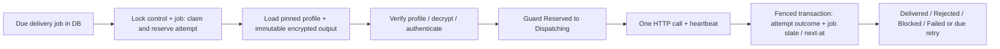

# M4.2 — Durable delivery attempts, retry และ lease recovery

## ขอบเขตที่ผู้ใช้ยืนยันและทำแล้ว

ต่อจาก M-33/M-34: encrypted Delivery Jobs มี final bytes/hash/key reference และ NextAt แล้ว ส่วน `IInformsClient` ส่ง HTTP ครั้งเดียวและคืน safe typed result รอบนี้เชื่อมด้วย durable delivery runner ตาม M-07/M-08/M-20/D-44 และ [แบบข้อมูล §8.5–8.6](data-runtime-design.md)

- เพิ่ม attempt ledger, claim/global concurrency budget, dispatch guard, heartbeat/fencing, durable completion/backoff/Retry-After และ recovery เมื่อ worker หยุด
- กำหนดเพดานตายตัว **6 reservations ต่อ Delivery Job** รวมครั้งแรก ไม่ใช่ retry เพิ่มอีก 6; counter ลด/reset ไม่ได้ ไม่มี attempt 7 แม้ restart/หลาย pod/งานซ้ำ
- เพิ่ม hosted worker แบบ DB polling และ MediatR command; เปิดด้วย Delivery.Enabled อย่างชัดเจนเท่านั้น ค่าเริ่มต้น false ไม่เปิดจาก scripts/up.ps1 อัตโนมัติ
- ใช้ encrypted intent/typed HTTP client เดิม ไม่แก้ payload/Source/config pin ไม่เพิ่ม retry handler และไม่เรียก HTTP ใน DB transaction
- API ดู log/summary/inspection/manual retry/pause controls ยังเป็น M4.3; M4.2 เคารพค่าที่ persist ใน delivery_controls แต่ไม่เพิ่ม action API หรือสิทธิ์ใหม่เอง
- ทดสอบกับ PostgreSQL/Kafka regression/HTTP loopback และข้อมูลสังเคราะห์; actual Informs acceptance/restart หลังรับจริงยังเป็น M4.4 และรอ T2.6/Q4; DB/URL/auth/TLS/key บริษัท Q7 ยังต้องเตรียมแยก

## Job source และการทำงานของ worker

Delivery Job ถูกสร้างพร้อม NextAt ใน row transaction ของ M-33 จึงใช้ **DB เป็นแหล่งงานที่ต้องส่ง** โดย polling งาน Pending/RetryableFailed ที่ถึงเวลา และ Sending ที่ lease หมดพร้อมพ้น grace ไม่ต้องรอ Kafka delivery event เพื่อเริ่มหรือกู้คืน

delivery outbox/topic ของ M3.3 คงรูปแบบ IDs-only เดิม ใช้แจ้งว่ามี durable intent แต่ไม่ใช่ตัวควบคุม attempt ไม่มี DeliveryConsumer ในรอบนี้ เพื่อไม่ให้ broker redelivery เปลี่ยน NextAt/backoff หรือสร้าง attempt นอก claim transaction การพัก/ล่มของ broker ไม่ทำให้งานที่ commit แล้วหายจาก DB sweep

default poll 1 วินาที, batch 32, local concurrency 1, lease 120 วินาที, heartbeat 20 วินาที, recovery grace 30 วินาที, run timeout หลัง claim 60 วินาที และใช้ Informs timeout 30 วินาทีของ M4.1; validate heartbeat < ครึ่ง lease, HTTP timeout < run timeout และ run timeout + grace < lease ค่าเหล่านี้เป็น technical settings ไม่ใช่ SLA

## ข้อมูลและ state ที่เพิ่ม

| ส่วน | ข้อมูล/กติกา |
|---|---|
| DeliveryJobs เดิม | เพิ่ม attempts_reserved, lease_owner/epoch/until, inform_id/existing_inform_id, replayed/replaced, last_outcome_code/last_http_status; counter/epoch monotonic, Delivered ต้องมี informId, terminal auto states ไม่ claim ซ้ำ; encrypted identity/payload ของ M-33 ยังคง immutable |
| DeliveryAttempts ใหม่ | UUID v7, delivery_job_id FK, attempt_number 1..6, lease epoch, Reserved/Dispatching/Completed/OutcomeUnknown, reserved/dispatched/completed timestamps, bounded fixed outcome code/status/latency/IDs/flags; unique `(delivery_job_id,attempt_number)`, identity และ completed history immutable, ไม่มี delete/truncate |
| delivery_controls เดิม | lock scope mapping ก่อน job เสมอ; DeliveryPaused หยุด claim/เริ่ม dispatch ใหม่ และ MaxParallel (default 1) เป็นเพดานรวมทุก process/pod; ไม่เพิ่ม per-pod budget ที่ทำให้เพดานเพิ่มเมื่อ scale |

counter reservations ไม่เท่ากับจำนวน HTTP requests ที่พิสูจน์ว่าส่งแล้ว: crash/cancellation หลัง reserve แต่ยังไม่รู้ว่าส่งหรือไม่ก็ใช้โควตานั้นตามแบบ M1.1; ledger ต้องแยก Reserved/Dispatching/OutcomeUnknown และไม่แต่งประวัติว่า HTTP ออกไปทุก reservation

ตัวอย่างข้อมูลสมมติ:

| เหตุการณ์ D1 | attempts_reserved | attempt state | job/result |
|---|---:|---|---|
| reserve แล้ว commit ก่อนส่ง | 1 | A1 Reserved | Sending + owner/epoch/lease |
| dispatch guard ผ่านแล้ว HTTP timeout | 1 | A1 OutcomeUnknown | RetryableFailed + NextAt, payload/key เดิม |
| retry ได้ 200 replayed พร้อม I1 | 2 | A2 Completed | Delivered / I1 / replayed true |
| D2 ได้ 503 ครบ reservation 6 | 6 | A1–A6 มีประวัติ | Failed; ไม่มี reservation/HTTP ครั้งที่ 7 |
| D3 ได้ 409 + existingInformId I9 | 1 | A1 Completed | Rejected / I9; ไม่บอกว่า D3 Delivered |

## Claim, budget และ fencing

1. ใช้ DB clock และ lock order **control row → Delivery Job → attempt**; claim แบบ conditional/`FOR UPDATE SKIP LOCKED` และตรวจ state/NextAt/pause/global budget/attempt cap ใน transaction เดียว
2. claim งาน due เพิ่ม epoch/owner/lease และ attempts_reserved พร้อม insert Reserved attempt ใหม่แบบ atomic ก่อนคืน token; rollback ต้องไม่เหลือ counter/attempt ครึ่งเดียว
3. global budget นับ Sending leases ที่ยังอยู่ในช่วง active/grace; local concurrency เป็นเพียงจำนวนงานพร้อมกันภายใน process ไม่แทนเพดาน DB; ลด MaxParallel ขณะมีงานส่งแล้วไม่สร้างงานใหม่จนต่ำกว่าเพดาน แต่ไม่ยกเลิกผลที่ส่งไปแล้ว
4. ก่อน HTTP ตรวจ token/lease/state และ pause อีกครั้ง แล้ว Reserved → Dispatching แบบ fenced; stale owner หรือ invoke ซ้ำด้วย attempt เดิม dispatch ไม่ได้; reservation ที่ไม่ผ่าน preflight/pause/cancel ถูกปิดด้วย safe diagnostic ตามจริง ไม่มี HTTP และไม่ลด counter
5. renew ด้วย owner/epoch/attempt เดิม; heartbeat ทำงานระหว่าง HTTP เท่านั้นและต้องหยุด/await ให้เสร็จก่อน complete เพื่อไม่ใช้ EF context พร้อมกัน; heartbeat ผิดพลาดหรือเสีย lease ให้ cancel HTTP ฝั่งผู้เรียกและทิ้งสิทธิ์เขียนผลเก่า
6. complete ต้องตรง owner/epoch/attempt/state/unexpired lease ก่อนเปลี่ยน job/attempt ใน transaction เดียว; completion ซ้ำ/terminal replay ไม่เพิ่ม attempts ไม่เปลี่ยน bytes/hash/key และ stale result เขียนทับไม่ได้

lease/heartbeat ไม่สามารถเรียก HTTP กลับคืนจาก Informs ที่อาจรับไปแล้ว กรณี crash/process pause/network แยกต้องคง unknown outcome และใช้ idempotency bytes/key เดิมตาม D-44; เพดาน DB เป็นเพดานงานที่ Mapping ถือว่ากำลัง dispatch ไม่อ้างว่า lease พิสูจน์จำนวนงานที่ remote server ยังทำอยู่ได้ในทุกกรณี

## Pinned input และ preflight

- โหลดด้วย Delivery Job ID ภายในเท่านั้น ตรวจ row/config/contract/profile lineage และ authentication/hash ของ encrypted bytes ไม่อ่าน latest config หรือ raw Source เพื่อ compile ใหม่
- destination profile ต้องเป็น ApiContract/pa-inform/1, endpointPath `/api/pa/informs`, connectionKey ที่ตรงกับ server-owned Informs connection; ไม่รับ URL จาก message/profile ที่ browser ควบคุมหรือ fallback profile ล่าสุดเมื่อ pin ผิด
- profile ที่ไม่มี connectionKey/endpointPath หรือ key/payload ใช้ไม่ได้ให้ Blocked พร้อม fixed code ก่อน HTTP ไม่มี plaintext fallback และไม่เปลี่ยน ciphertext เพื่อให้ผ่าน; reservation ที่ commit ไปแล้วคงอยู่พร้อมหลักฐานว่าไม่ได้ dispatch
- การคืน plaintext buffer หลังใช้ต้องล้างใน finally เช่น M4.1 tests; log/ledger เก็บแต่ IDs/code/status/flags/latency ไม่มี request/response body, exception text, auth/keys หรือ raw business values
- disabled config ไม่เปลี่ยนงานที่ pin แล้ว; DeliveryPaused ใช้หยุดส่งตาม controls ไม่ตีความการ disable รับไฟล์ว่าให้ลบ pending deliveries

## Result, retry และ recovery

| M4.1 result / เหตุการณ์ | Job | Attempt / scheduling |
|---|---|---|
| Created / Replayed / Replaced พร้อม informId | Delivered | Completed + IDs/flags/status; terminal |
| ContractRejected 400 / DuplicateRejected 409 | Rejected | Completed + fixed code/existingInformId; ไม่ auto retry |
| Throttled 429 / TransientFailure 5xx | RetryableFailed ถ้า <6, ไม่เช่นนั้น Failed | Completed + durable next-at; เก็บ Retry-After lower bound |
| UnknownOutcome timeout/network/malformed success | RetryableFailed ถ้า <6, ไม่เช่นนั้น Failed | OutcomeUnknown; ไม่อ้าง Informs ไม่รับและไม่ probe ครั้งที่ 7 |
| Blocked/config/profile/key/protocol/auth | Blocked | Completed พร้อม safe code ถ้ายังไม่ dispatch ต้องคง dispatchedAt null; ไม่มี auto retry |
| cancellation/DB failure หลัง HTTP หรือก่อน commit result | unknown / recovery | พยายาม fenced cleanup ด้วย bounded token; หาก DB ใช้ไม่ได้คง Sending ให้กู้คืนหลัง lease/grace |
| lease หมดและพ้น grace | RetryableFailed หรือ Failed ที่ cap | ปิด active attempt เป็น OutcomeUnknown, ไม่ reset counter; ตั้ง backoff ก่อนจองรอบใหม่ |

backoff default exponential จาก 30 วินาที capped 300 วินาที โดยใช้ reservation number ไม่ reset หลัง restart; `NextAt = max(DB now + backoff, retryNotBefore)` และไม่ลด Retry-After ให้ต่ำกว่าที่ Informs ระบุ หากผลสุดท้ายหายก่อน persist ก็ระบุ outcome unknown ไม่เดา header ที่ไม่ได้บันทึก

recover expired Sending เป็นงานแยกจากการ reserve รอบใหม่: ปิดประวัติเก่า/ตั้ง next-at ให้ durable ก่อน เมื่อถึงเวลาจึง claim ใหม่; attempt 6 ที่หมด leaseให้ Failed/OutcomeUnknown โดยไม่มี attempt 7; terminal jobs ไม่ sweep/dispatch อีก

M4.2 ยังไม่เปิด manual retry endpoint หลังครบเพดาน (M-20); M4.3 ต้องใช้ state/action/version guards เดียวกันและไม่มีวิธี reset counter/เพิ่มโควตาจาก Web/API

## Local configuration และ dependency

- เพิ่ม `Delivery` options และ environment `MAPPING_DELIVERY_ENABLED` default false ใน Compose; worker เปิดได้โดยไม่ผูกการ sweep งาน DB กับการรับ Kafka event แต่ไม่เปิด runtime นี้อัตโนมัติบนเครื่องหรือบริษัท
- ใช้ key store ของ M-33 เดิม ห้ามสร้าง key ใหม่ทับ/ทดแทน key ที่ใช้เข้ารหัส outputs เดิม เมื่อเปิดเฉพาะ delivery ไม่เพิ่ม key generation ใน script
- ไม่ auto-upgrade schema/config/payload เดิมเพื่อแก้ fileReceivedAt; actual Informs schema/deploy T2.6/Q4 ยังเป็นเงื่อนไขก่อนรับตรวจ/เปิดส่งจริง company URL/auth/TLS/key/share ติดตาม Q7
- สถานะ capability คงไม่อ้าง actual integration พร้อมเพียงเพราะ worker local ผ่าน; deployment/acceptance และ API controls ยังแยกตาม milestone เดิม

## Source batch ที่ผู้ใช้ยืนยัน

ทุก path อยู่ใน `prjInsuranceValidationMapping`; ไม่มีไฟล์ลบ รวมขอบเขต tests/config ที่จำเป็นต่อ failure/recovery:

| ส่วน | เพิ่ม | แก้ |
|---|---|---|
| Domain | `src/Mapping/Mapping.Domain/Entities/DeliveryAttempts/DeliveryAttempts.cs`, `Repositories/DeliveryJobs/IDeliveryJobRepository.cs` | `Entities/DeliveryJobs/DeliveryJobs.cs` |
| Application | `src/Mapping/Mapping.Application/Delivery/{DeliveryOptions,DeliveryService}.cs`, `Delivery/DTOs/DeliveryRunResultDto.cs`, `Delivery/Commands/RunDeliveryCommand.cs` | `DependencyInjection.cs`, `Capabilities/Queries/GetCapabilitiesQuery.cs` |
| Infrastructure | `src/Mapping/Mapping.Infrastructure/Repositories/DeliveryJobRepository.cs`, `Messaging/DeliveryWorker.cs`, `Database/Configurations/DeliveryAttempts/DeliveryAttemptsConfiguration.cs` | `DependencyInjection.cs`, `Database/MappingDbContext.cs`, `Database/Configurations/DeliveryJobs/DeliveryJobsConfiguration.cs` |
| Migration | `src/Mapping/Mapping.Infrastructure/Migrations/20261117095253_AddDeliveryRuntime.cs` และ `.Designer.cs` | `Migrations/MappingDbContextModelSnapshot.cs`; attempt/lease/result constraints, immutable payload/history/terminal guards |
| Config/local | — | `src/Mapping/Mapping.Api/appsettings.Local.json`, `docker-compose.yml`; sender default disabled ไม่มี secret/key generation |
| Unit tests | `tests/Mapping.UnitTests/Delivery/{DeliveryJobsTests,DeliveryAttemptsTests,DeliveryOptionsTests}.cs` | — |
| Integration tests | `tests/Mapping.IntegrationTests/Delivery/{DeliveryJobRepositoryTests,DeliveryRuntimeTests,DeliveryWorkerTests,DeliveryRecoveryTests,DeliveryTestData}.cs` | `Database/MappingCatalogTests.cs` (table inventory), `Messaging/MessagingConfigurationTests.cs` (default disabled), `Intake/FileIntakeRepositoryTests.cs` และ `RowTransformation/TransformJobRepositoryTests.cs` (helper optional pinned profile settings), `Delivery/InformsHttpStub.cs` เฉพาะ helper ของ timeout/recovery เมื่อจำเป็น |

ใช้ M4.1 source ที่ยังไม่ commit เป็นฐาน ไม่ commit งาน M4.1 แทรกเอง; ไม่แก้ typed client/contract ของ Informs ไม่แก้ Web/demo source หรือสร้าง docs ใน repo โค้ด หากต้องแก้ source นอกชุดนี้ให้แจ้งเพิ่มก่อน

ไม่ต้องแก้ `Delivery/InformsHttpStub.cs` เพิ่มใน M4.2 เพราะ helper ที่อนุญาตให้แก้เมื่อจำเป็นรองรับ failure injection เดิมอยู่แล้ว; optional profile settings ใน test seed helpers ทำให้ M4.2 pin connectionKey/endpointPath ครบโดยไม่เปลี่ยนพฤติกรรม fixtures ของ M4.1

## หลักฐาน implementation และการตรวจ local (2026-11-17)

- Migration `20261117095253_AddDeliveryRuntime` เพิ่ม attempt table/lease/result columns และ DB guards; payload/identity guard ของ M-33 คงเดิม เพิ่ม trigger สำหรับ monotonic budget/epoch/terminal Delivered-Rejected-Failed และ immutable completed/unknown attempt history
- Unit M4.2 เพิ่ม 5 ข้อ: Delivery Jobs 2, Attempts 2, Options 1; เพิ่ม integration 14 ข้อ: repository 4, runtime 4, recovery 5 และ hosted worker 1; ผล gate รวมติดตามใน plan
- Recovery/heartbeat/global-budget targeted rerun ผ่าน **6/6** หลังแก้ heartbeat-loss reporting: ถ้ายัง own lease และบันทึก unknown ได้คืน RetryableFailed; ถ้า owner ถูกแทนที่คืน LeaseLost และเขียนผลทับไม่ได้
- ทดสอบ force rollback ตอน reserve/complete, lease grace/stale owner, heartbeat DB failure, cancel ก่อน dispatch/ระหว่าง HTTP, remote stub รับแล้ว DB completion ล้มเหลว/restart และครบ 6 reservations ของทั้ง Reserved/Dispatching crash โดยไม่มี attempt 7
- Worker สองตัวกับ local concurrency 2 ใช้ DB budget default 1 แล้ว peak HTTP เท่ากับ 1, renew ระหว่าง HTTP และ restart ไม่ส่ง terminal output ซ้ำ; ทดสอบปรับ persisted MaxParallel เป็น 2 แล้วลดเหลือ 1 โดยไม่เพิ่มงานใหม่ขณะยังเกินเพดาน
- heartbeat ใช้ scoped repository เฉพาะช่วงที่ main service รอ HTTP และถูก stop/await ก่อน complete DB เสมอ จึงไม่ใช้ DbContext พร้อมกันจากสองงาน; cleanup ใช้ token แยกจำกัด 5 วินาที ไม่ปลอม Delivered ถ้าบันทึกผลไม่ได้
- lease/grace จำกัดงานที่ worker ยังยืนยันสิทธิ์ได้ ไม่พิสูจน์ว่า request ที่ Informs อาจรับแล้วหยุดหลัง process pause/crash; ส่วนนี้ใช้ idempotency เดิม/OutcomeUnknown ตาม D-44 และไม่ probe เกินเพดาน ผล loopback ไม่ใช่หลักฐาน actual Informs acceptance
- `Delivery.Enabled`/Compose default false; ใช้ `MAPPING_DELIVERY_ENABLED=true` เฉพาะเมื่อ operator พร้อม Worker ไม่ต้องใช้ Kafka delivery consumer และไม่สร้าง key แทนของเดิม ไม่มี HTTP ไปบริษัทหรือการแก้ Informs/Web/DB บริษัท

### ข้อสังเกต gate รวม (2026-11-18)

- check.ps1 แบบ default parallel collections สองรอบได้ unit 32/32, integration 137/138 โดย KafkaFileIntakeTests.HostedPipeline_ShouldReadThreeFormatsQueueThroughKafkaAndArchiveWithoutHttpDelivery รอ archive ไม่ครบก่อน timeout 3 นาที; ไม่ถือว่าสองรอบนี้ผ่าน gate
- test เดิมรันแยกผ่าน 1/1 ใน 2 นาที 5 วินาที; ระหว่างรันตรวจ DB พบ CSV/FixedWidth Archived แล้ว ส่วน Excel Importing/CommittedCount 1875 จาก ReadCount 2556 โดยไม่มี intake diagnostic/outbox blocked และ checkpoint ยังเดิน
- ตรวจว่ามี 12 logical CPUs และยังไม่มี collection parallelism limit ใน test projects; เปรียบเทียบ gate เดิมด้วย RunSettings ชั่วคราว `<RunSettings><xUnit><ParallelizeTestCollections>false</ParallelizeTestCollections></xUnit></RunSettings>` ผ่าน environment `RunSettingsFilePath` ซึ่ง local SDK Microsoft.TestPlatform.targets อ่านอยู่แล้ว; ไม่เปลี่ยน timeout/assertions/filter หรือ explicit concurrency ภายใน tests
- RunSettings ใช้รูปแบบตาม [xUnit: Config with RunSettings](https://xunit.net/docs/config-runsettings); ไฟล์ชั่วคราวอยู่ OS temp ถูกล้างหลังใช้และคืนค่า environment ไม่เพิ่ม config/source file นอกชุดที่อนุญาต ไม่ถือว่าการรันแบบ default ที่เคย timeout ถูกแก้ถาวรแล้ว
- ระหว่างตรวจแบบ collections ตามลำดับพบ race ใน heartbeat DB failure test: trigger เดิมอาจทำให้ heartbeat cancel HTTP ก่อน request ถึง stub จึงหยุดรอบที่ล้มและปรับเฉพาะ `DeliveryRecoveryTests.cs` ใน source batch ที่ยืนยันไว้ ให้ inject trigger หลังรับ request จริง ใช้ HTTP timeout 10 วินาทีเฉพาะ scenario นี้และเพิ่ม assertion `LastOutcomeCode == LeaseHeartbeatLost`; targeted test ผ่าน **1/1** พร้อม request หนึ่งรายการ/OutcomeUnknown/ไม่มี informId ไม่แก้ Kafka timeout 3 นาทีหรือ production source

### ผลปิดงาน local (2026-11-18)

- check.ps1 ผ่าน **build Release, unit 32/32, integration 138/138 และ EF model check** เมื่อกำหนด RunSettings ข้างต้นผ่าน environment `RunSettingsFilePath`; ไม่มี failed/skipped/not-executed tests ใน TRX รอบผ่าน และไม่ได้ filter รายการทดสอบ
- Integration TRX `tests/Mapping.IntegrationTests/TestResults/m4-2-gate-serial.trx`: 138 executed/138 passed/0 failed/0 skipped; เวลารวม 9 นาที 12 วินาที, Kafka intake เดิม 59.73 วินาที, full MTLS 2,556 encrypted outputs 2 นาที 35.38 วินาที, สอง hosted workers/global budget 1.33 วินาที และ synchronized heartbeat failure 0.51 วินาที
- สถานะนี้ปิด implementation/local validation ของ M4.2; default parallel collections ยังมีประวัติ Kafka timeout และยังไม่มี persistent runner config ใน source การรันต่อให้ใช้ RunSettings แบบเดียวกันหรือแก้ test infrastructure แยก ไม่อ้างว่ารอบ default เดิมผ่าน
- Test collections ตามลำดับไม่เปลี่ยนงาน async/concurrency ที่ test สร้างเอง: tests worker สองตัว/หลาย contexts/local concurrency 2 ยังคงทดสอบจริง และกรณี MaxParallel 2→1 ผ่าน; ไม่มีการเพิ่ม Kafka timeout หรือข้าม assertion
- ตรวจ source ค้าง M4.1+M4.2 รวม **41 ไฟล์** ไม่มี runtime/private config/keys/workspace dependency หรือ company connection marker; M4.2 ไม่แก้ `InformsClient.cs` ของ M4.1, script up หรือ Informs/Web; sender default false และไม่มี company writes/deployment
- ลบการเรียก EF configuration ที่ซ้ำใน DeliveryJobsConfiguration โดยคง effective constraint/property definitions เดิมให้ตรง migration/snapshot; ตรวจ build/model consistency หลัง cleanup แยกจาก full gate ไม่เพิ่มหรือเปลี่ยน model
- Actual Informs schema/DTO ที่ตรวจ 11-18 ยังไม่มี fileReceivedAt จึงคง dependency T2.6/Q4 ก่อน M4.4/เปิดส่งจริง และ Q7 สำหรับบริษัท; source M4.1+M4.2 commit `aca67c6` และ push develop แล้ว 11-18 ตามคำสั่งผู้ใช้

## เกณฑ์ตรวจและการปิดงาน

1. real PostgreSQL: claim/attempt reservation atomic, pause/global MaxParallel=1 ข้าม workers/pods, due/backoff/grace/heartbeat/renew/fencing, unique attempt 1..6, monotonic counter/epoch และ terminal result/history ไม่ถูกแก้
2. HTTP loopback: 201/replay/replaced/400/409/429/5xx/timeout/cancel/unknown/malformed response ย้าย state ถูก; Retry-After delta/date ไม่ส่งก่อนเวลา; ไม่มี hidden retry และ byte/hash/key เดิมทุก attempt
3. reserve→crash, mark dispatch→crash, remote stub รับแล้ว→DB completion ล้มเหลว/restart, stale owner กลับมา, DB failure ใน reserve/complete/heartbeat และ shutdown ยังคง budget/history/unknown outcome ไม่ false Delivered และไม่มี attempt 7
4. pinned config/profile/schema/identity/key และ missing/tampered/preflight failure ไม่มี HTTP ที่ไม่ควรส่ง; safe ledger/log ไม่มี canary PII; แถวอื่นยังไปต่อได้
5. hosted worker opt-in/disabled default, สอง workers ไม่เพิ่ม concurrency/output identities, polling restart อ่าน NextAt เดิมโดยไม่ต้อง republish event; M4.1/MTLS/Kafka/import regression เดิมยังผ่าน
6. `./scripts/check.ps1` ผ่าน พร้อม plan/M-35/แบบข้อมูลตาม implementation; actual Informs acceptance/company dependencies คงแยก Q4/Q7/M4.4 และไม่ commit/push อัตโนมัติ
