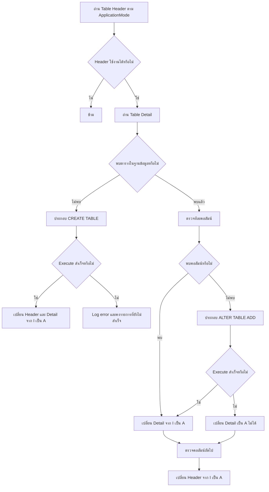

# การสร้างตารางของโปรแกรม Mapping: ระบบเก่าและระบบใหม่

เอกสารนี้อธิบายว่าระบบเก่าสร้างหรือเพิ่มคอลัมน์ในตารางอย่างไร และระบบใหม่เลือกแก้ปัญหาแบบใด เน้นภาพรวมสำหรับคนที่ไม่ได้อ่านโค้ดมาก่อน

## สรุปสั้น

| เรื่อง | ระบบเก่า | ระบบใหม่ |
|---|---|---|
| แหล่งข้อมูลโครงสร้างตาราง | Excel ถูกนำเข้าเป็น `MapTableHeader` และ `MapTableDetail` | HTTP API รับข้อมูลแบบมีชนิด แล้วเก็บใน `table_definitions` และ `table_columns` |
| เวลาสร้างตาราง | อยู่ในรอบเริ่มงาน Mapping และอาจถูกตรวจซ้ำเมื่อเริ่มรอบใหม่ | สร้างตอนจัดเตรียม configuration ก่อนเปิดใช้งาน ไม่สร้างระหว่างประมวลผลไฟล์ |
| วิธีสร้าง SQL | ต่อข้อความ SQL ภายใน `CreateTable` และ `AddNewColumn` | `DdlBuilder` รับ typed model แล้วสร้าง SQL จากชนิดที่อนุญาตเท่านั้น |
| ฐานข้อมูลในตัวอย่าง | SQL Server เช่น `[dbo].[table_name]` | PostgreSQL เช่น `"table_name"` |
| การเลือก schema | เก็บ schema ต่อ `MapTableHeader` | model ปัจจุบันเก็บเฉพาะชื่อตาราง จึงใช้ schema ตาม PostgreSQL `search_path` |
| ความสอดคล้องของ metadata กับตารางจริง | metadata และ DDL แยกกัน ไม่มี transaction เดียวครอบทั้งหมด | บันทึก metadata และรัน DDL ใน transaction เดียวกัน |
| การแก้ schema | ถ้าไม่พบคอลัมน์จะ `ALTER TABLE ... ADD` | รองรับเพิ่มคอลัมน์ผ่าน API; ยังไม่เปิดลบ เปลี่ยนชื่อ หรือเปลี่ยนชนิด |
| SQL จากผู้ใช้ | ค่า schema/table/column จาก config ถูกนำมาต่อ SQL | Browser ส่ง definition เท่านั้น ไม่รับ raw SQL; ชื่อต้องผ่านกฎและถูก quote อีกชั้น |

แนวคิดหลักของระบบใหม่คือ **แยกการเตรียม schema ออกจากการรัน Mapping** และ **ใช้ definition ที่ตรวจสอบได้แทนการประกอบ SQL จาก config โดยตรง**

---

## 1. คำที่ควรรู้ก่อน

- **Metadata**: ข้อมูลที่อธิบายตาราง เช่น ชื่อตาราง ชื่อคอลัมน์ ชนิดข้อมูล และลำดับคอลัมน์ ไม่ใช่ข้อมูลธุรกิจจริง
- **DDL**: SQL สำหรับเปลี่ยนโครงสร้างฐานข้อมูล เช่น `CREATE TABLE` และ `ALTER TABLE`
- **Source table**: ตารางรับค่าดิบจากไฟล์ ข้อมูลจากไฟล์เก็บเป็นข้อความก่อน
- **Normalized table**: ตารางผลลัพธ์หลัง Mapping และแปลงชนิดข้อมูลแล้ว
- **Configuration version**: ชุดกติกา Mapping รุ่นหนึ่ง งานที่เริ่มแล้วต้องใช้รุ่นเดิมจนจบ

---

## 2. ระบบเก่าสร้างตารางอย่างไร

### 2.1 ข้อมูลตั้งต้น

ระบบเก่าอ่าน Excel configuration แล้วบันทึกข้อมูลสำคัญสองระดับ:

| Metadata | หน้าที่ |
|---|---|
| `MapTableHeader` | เก็บ `TableID`, schema, ชื่อตาราง และสถานะของตาราง |
| `MapTableDetail` | เก็บชื่อคอลัมน์ ชนิด ความยาว อนุญาตให้เป็น `NULL` หรือไม่ และสถานะของคอลัมน์ |

สถานะที่พบใน flow เดิม:

- `I` = รอดำเนินการ
- `A` = พร้อมใช้งาน
- `E` = สถานะที่ query รายละเอียดบางส่วนยังเลือกมาเพื่อตรวจ แต่ตัว update ใน flow เดิมไม่ได้เปลี่ยน `E` เป็น `A`

### 2.2 ลำดับการทำงานหลัก



โค้ดจากภาพทำงานดังนี้:

1. `CreateHeaderList(_app)` อ่านรายการตารางของ application ปัจจุบัน
2. ตรวจว่า `TableID`, `Schema` และ `TableName` มีค่า และ `TableID` ไม่ใช่ Guid ศูนย์
3. `CreateTableList(_app, _h.TableID)` อ่านรายละเอียดคอลัมน์
4. `ExistsTable(...)` ตรวจว่าตารางจริงมีอยู่แล้วหรือไม่
5. ถ้ายังไม่มี เรียก `CreateTable(...)`
6. ถ้ามีแล้ว ตรวจแต่ละคอลัมน์ด้วย `ExistsColumn(...)`; คอลัมน์ที่ขาดถูกเพิ่มด้วย `AddNewColumn(...)`
7. เมื่อ operation สำเร็จ เรียก `UpdateHeaderTableFlag(...)` หรือ `UpdateDetailTableFlag(...)` เพื่อเปลี่ยนสถานะเป็น `A`

### 2.3 การประกอบ `CREATE TABLE`

`CreateTable(...)` สร้าง SQL รูปแบบนี้:

```sql
CREATE TABLE [schema_name].[table_name] (
    [column_1] VARCHAR(100) NULL,
    [column_2] DECIMAL(18, 2) NOT NULL
);
```

การแปลงชนิดข้อมูลเดิม:

| ค่าใน metadata | SQL ที่สร้าง |
|---|---|
| `STRING` | `VARCHAR(length)` |
| `INT` | `INT` |
| `DECIMAL` | `DECIMAL(length, 2)` |
| `DATE` | `DATE` |
| `DATETIME` | `DATETIME` |
| `UNIQUEIDENTIFIER` | `UNIQUEIDENTIFIER` |
| ค่าอื่น | ใช้ชื่อชนิดเดิม และเติม `(length)` |

ถ้า `IsNullFlag` เท่ากับ `N` จะเติม `NOT NULL`; ค่าอื่นเติม `NULL` จากนั้นส่ง SQL ทั้งก้อนไป `IValidateDB.ExecuteNonQuery(...)`

### 2.4 การเพิ่มคอลัมน์

ถ้าตารางมีอยู่ แต่คอลัมน์ยังไม่มี `AddNewColumn(...)` จะสร้าง SQL รูปแบบนี้:

```sql
ALTER TABLE [schema_name].[table_name]
ADD [column_name] VARCHAR(100);
```

จุดต่างจากตอนสร้างตาราง: method นี้ไม่ใส่ `NULL`/`NOT NULL` และไม่ใช้ default value อย่างชัดเจน

### 2.5 จุดที่ระบบเก่าทำได้ดี

- สร้างตารางใหม่และเติมคอลัมน์ที่ขาดได้อัตโนมัติ
- ใช้ metadata ชุดเดียวกับ Excel configuration
- รองรับการรันซ้ำระดับหนึ่ง เพราะตรวจ table/column ก่อนสร้าง
- เปลี่ยนสถานะ metadata หลัง operation สำเร็จ

### 2.6 ข้อจำกัดของระบบเก่า

| ข้อจำกัด | ผลกระทบ |
|---|---|
| การ import metadata และ DDL ไม่อยู่ใน transaction เดียว | ตารางจริงกับ metadata อาจไม่ตรงกันเมื่อบางขั้นล้มเหลว |
| สร้าง SQL ด้วย string | กฎชื่อและชนิดกระจายอยู่ใน method; ตรวจสอบและทดสอบยาก |
| ไม่มี allowlist ชื่อ identifier ที่ชัดในโค้ดส่วนนี้ | ชื่อผิดรูปแบบอาจทำให้ SQL ล้ม; ต้องพึ่งความถูกต้องของ config |
| `AddNewColumn` ไม่ระบุ nullability | ผลอาจไม่ตรงกับ `IsNullFlag` ใน metadata |
| ไม่เปลี่ยนชนิดคอลัมน์เดิม | แก้ type/length ใน Excel ไม่ได้แปลว่าตารางจริงจะถูกแก้ตาม |
| Header ถูกเปลี่ยนเป็น `A` หลังจบรอบตรวจตารางเดิม | อาจเห็น Header พร้อมใช้ แม้บางคอลัมน์เพิ่มไม่สำเร็จ |
| DDL อยู่ใกล้รอบประมวลผลไฟล์ | ทุกครั้งที่เปิด flow ต้องเสียเวลาตรวจ schema และเพิ่มความเสี่ยงต่อ runtime |
| error หลักส่งผ่านข้อความ `_msg` | แยกชนิด error และแสดงตำแหน่ง config ที่ผิดได้ยาก |

> ขอบเขตหลักฐาน: รายละเอียด `CreateTable` และ `AddNewColumn` มาจากภาพโค้ด ส่วน behavior รอบนอกอ้างจาก `current-program-workflow.md` หัวข้อ 5.2 การทำงานภายใน `IValidateDB.ExecuteNonQuery` ไม่ปรากฏในภาพ จึงไม่สรุปเรื่อง transaction ภายใน method นั้นเกินหลักฐานที่มี

---

## 3. ระบบใหม่เลือกสร้างตารางแบบใด

ระบบใหม่แบ่งงานเป็น 4 ชั้น:

```text
ผู้ดูแล/หน้าเว็บ
    → Tables API
    → TableDefinitionValidator
    → TableService + DdlBuilder
    → PostgreSQL: metadata + ตารางจริงใน transaction เดียว
```

หน้าเว็บไม่ส่ง SQL และไม่กำหนด connection เอง ส่งเฉพาะ table definition ที่ API รู้จัก

### 3.1 Typed table definition

ข้อมูลตารางถูกแปลงเป็น model ที่มีชนิดชัดเจน:

```text
TableDefinition
├─ Name
├─ Kind: Source | Normalized
└─ Columns[]
   ├─ Name
   ├─ DataType
   ├─ IsRequired
   ├─ Ordinal
   ├─ Length
   ├─ Precision
   └─ Scale
```

ชนิดคอลัมน์ที่รองรับ:

| Model | PostgreSQL |
|---|---|
| `Text` | `text` หรือ `varchar(length)` |
| `Date` | `date` |
| `Decimal` | `numeric`, `numeric(precision)` หรือ `numeric(precision, scale)` |
| `Boolean` | `boolean` |
| `Integer` | `integer` |
| `DateTime` | `timestamp without time zone` |
| `Guid` | `uuid` |

### 3.2 Validation ก่อนแตะฐานข้อมูล

`TableDefinitionValidator` ตรวจอย่างน้อย:

- ชื่อตารางและคอลัมน์ต้องเป็นตัวพิมพ์เล็ก เริ่มด้วย `a-z` และมีเฉพาะ `a-z`, `0-9`, `_`
- ความยาวชื่อไม่เกิน 63 ตัว และห้ามขึ้นต้น `pg_`
- ห้ามใช้ชื่อคอลัมน์ระบบ เช่น `id`, `file_job_id`, `row_number`, `source_row_id`
- ต้องมีคอลัมน์ข้อมูลอย่างน้อยหนึ่งคอลัมน์
- ชื่อคอลัมน์ในตารางเดียวกันห้ามซ้ำ
- Source column ต้องเป็น `Text` และ `isRequired = false`
- `length` ใช้กับ `Text` เท่านั้นและต้องมากกว่า 0
- `precision`/`scale` ใช้กับ `Decimal` เท่านั้น; scale ต้องไม่เกิน precision

หลัง validation ชื่อ identifier ยังถูกครอบด้วย double quote เช่น `"order_no"` เป็น defense in depth อีกชั้น

### 3.3 API ที่ใช้

| API | หน้าที่ | ผลสำเร็จหลัก |
|---|---|---|
| `POST /tables` | สร้าง metadata และตารางจริง | `201 Created` |
| `GET /tables` | ดู table definitions ทั้งหมด | `200 OK` |
| `GET /tables/{id}` | ดูตารางหนึ่งรายการ | `200 OK` หรือ `404 Not Found` |
| `POST /tables/{id}/columns` | เพิ่ม metadata และคอลัมน์จริง | `204 No Content` |
| `GET /tables/{id}/verification` | ดูผลตรวจ physical schema ล่าสุด | `200 OK` หรือ `204 No Content` |
| `POST /tables/{id}/verify` | ตรวจ PostgreSQL catalog แบบ read-only | `200 OK`, `Healthy`/`Drifted`/`Missing`/`VerificationFailed` |
| `GET /tables/{id}/references` | ดู Mapping Config/Version และ pinned jobs ที่อ้าง table | `200 OK` |

ข้อมูลไม่ผ่าน validation ได้ `400`; ชื่อตารางหรือคอลัมน์ซ้ำได้ `409`

### 3.4 ตัวอย่างสร้าง Source table

Request:

```http
POST /tables
Content-Type: application/json

{
  "name": "src_orders",
  "kind": "source",
  "columns": [
    {
      "name": "order_no",
      "dataType": "text",
      "isRequired": false,
      "length": 50
    },
    {
      "name": "amount",
      "dataType": "text",
      "isRequired": false
    }
  ]
}
```

DDL ที่ระบบสร้างโดยย่อ:

```sql
CREATE TABLE "src_orders" (
    id bigint GENERATED ALWAYS AS IDENTITY PRIMARY KEY,
    file_job_id bigint NOT NULL,
    row_number int NOT NULL,
    physical_line_number int NOT NULL,
    imported_at timestamptz NOT NULL DEFAULT now(),
    "order_no" varchar(50),
    "amount" text,
    UNIQUE (file_job_id, row_number)
);
```

เหตุผลที่ Source เก็บข้อมูลเป็น text: ไฟล์อาจมีวันที่หรือตัวเลขผิดรูปแบบ ระบบยังต้องเก็บค่าดิบไว้เพื่อรายงาน error และ reprocess ได้ การแปลงชนิดเกิดในขั้น Transformation ภายหลัง

`UNIQUE (file_job_id, row_number)` ป้องกัน retry แล้วเพิ่ม Source row เดิมซ้ำ

### 3.5 ตัวอย่างสร้าง Normalized table

Request:

```http
POST /tables
Content-Type: application/json

{
  "name": "norm_orders",
  "kind": "normalized",
  "columns": [
    {
      "name": "order_no",
      "dataType": "text",
      "isRequired": true,
      "length": 50
    },
    {
      "name": "amount",
      "dataType": "decimal",
      "isRequired": true,
      "precision": 18,
      "scale": 2
    },
    {
      "name": "order_date",
      "dataType": "date",
      "isRequired": true
    }
  ]
}
```

DDL ที่ระบบสร้างโดยย่อ:

```sql
CREATE TABLE "norm_orders" (
    id bigint GENERATED ALWAYS AS IDENTITY PRIMARY KEY,
    source_row_id bigint NOT NULL,
    output_key text NOT NULL,
    file_job_id bigint NOT NULL,
    row_number int NOT NULL,
    row_job_id bigint NOT NULL,
    config_version_id bigint NOT NULL,
    normalized_at timestamptz NOT NULL DEFAULT now(),
    "order_no" varchar(50),
    "amount" numeric(18, 2),
    "order_date" date,
    UNIQUE (source_row_id, output_key)
);
```

`UNIQUE (source_row_id, output_key)` รองรับ Source หนึ่งแถวสร้างผลลัพธ์ `0..N` รายการ เช่น primary และ CTP โดยแต่ละผลลัพธ์มี `output_key` ต่างกัน และ retry ไม่เพิ่มผลลัพธ์เดิมซ้ำ

### 3.6 ทำไมคอลัมน์ธุรกิจยัง nullable แม้ `isRequired = true`

`isRequired` เป็นกฎของ Mapping/validation ไม่ได้ถูกสร้างเป็น `NOT NULL` ในตาราง Normalized ปัจจุบัน เหตุผล:

1. Worker ต้องตรวจ required แล้วบันทึก Row Error ที่อธิบายได้
2. การเพิ่ม required column ในตารางที่มีข้อมูลเดิมจะไม่ล้มเพราะแถวเก่ายังไม่มีค่า
3. schema evolution ปลอดภัยขึ้นระหว่างที่ config version เก่ายังถูกใช้งาน

ดังนั้นคำว่า required หมายถึง “ผล Mapping ที่ถูกต้องต้องมีค่า” ไม่ใช่ database constraint ใน DDL ชุดนี้

### 3.7 Transaction ทำให้ metadata ตรงกับตารางจริง

ตอนสร้างตาราง `TableService.CreateAsync` ทำใน transaction เดียว:

1. insert `table_definitions`
2. insert `table_columns`
3. สร้าง DDL ด้วย `DdlBuilder`
4. execute `CREATE TABLE`
5. commit

ถ้าขั้นใดล้ม ทุกขั้น rollback จึงไม่เหลือ metadata ที่บอกว่าสร้างแล้วทั้งที่ตารางจริงไม่มี

การเพิ่มคอลัมน์ใช้หลักเดียวกัน: lock table definition, คำนวณ ordinal ถัดไป, insert metadata, execute `ALTER TABLE ADD COLUMN`, แล้ว commit

---

## 4. วิธีที่วางแผนใช้เมื่อมีหน้าเว็บ Configuration ครบ

เป้าหมายไม่ใช่ให้ Worker สร้างตารางทุกครั้งที่พบไฟล์ แต่ใช้ lifecycle นี้:


แนวทางที่เลือก:

1. ผู้ดูแลสร้าง Draft ผ่านเว็บ หรือ import Excel เดิมเข้ามาเป็น Draft
2. API แปลงข้อมูลเป็น typed definition; ไม่ execute SQL จาก Excel หรือ browser โดยตรง
3. Validate ชื่อตาราง ชนิด field mapping condition และ dependency ทั้งชุด
4. Preview ด้วย engine เดียวกับ runtime แต่ไม่เขียน business table ไม่ archive และไม่ส่ง external side effect
5. ขั้น `Prepared` จึงสร้าง/ตรวจ staging schema ภายใต้ config deployment lock
6. Activate config version แบบ atomic งานใหม่จึงเห็น version ใหม่ทั้งชุด
7. งานที่ queue หรือเริ่มแล้วใช้ config version ที่ pin ไว้ ไม่เปลี่ยนกลางงาน
8. Runtime อ่านไฟล์และ Mapping เท่านั้น ไม่ import workbook และไม่ทำ DDL ซ้ำ

ข้อสำคัญ: source/normalized table ที่สร้างแล้วถูกอ้างด้วย ID จาก configuration ไม่ให้ browser ส่งชื่อตาราง SQL แบบอิสระในทุก request และไม่ให้ส่ง raw URL, credential หรือ raw SQL

### สถานะปัจจุบันของ repository

- API และ service สำหรับสร้าง/list/get/add column, references และ physical verification มี implementation แล้ว
- `DdlBuilder`, validation, Inspector Module, PostgreSQL adapter, migrations `0018`/`0019` และ automated tests มีแล้ว
- หน้า Configuration อ่านรายการตารางจาก `GET /tables` เพื่อเลือกใช้งานได้
- table definition ปัจจุบันยังไม่มี field `schema`; ถ้าต้องแยก PostgreSQL schema ต่อ partner ต้องออกแบบเพิ่มก่อนใช้จริง
- หน้า `/admin/tables` รองรับ list/search/filter, create→redirect→verify, detail, safe diagnostics, impact และ additive column; ไม่มี drop/rename/alter/data browser
- Gate H approved แล้ว แต่ production Table mutation ยังปิดด้วย `TableAdministration:MutationsEnabled=false` จน controlled rollout change แยกต่างหากเสร็จ; read/detail/verify ยังใช้งานได้
- lifecycle ระยะยาวต้องย้าย DDL ไปอยู่ขั้น `Prepared` ตามแผน และไม่ผูกกับ file-processing loop

---

## 5. ความต่างที่คนดูแลระบบจะเห็น

### ระบบเก่า

```text
วาง Excel config
→ import metadata
→ เริ่ม Mapping
→ ตรวจ/สร้าง/เพิ่มคอลัมน์
→ อ่านไฟล์
→ transfer ข้อมูล
```

### ระบบใหม่

```text
สร้างหรือ import Draft
→ validate + preview
→ prepare schema
→ activate immutable Config Version

เมื่อไฟล์เข้า:
เลือก Active Version
→ pin version ให้ job
→ อ่าน Source
→ transform
→ ส่งผลไป LegacyTable / ApiContract / JsonFile
```

ผลที่ได้: การรับไฟล์เร็วและคาดเดาได้กว่า เพราะ schema ถูกเตรียมก่อน งานเก่าไม่ถูก config ใหม่เปลี่ยนกลางทาง และ error ของ config ถูกพบก่อนเปิดใช้งาน

---

## 6. สิ่งที่ระบบใหม่ตั้งใจไม่ทำ

- ไม่รับ raw SQL จากหน้าเว็บ
- ไม่สร้างหรือแก้ schema ทุกครั้งที่รับไฟล์
- ไม่ลบ/rename/เปลี่ยน type ของคอลัมน์เดิมอัตโนมัติ เพราะ config version เก่าอาจยังอ้างชื่อเดิม
- ไม่เปลี่ยน active config บางส่วน ถ้า prepare ล้ม active version เดิมยังทำงานต่อ
- ไม่ให้ source table บังคับชนิดข้อมูลจากไฟล์ทันที
- ไม่ให้ rollback config ไป undo ตารางหรือข้อมูลธุรกิจอัตโนมัติ

---

## 7. ไฟล์อ้างอิงใน repository

| เรื่อง | ไฟล์ |
|---|---|
| หลักฐาน flow ระบบเก่า | `current-program-workflow.md` หัวข้อ 5 |
| แผน lifecycle และหน้าเว็บ | `docs/web-config-plan.md`, `plan-mapping-api-modernization.md` |
| API endpoint | `src/MappingDemo.Api/Controllers/TablesController.cs` |
| transaction และ persistence | `src/MappingDemo.Api/Services/TableService.cs` |
| typed model และ validation | `src/MappingDemo.Shared/Tables/` |
| SQL builder | `src/MappingDemo.Shared/Tables/DdlBuilder.cs` |
| metadata schema | `src/MappingDemo.Shared/Database/Migrations/0001_table_definitions.sql` |
| verification/audit schema | `src/MappingDemo.Shared/Database/Migrations/0018_table_schema_administration.sql` และ append-only guards ใน `0019_table_admin_append_only.sql` |
| Admin UI | `web/app/admin/tables/` |
| operations | `docs/phase-28-table-administration-operations-runbook.md` |
| request ตัวอย่าง | `requests/tables.http` |
| tests | `tests/MappingDemo.Tests/Tables/` |

